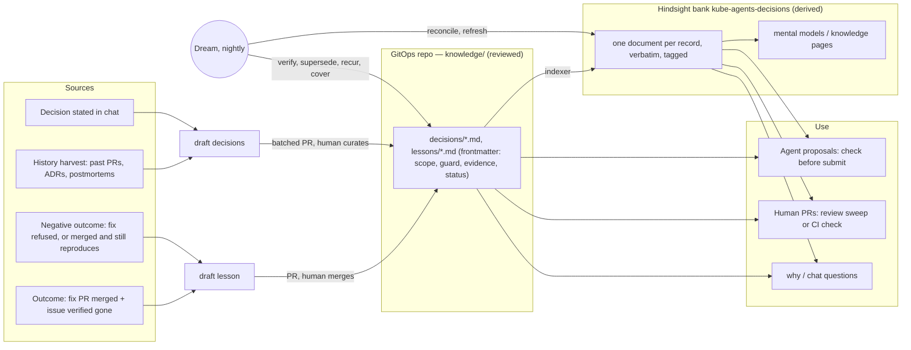
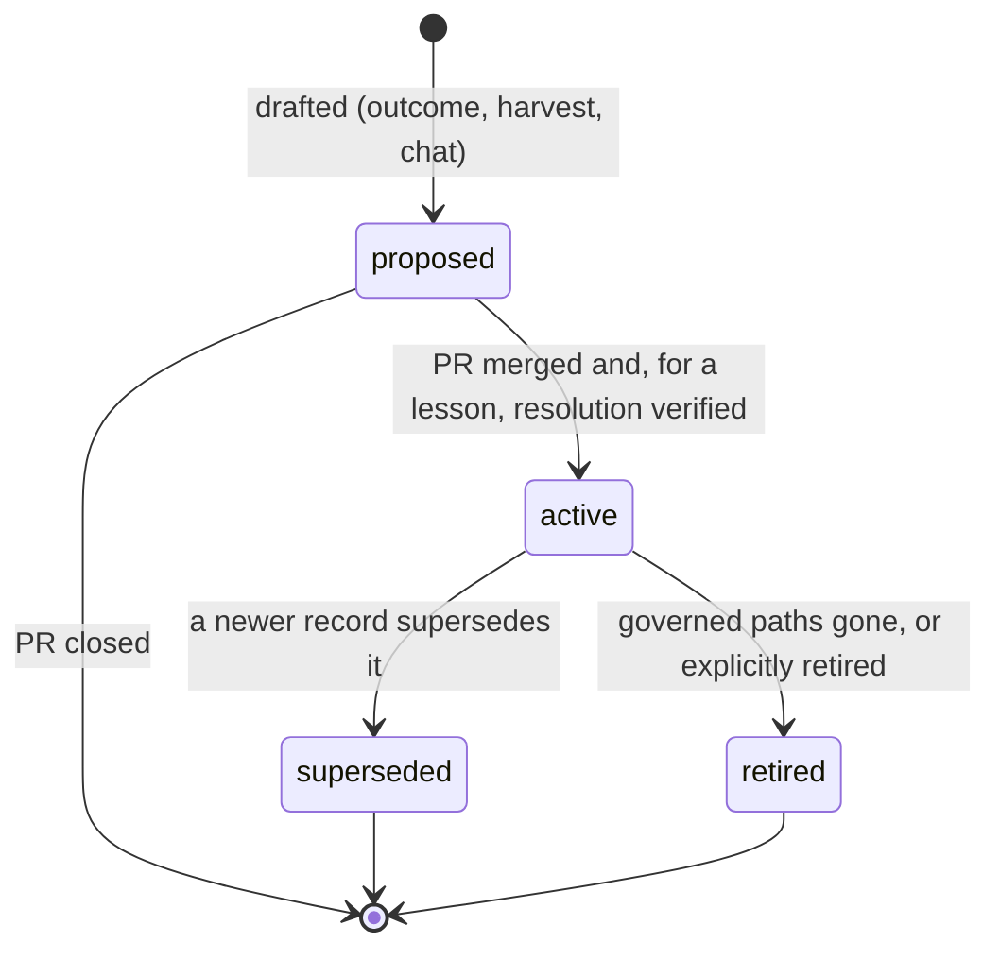

# Decision memory: remembering why, and learning from what the agent fixed

## Summary

An organisation that cannot find the reason behind an infrastructure setting will eventually
undo it, and the outage it prevented comes back. That is the problem a customer (SAP) brought us:
its engineers cannot work out why past infrastructure decisions were made, so previous outages
and misconfigurations keep coming back.

The memory we ship ([`memory.md`](memory.md)) does not answer this. It learns from chat only:
automatic capture is personal, and anything shared gets there only because the model chose to
call `memory_retain` in a conversation. The loop where the agent does real work never reaches
memory at all. That loop is: diagnose an issue, open a fix PR, a human merges it, the issue goes
away. `submit-suggestion` keeps no state about the PRs it opens. The fleet-audit ledger works out
`resolved-merged`, a merged fix that worked, but neither renders it nor emits it. Nothing watches
a merge in general, and the agent reviews no PR it did not write.

This document proposes **decision memory**:

- **Records in git are the source of truth.** Decisions and lessons live as reviewed OKF records
  in the GitOps repository: `knowledge/decisions/*.md` and `knowledge/lessons/*.md`, markdown with
  YAML frontmatter. Each record says what it governs and may carry a **guard**, an assertion a
  machine can check against the tree.
- **Lessons are learned from outcomes.** A lesson is written when a fix PR is merged and the issue
  is verified gone. It is never written from what the agent intended to do.
- **Records are read at the two places changes come in:**
  - every change the agent proposes is checked against the records before it is submitted;
  - human PRs are reviewed against the same records.
  - "Why is this configured like this?" is answered from the records, with citations.
- **A Hindsight bank (`kube-agents-decisions`) is an index built from git.** It adds semantic
  recall and pages the model synthesises. It can be thrown away and rebuilt.
- **Dreams** are a nightly pass that keeps records current. It checks every active record against
  the repository, detects reverts, supersessions, recurrence and changes no record covers, and
  re-indexes. Any change to a record goes back through a PR.

Nothing here depends on Hermes. Records are files in git. The index is Hindsight's REST API, not
the Hermes memory provider. The agent reaches it through a skill script and an MCP surface that
both Hermes and the `mode: next` worker can load. Scheduling is a script that runs the same way
from a Hermes `no_agent` cron entry or a Kubernetes CronJob.

**Status:** proposal plus a working prototype of the record model, the guard evaluator, `check`,
`why`, `from-outcome`, the deterministic phases of `dream`, and the Hindsight indexer. Each was
validated against a live Hindsight 0.10.2: [Prototype](#prototype). The outcome recorder, the
review sweep and the CI action are designed here and not built.

| Layer                    | Where it lives                                                                                                                                    |
| ------------------------ | ------------------------------------------------------------------------------------------------------------------------------------------------- |
| Records (truth)          | `knowledge/decisions/`, `knowledge/lessons/` in the customer's GitOps repository ([06 §5](../architecture/06-api-and-data-contracts.md))          |
| Tool                     | [`agents/platform/skills/decision-memory/`](../../agents/platform/skills/decision-memory/SKILL.md), `scripts/decision_memory.py`, standard library + PyYAML |
| Index                    | Hindsight bank `kube-agents-decisions` on the existing `hindsight-api` ([memory.md, The two pods](memory.md#the-two-pods))                        |
| Relation to chat memory  | Separate bank, separate write paths; [`memory.md`](memory.md) is unchanged                                                                        |

---

## The problem, concretely

### What SAP is describing

Two failure modes, both about rationale:

1. **Undoing a fix.** Someone tunes a value for cost or tidiness: a memory request, a PDB, a
   quota, a node pool's max surge. That value was the fix for an incident nobody on today's
   team remembers, so the incident comes back.
2. **Repeating a fix that did not work.** An approach was tried, reviewed and found wrong, for
   example raising a quota rather than restoring an inflated request. Nobody remembers that it
   was tried, so it gets proposed again.

Both are cheap to prevent if, at the moment of change, someone sees the record of what was decided
and why. Both are expensive later, because the cost is an outage.

### We have reproduced it on our own agent

The [GitOps fix cycle pilot](gitops-fix-cycle.md#findings-from-the-runs-2026-09-09-2026-09-10-and-2026-09-15)
contains the second failure mode four times over. In runs 7, 13, 15 and 16 the agent diagnosed
b-0011's quota exhaustion correctly. Each time it then fixed it by raising the payments quota
rather than restoring the inflated 64Mi request, and each time the task's `quota-cap-held`
safeguard fired. Nothing carried "raising the quota is the wrong fix here" from one run to the
next. The pilot's own conclusion applies: the prompt sentence that tried to steer it was "a
mitigation, not a control". A recorded decision with a `warn` guard on the quota file is a
control.

### What the current machinery does not do

| Needed                                       | Today                                                                                                                                           |
| -------------------------------------------- | ----------------------------------------------------------------------------------------------------------------------------------------------- |
| Remember a fix the agent made                | `submit-suggestion` records nothing; "nothing dedupes it and nothing ever closes it" (`skills/submit-suggestion/SKILL.md`)                        |
| Know the fix worked                          | fleet-audit computes `resolved-merged` and renders/emits nothing ([ledger §4](fleet-audit-issue-ledger.md#4-finding-lifecycle)); findings-queue `pr_state` "needs someone to notice a merge" ([findings queue](inventory-findings-queue.md)) |
| Remember a fix that did not work             | `pr-merged-persists` and `refused` exist in the ledger, and nothing turns them into knowledge                                                       |
| Check a new change against the past          | Nothing; the platform worker can `memory_recall` shared chat memory, and nothing asks it to before a PR                                          |
| Review a human PR                            | Out of scope ([pr-comment-conversation §7](pr-comment-conversation.md#7-out-of-scope)); `is_agent_pull_request` filters to the agent's own PRs  |
| Answer "why" with a source                   | Shared chat memory paraphrases, and drops identifiers in 37 of 82 units ([memory.md](memory.md#what-survives-if-honcho-gets-the-wrapper)); per-unit provenance is not built |
| Survive a reinstall                          | Deleting the Hindsight PVC is "a complete, safe reset of memory" ([memory.md](memory.md#bank-provisioning-is-lazy)), which is the opposite of what a decision log needs |
| Work under `mode: next`                      | No Hindsight integration exists under next; `kube_agents_memory` is a Hermes `MemoryProvider`                                                   |

## Requirements

- **R1 Rationale is answerable.** "Why is X like this?" returns the decision or lesson that
  governs X, with its id, its PR and who approved it. If no record exists, the answer says that
  plainly instead of inventing a reason from the history.
- **R2 Learn from outcomes, not intentions.** A lesson exists only for a change that was merged
  and verified to have resolved the issue. A merged fix that did not resolve it, or a fix a person
  refused, is also an outcome, and it is recorded as "this does not work".
- **R3 Prevent recurrence where changes come in.** That means the agent's own proposals
  (submit-suggestion, fleet-audit remediation, manifest generation) and human pull requests. The
  check is deterministic and runs inside the tool path, so the model cannot skip it.
- **R4 Stay current.** Records that have been superseded, reverted, or have lost their files
  are found and flagged without anyone having to remember to look. Changes to governed
  infrastructure that no record covers are surfaced for harvesting.
- **R5 Harness-neutral.** It works the same on today's Hermes stack and under `mode: next`, and
  nothing in the design calls a Hermes API.
- **R6 Attributable and reviewed.** Every record carries who decided and which PR proves it. No
  model writes organisational knowledge on its own: every change to a record is a PR a person
  merges. This is the [four-property test](../architecture/02-agent-personas.md) (durable,
  attributable, …) applied to knowledge.
- **R7 Degrades gracefully.** Without Hindsight, `check`, `why` and `dream` still work from git
  alone. The index only adds recall.

**Non-goals:**

- Replacing conversational memory, which [`memory.md`](memory.md) keeps doing unchanged.
- Admission-time enforcement. Recurring lessons are _proposed_ for `policy/`, and policy is what
  enforces.
- Storing incident timelines. A record links to the postmortem; it does not contain it.

---

## Design overview



There are three roles, and they are kept apart on purpose:

- **Writers produce drafts.** Every draft becomes a record through a pull request. No path writes
  a record directly.
- **Git holds the truth.** A record is active because a person merged it, and it stops being
  active the same way.
- **The index serves reads.** It is built from git's default branch and from nothing else, so
  rebuilding it from scratch is a correct recovery.

### Why git is the source of truth and Hindsight is the index

1. **It is the architecture we already decided.** Curated, durable, shareable knowledge is
   OKF in git under `knowledge/`, and agents propose updates by PR
   ([02 §2.3](../architecture/02-agent-personas.md), [05 C9](../architecture/05-system-architecture.md),
   [06 §5](../architecture/06-api-and-data-contracts.md)). Audits already read `declares:`
   entries from `knowledge/` to reclassify findings that are intentional. Decisions and lessons
   are two more OKF types.
2. **Rationale needs review and provenance more than recall.** A decision record is something
   people sign up to, and the PR that merges it is the signature. Shared chat memory has no review
   step, and its consolidation is built to paraphrase. That suits conversational facts and is
   exactly wrong for "the request must stay ≥ 256Mi because of PR #31".
3. **It must outlive the agent.** SAP's decision log has to survive an uninstall, a PVC wipe, a
   change of memory provider, and the day they stop using kube-agents. Git does all four.
4. **Reverts can be seen.** If a fix is reverted, git shows it. The dream reads that, and a
   memory store cannot.
5. **It is harness-neutral for free.** Every harness, every CI system and every engineer can read
   a markdown file.

What Hindsight adds on top is what git cannot do:

- semantic recall over prose, for changes no record's scope covers yet and for questions
  phrased in someone's own words;
- budget-bounded injection into a turn;
- tag-scoped synthesis in the form of mental models and knowledge pages.

### Why a separate bank

`kube-agents-decisions` sits next to `kube-agents-memory` on the same `hindsight-api` pod. Four
settings make it different, and the [live probe](#prototype) confirmed each one:

| Setting                                    | Why                                                                                                        |
| ------------------------------------------ | ---------------------------------------------------------------------------------------------------------- |
| `retain_default_strategy: record`, a strategy pinning `retain_extraction_mode: chunks` | `chunks` runs no LLM ([memory.md, bounding the bank](memory.md#bounding-the-bank--built-deferred-and-not-urgent)): the record's text, id and PR link are stored verbatim. Probe: 2 records gave 2 `world` units, each containing its id. |
| `enable_observations: false`               | No background paraphrase layer. Synthesis is the dream's job, done on purpose and from active records only. |
| `document_id = okf:<repo>:<path>`, `update_mode: replace` | Re-indexing a changed record replaces it in place. Probe: superseding a record left 3 documents and 3 units, with no duplicates. |
| Every unit tagged `scope:shared`           | Under `any_strict`, an untagged unit is invisible ([memory.md pinned setting 1](memory.md#the-four-pinned-settings)). The bank holds no personal data, so the user-isolation problem `kube_agents_memory` solves does not arise. |

Putting records in the existing bank under a `kind:` tag was considered. It would mean sharing
the conversational bank's consolidation, which `consolidation_strategies` (new in 0.10.2) could
switch off per scope. But it would also tie the index to that bank's lifecycle, including the
"delete the PVC to reset memory" advice. Deleting a derived index loses nothing; deleting
the conversational bank loses facts that exist nowhere else. Keeping them in separate banks keeps
that distinction clear.

---

## The record model

There are two types, and they share one schema:

- **decision** (`DEC-YYYY-NNN`): a choice and its reason, forward-looking. For example: "the
  payments quota is a capacity cap; fix the over-request instead".
- **lesson** (`LES-YYYY-NNN`): what an outcome taught, backward-looking, always tied to a merged
  PR. For example: "checkout OOM-kills below 256Mi".

```yaml
---
type: lesson
id: LES-2026-001
title: checkout OOM-kills below 256Mi under the JVM's off-heap growth
status: active # proposed | active | superseded | retired
date: 2026-09-10
scope: # what this record governs; at least one key
  paths: ["clusters/*/payments/checkout.yaml"]
  resources: ["Deployment/payments/checkout"] # kind/namespace/name, globs allowed
  clusters: [prod-eu]
  checks: [oom-kill] # fleet-audit check ids, the join key to findings
guard: # optional; makes the record enforceable
  rule: Keep checkout's memory request at or above 256Mi.
  severity: block # block | warn | info
  expect:
    file: "clusters/*/payments/checkout.yaml"
    path: "spec.template.spec.containers[name=app].resources.requests.memory"
    op: ">=" # == != >= > <= <, Kubernetes quantities understood
    value: 256Mi
evidence:
  pull_request: https://github.com/acme/gitops/pull/31
  commit: 1a2b3c4
  merged_by: alice
  finding_id: oom-kill.prod-eu.payments.checkout # derive_finding_id
  resolution: { verified_by: fleet-audit, at: 2026-09-11T02:00:00Z }
supersedes: []
---
## What happened
## What fixed it
## How we know it worked
## Prevent it next time
```

The design choices behind it:

- **Scope is what makes a record usable at all.** An unscoped record can never be matched to a
  change, so validation rejects it. Paths catch edits to the file the record names. Resources
  catch the same object moved or copied to another file: the prototype matches a checkout
  Deployment copied into `clusters/prod-us/` by `kind/namespace/name` even though no path glob
  covers it.
- **Guards are optional, and they are the difference between a reminder and a control.** A
  record without a guard still appears on every matching change as `related`. A guard turns it
  into `violates` / `consistent`. The expression language is deliberately small: a file glob, a
  YAML path with list selectors, one comparison. Anything richer belongs in `policy/`, which is
  where [recurring lessons graduate](#p4-graduation-to-policy).
- **Evidence is mandatory for a lesson.** A lesson with no merged PR behind it is an opinion.
- **Status changes go through PRs.** `superseded` requires `superseded_by`. A record is never
  deleted while anything refers to it; it is `retired` instead.



---

## How records are written

There are three write paths. None of them is a model writing to memory: each produces a draft,
and a person merges it. That is the rule [`memory.md`](memory.md#nominating-a-finding-the-card-is-the-write-path)
already applies to shared memory ("the person … is the control"), moved to a place where the
person is reviewing a diff, not approving a sentence in chat.

### W1 — Outcomes: the agent's own fixes (R2)

This is the "troubleshoot → PR → merge → resolved" loop.

```mermaid
sequenceDiagram
  participant A as Agent (any harness)
  participant G as GitOps repo
  participant OR as Outcome recorder (job)
  participant V as Verifier signals
  A->>G: fix PR (patch + "Lesson draft" section, optionally knowledge/lessons/LES-….md status: proposed)
  Note over G: human reviews and merges (approves the fix and the lesson together)
  OR->>G: sweep merged/closed agent PRs (platform-agent/* branches)
  OR->>V: was the issue resolved?
  V-->>OR: fleet-audit resolved-merged / watcher quiet N h / Argo Synced+Healthy at merge SHA
  OR->>OR: outcome JSON {pr, commit, files, finding_id, cluster, check, verified_by}
  OR->>G: PR: activate the proposed lesson (or draft one via from-outcome)
  Note over G: human merges; indexer and dream pick it up
```

**When the PR is proposed.** `submit-suggestion` and fleet-audit `remediate` add a
**Lesson draft** section to the PR body. They may also add the record file itself, with
`status: proposed`, so that one review covers the fix and its rationale and both land in the same
commit. If the fix is reverted, the lesson goes with it, and the dream notices. The content comes
from what the agent already has:

- the Cluster Agent's `root_cause` and `proposed_patch` (kanban metadata on Hermes, the task
  artifact under next);
- the incident thread;
- the finding id.

**After the merge, the issue has to be verified gone.** These are the signals, strongest first.
Each is harness-neutral and reads state that already exists.

| Signal | Source | Exists today? |
| --- | --- | --- |
| `resolved-merged`: a complete audit run no longer reproduces a finding that a merged remediation PR claims | `audit_report.py finish`. It has `resolved_ids` (complete runs only) and the merged `audit:remediation` PRs from the `gh pr list` it already makes | Computed and discarded. Needs `finish` to emit it ([ledger §4](fleet-audit-issue-ledger.md#4-finding-lifecycle)) |
| The workload's incident reason has not recurred for N hours since the merge | `intercepted_events` in the Session KV store (cluster, namespace, workload, reason) | Data exists; needs a query |
| GitOps controller `Synced` at the merge SHA and `Healthy` | Argo/Flux status, the predicate [gitops-fix-cycle](gitops-fix-cycle.md#how-the-pr-is-found-and-what-done-means) built in the bench | Bench only |
| Findings-queue row `pr_state=merged`, then re-verified | `findings_queue.py` | Merge watcher not built ([findings queue](inventory-findings-queue.md)) |

**Negative outcomes are recorded too.** A fix that does not work, or that a reviewer rejects,
teaches as much as one that does. The ledger already has both states:

- `pr-merged-persists`: the fix merged and the finding still reproduces;
- `refused`: a person closed the PR unmerged.

Either becomes a draft lesson of the form "approach X does not fix Y". It carries the reviewer's
closing comment as evidence and, where possible, a `warn` guard. This is the record that would
have stopped the quota raises in the pilot.

**The outcome recorder is a deterministic job, not an agent turn.** It joins PR ↔ finding ↔
verification, emits an outcome JSON, and runs `decision_memory.py from-outcome` to draft the
record. A model is used only to tidy the prose of the draft, never to decide whether something
was resolved. It runs:

- **today:** as a third sweep in `github_scan_gate.py`'s `SWEEPS` registry (merged/closed
  `platform-agent/*` proposals), next to the PR-comment sweep;
- **under next:** as the consumer of an `a2a.topics.shared.outcomes` journal topic that
  fleet-audit `finish` and the sweep publish to. See
  [Harness neutrality](#harness-neutrality).

### W2 — Harvest: the decisions nobody wrote down (SAP's backlog)

SAP's immediate pain is history, not tomorrow. The harvester mines what already exists:

- merged PRs that touched governed infrastructure paths, with their discussions and linked
  issues;
- commit messages, especially reverts;
- ADRs, postmortems and runbook pages already in the repository or exported from a wiki.

For each area (a namespace, a node pool, a cluster family) it drafts `DEC` records with
`status: proposed` and full evidence links. It groups them into one PR per area, with a weekly
cap, so a team curates a dozen records at a time instead of a hundred.

The dream feeds the harvester continuously through `uncovered_changes`: commits to governed
paths with no record and no record of their own in the same change. `why` feeds it on demand:
"no record governs this; here is the history; shall I draft one?"

Harvested text is untrusted input. A PR body or an issue comment is someone's claim, not a
decision. That is why harvested records always start `proposed` and become `active` only when a
person merges them.

### W3 — Chat: a decision stated in conversation

"We pin node pool max-surge to 1 in prod-eu because of the licence-server quorum" is a decision.
When someone says something like this, the Chat Agent offers to draft a `DEC` record PR, as well
as or instead of `memory_retain(scope="shared")`. The rule in `SOUL.md` §1.6 (stated, not
inferred; the agent says out loud what it is writing org-wide) carries over unchanged. The only
difference is that the write is a reviewable file.

---

## How records are used

### P1 — The agent's own proposals (R3)

`decision_memory.py check --base <base>` runs **inside the tool path**:

- in `submit_suggestion.py submit`, before the push;
- in `audit_report.py remediate`, before it opens the PR.

It does not run as a step in a skill's prose. The pilot showed the agent will not reliably follow
a prompt sentence, and a control the model can skip is a mitigation.

| Verdict | Effect |
| --- | --- |
| `violates`, `block` | `submit` refuses, naming the record and its guard. The agent changes the patch or asks the human. |
| `violates`, `warn` | `submit` proceeds only if the PR body has a **Prior decisions and lessons** section that addresses the record id. The check generates that section (`--markdown`). |
| `related` / `consistent` | The section is still generated, so the reviewer sees which past decisions the change touches. |
| `semantic` | Records related by meaning, not by scope, listed as "possibly related — verify". Requires the index. |

Recall also happens earlier, when the agent is _designing_ the change:

- `gke-manifest-generation` "Tooling & Grounding";
- `gke-golden-path` rule 4, "Document decisions and rationale";
- fleet-audit before `remediate`.

These are prose steps calling `why` or `check --files`. They make for a better first draft; the
hard check stays in the tool path.

### P2 — Human pull requests (R3)

There are two variants, and the customer can run either or both.

- **The CI-native check, which needs no agent.** A GitHub Actions (or GitLab CI) job runs
  `decision_memory.py check --base $BASE --head $HEAD --markdown` on every PR that touches the
  repository, posts the markdown as a sticky comment, and fails on `block`. Making it a required
  check turns a lesson into a merge gate. This is the most harness-neutral form there is, because
  no agent is in the loop, and it is what we would recommend SAP turn on first.
- **The agent review sweep.** An opt-in `agent:review` label, or a per-repository setting,
  widens the scan gate past `is_agent_pull_request`. A review worker then:
  1. runs `check`, which is deterministic;
  2. uses semantic recall plus the diff to look for implications that no guard encodes;
  3. posts **one** comment citing record ids and the PRs they were learned in;
  4. never approves, merges or closes, as pr-conversation already forbids.

  It reuses [pr-comment-conversation](pr-comment-conversation.md)'s marker bookkeeping to stay
  idempotent.

A human who disagrees with a `block` overrides it in the PR itself: a `decision-override:<id>`
label plus a sentence of justification. The dream sees the override after merge and proposes
superseding the record. So the disagreement becomes a new decision instead of a silent
erosion.

### P3 — Questions

`why <path>` returns:

- the records that govern the path, active first;
- the path's git history, with PR numbers;
- `history_without_record`, the commits that changed it with no record behind them;
- a note telling the model how to talk about absence.

"No recorded decision" must never become "no decision exists". This is the same failure
[`memory.md`](memory.md#a-read-names-its-outcome) fixed for recall, and the same rule is stated
in the skill. Free-text questions go to recall over the index, filtered to
`scope:shared AND status:active` with `tag_groups`.

### P4 — Graduation to policy

A lesson that recurs (same `check`, or same guarded field, across clusters) should not stay a
lesson. The dream proposes a fleet-wide decision plus a `policy/` change, for example a
ValidatingAdmissionPolicy or a Gatekeeper/Kyverno constraint. That moves the protection from
"the agent and CI will warn you" to "the API server refuses". The record stays as the rationale
the policy links back to. Graduation is always propose-only, because a policy narrows what is
allowed.

---

## Dreams: keeping it current (R4)

A dream is a scheduled pass, nightly and again after any merge to `knowledge/`, that keeps the
records and the index truthful.

**What a dream may write.** Changes to records go into **one** PR per run, labelled
`knowledge:dream`. The index is rebuilt, but it is derived, not authored. The chat report is
silent when nothing changed. The [learning policy](capability-delivery-vehicle.md#r5--self-learning)
the capability vehicle defines applies as written:

| Class of change | Default |
| --- | --- |
| Adding context or links | apply and report |
| Superseding or retiring a record | propose only |
| Promoting to policy | propose only |

| Phase | What it does | Deterministic? | Prototype |
| --- | --- | --- | --- |
| 1. Reconcile index | Upsert each valid record by `document_id`, delete documents whose record is gone | yes | built (`index`) |
| 2. Verify against the tree | For each active record: do its paths still exist (else **obsolete**), does its guard still hold at HEAD (else **at-risk**, with the commit/PR that broke it), was its fix commit reverted (**reverted**) | yes | built |
| 3. Verify against the clusters | Optional, read-only: does the live value match the record (GitOps drift, or a hand edit)? Mismatches go to the fleet-audit drift stream as findings, not into knowledge | yes | designed |
| 4. Supersession hygiene | A record that `supersedes` another must be mirrored by `superseded_by` on the old one; propose the edit | yes | built |
| 5. Recurrence | Lessons sharing a `check` or a guarded field, at or above a threshold, across clusters: propose a fleet-wide decision and a policy | yes | built (detection) |
| 6. Coverage | Commits to governed paths since the last run with no record and no record in the same change: harvest queue. Merged PRs carrying `decision-override:<id>`: propose superseding | yes | built (coverage) |
| 7. Synthesis | Refresh Hindsight mental models / knowledge pages, tag-scoped to `scope:shared` + `status:active` (+ area), e.g. "Decision log: payments", "Recurring failure modes this quarter" | no (LLM) | designed |
| 8. Report | A "dream diary" posted to the chat relay or ledger: at-risk records first, then proposals. Silent when there is nothing new, like fleet-audit's `silent_ok` | yes | built (`silent`) |

Phase 2 is what SAP most needs from a dream. It catches the moment a lesson is being unlearned,
for example a cost pass that took checkout back to 128Mi, and names the PR that did it, the
morning after it merged, before the incident repeats.

Phase 7 uses Hindsight's own scheduling instead of building any: a mental model created with a
`trigger.refresh_cron` and tags `[scope:shared, kind:decision, area:<x>]` (default
`all_strict`) refreshes itself. Hindsight 0.10.2 scopes mental models by tag on reflect. That
makes the claim in `kube_agents_memory/client.py` and [`memory.md`](memory.md#the-four-pinned-settings)
that mental models are "bank-level and not tag-scoped" out of date. It does not matter here,
because the decisions bank holds only shared records.

Hermes has no built-in "dream" in the pinned base (`v2026.9.14`). What the web describes as Hermes
dreaming is an out-of-core plugin, and it consolidates the file memory. This design uses neither,
and that is deliberate.

---

## Harness neutrality

| Component | Today (Hermes) | `mode: next` | Hermes-specific? |
| --- | --- | --- | --- |
| Records | `knowledge/` in the GitOps repo | same | no |
| Tool | `decision_memory.py` in a platform skill; runs where a clone exists (broker-side clone / GitOps workspace) | same script; the skill is plain `SKILL.md` + script | no |
| Agent read surface | the skill's CLI; optionally an MCP server listed in the profile's `mcp_servers` | the same MCP server passed to the worker's `--mcp-config` (the worker-adapter runs `--strict-mcp-config`, so the gateway has to vet and add it) | no |
| Index | Hindsight REST, bank `kube-agents-decisions` | same | no. It does **not** go through `kube_agents_memory`, the Hermes `MemoryProvider` |
| Read-only MCP over the index | Hindsight's built-in per-bank endpoint `/mcp/kube-agents-decisions/`, limited with `mcp_enabled_tools` to recall/reflect/list/get. Safe here because the bank is shared-only (it would not be safe on the conversational bank, where tags are the isolation boundary) | same | no |
| Scheduling | `no_agent: true` entry in `agents/platform/cron/jobs.json` running `dream` | Kubernetes CronJob, or a stage-4 submission to `platform` | the script is not; only the trigger differs |
| Outcome events | new `github_scan_gate` sweep plus fleet-audit `finish` | the same producers publish `topic-update` artifacts to a provisioned journal topic `a2a.topics.shared.outcomes` (subject list, provision grant and writer grant in the operator; a read-only durable consumer for the recorder) | no |
| Join keys | PR URL, commit SHA, `derive_finding_id`, branch `platform-agent/*` | same, plus `correlationId` from question to PR | no. Kanban `metadata` (`root_cause`, `proposed_patch`) is optional enrichment, never a key |
| CI check (P2) | GitHub Action / GitLab job | same | no agent at all |

The Chat Agent's `kube_agents_memory` provider is unchanged. It may later add the decisions bank
to its per-turn prefetch, but nothing in this design requires it to.

---

## Security and trust

- **Untrusted text never becomes truth on its own.** Harvested PR bodies, issue comments and
  reviewer remarks only ever produce `proposed` drafts. The index is built from the default
  branch alone. Recalled records reach the model as quoted data with their id, status and PR, so
  a planted instruction arrives labelled as a record's content, not as an instruction.
- **A `block` guard is a merge gate, so its authorship matters.** Guard `CODEOWNERS` on
  `knowledge/` to the platform owners. A guard can only come from a merged record, and an override
  is a labelled, justified, visible act that the dream turns into a supersession proposal.
- **No new write access.** The agent stays read-only on clusters and keeps proposing by PR
  through Minty. The outcome recorder and the dream need the same repository scope fleet-audit
  already has.
- **No isolation surface.** The bank is shared-only and holds nothing personal, so a wrong tag
  can at worst hide a record. It cannot leak someone's memory. The Hindsight MCP endpoint is
  exposed with read tools only.
- **Index loss is harmless.** Wiping `kube-agents-decisions` loses nothing, because the next
  `index` run rebuilds it from git.

---

## Rolling it out at SAP

1. **Week 0–2: make the past answerable.**
   - Scaffold `knowledge/decisions|lessons` with `CODEOWNERS`.
   - Run the harvester over the last 12 months of merged PRs and postmortems in the 3–5 areas with
     the most repeat incidents.
   - Curate the drafts.
   - Turn on the CI check in comment-only mode.
2. **Week 2–6: learn from outcomes.**
   - Have fleet-audit `finish` emit `resolved-merged`, `pr-merged-persists` and `refused`.
   - Build the outcome-recorder sweep.
   - Have `submit-suggestion` / `remediate` generate the lesson draft and run `check` in the tool
     path.
3. **Week 6–10: prevent.**
   - Make the CI check required for `block`.
   - Offer the opt-in agent review sweep.
   - Run dreams nightly with the diary posted to the platform team's space.
4. **Then: graduate.** Promote recurring lessons to `policy/`, and publish mental-model pages per
   area as the team's living decision log.

**What to measure:**

- **Repeat rate:** incidents or findings with the same `check` and resource after a lesson for
  them exists. This is the number SAP cares about.
- Guard hits: changes stopped or amended, split into agent and human.
- Coverage: the share of changes to governed paths that have a record.
- Time from merge to an active lesson.
- `why` answers backed by a record versus history alone.
- Records flagged at-risk or obsolete per week.

---

## Alternatives considered

- **Write lessons straight into shared Hindsight memory from the outcome recorder.** Rejected
  because:
  - there is no review step, which breaks R6;
  - consolidation paraphrases the record and drops identifiers;
  - a PVC wipe destroys the lessons;
  - humans and CI cannot see them;
  - the write path runs through a Hermes provider, which breaks R5.
- **Reuse `kube_agents_memory`'s `scope:shared` with a `kind:` tag.** It is a reasonable bridge
  for chat recall. As the source of truth it fails for the same reasons as the first alternative.
- **Policy-as-code only.** Too rigid as a starting point: most decisions are judgement plus a
  reason, not an admission rule, and a policy carries no rationale. Lessons graduate into policy
  instead.
- **Hindsight mental models as the record.** They are synthesised, so they are not
  reviewed and not reproducible. They are good as derived pages, not as truth.
- **One big `DECISIONS.md`.** Every argument [`memory.md`](memory.md#a-file-store-is-bounded-or-it-eats-the-window)
  makes against a single injected file applies, and it cannot be scoped per path.

## Open questions

- **A separate knowledge repository.** Should `knowledge/` live in its own repository for a
  multi-repo customer? The tool already takes `--knowledge-repo`. The outcome recorder would then
  open its PRs in a different repository from the fix, and whether reviewers accept that split is
  unknown.
- **How long to wait before declaring a fix verified.** The watcher signal needs N hours of
  quiet, and the right N differs by failure class. Start at 24h with a fleet-audit run as the
  stronger signal.
- **Guard language.** Is one comparison per guard enough before graduating to `policy/`? The
  pilot cases and the SAP examples so far fit. Multi-field invariants are the first likely gap.
- **Hindsight 1.0.0 (released 2026-10-13).** It rejects tag-scoped callers on bank-wide
  operations. That does not affect a shared-only bank, but needs checking before any upgrade.
- **GitLab parity.** The forge layer already has the three-state proposal. The CI check and the
  sweep each need a GitLab variant.

---

## Prototype

`agents/platform/skills/decision-memory/` on this branch:

| Command | What it does | Tests |
| --- | --- | --- |
| `validate` | Schema checks: id format, scope present, lessons carry a PR, superseded names its successor, references resolve | 2 |
| `check` | Matches a diff (`--base/--head`) or a file list against records by path glob and by `kind/ns/name`, evaluates guards on the new content, flags deleted guarded files, ignores superseded records; optional semantic recall from the index; exit 2 on `block` | 8 |
| `why` | Governing records + history + changes without a record + an absence note | 2 |
| `from-outcome` | Drafts a valid lesson from an outcome JSON | 1 |
| `dream` | Phases 1, 2, 4, 5, 6, 8; `--apply` writes the proposed edits into the working tree for a PR | 7 |
| `index` | Provisions the bank (`chunks` strategy, observations off), upserts by `document_id`, deletes removed records | 2 (fake server) + 1 live |

`python3 -m unittest test_decision_memory`: 26 tests, all passing, with no network and no model.
The live test runs only when `DECISION_MEMORY_LIVE_URL` is set.

### Live validation

The prototype was validated against `ghcr.io/vectorize-io/hindsight-api:0.10.2` with
`pgvector 0.8.6-pg15`, the same images `images.json` pins, running locally with **no LLM
configured**. That is itself a finding: the whole index path needs no model call.

| Property the design relies on | Observed |
| --- | --- |
| Bank config applies (`enable_observations: false`, default strategy `record`) | yes |
| One document per record, `chunks` keeps the text verbatim | 2 records → 2 documents, 2 `world` units, each containing its id and PR link |
| Recall with `tag_groups` `[scope:shared all_strict] AND [status:active all_strict]` ranks the relevant record first | "can I lower checkout memory?" → `LES-2026-001`, then `DEC-2026-001` |
| Re-indexing a status change replaces in place | superseding `DEC-2026-001`: 3 documents, 3 units, no duplicates |
| Superseded records drop out of active recall and stay reachable on purpose | active-only: `DEC-2026-002`, `LES-2026-001`; superseded-only: `DEC-2026-001` |
| The `dream` → `--apply` → `index` loop converges | the supersession edit applied, validated, re-indexed (`upserted: [DEC-2026-001]`) |

A full end-to-end run with the agent on a GKE install (submit-suggestion refusing a `block`
change, and a dream diary posted to chat) has not been done yet.

## Related

- [`memory.md`](memory.md): conversational memory, which this complements.
- [`fleet-audit-issue-ledger.md`](fleet-audit-issue-ledger.md): finding identity and the
  `resolved-merged` state the outcome recorder needs emitted.
- [`gitops-fix-cycle.md`](gitops-fix-cycle.md): the verified-fix predicate, and the repeated
  quota raise this would have stopped.
- [`pr-comment-conversation.md`](pr-comment-conversation.md): the sweep and marker pattern the
  review sweep reuses.
- [`capability-delivery-vehicle.md`](capability-delivery-vehicle.md): the learning policy the
  dream follows.
- [`spec-mode-switch.md`](spec-mode-switch.md): `mode: next`, the reason nothing here may depend
  on Hermes.
- Architecture [02 §2.3](../architecture/02-agent-personas.md),
  [06 §5](../architecture/06-api-and-data-contracts.md): OKF as the curated-knowledge layer.
