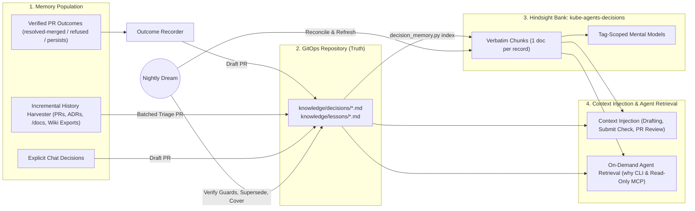
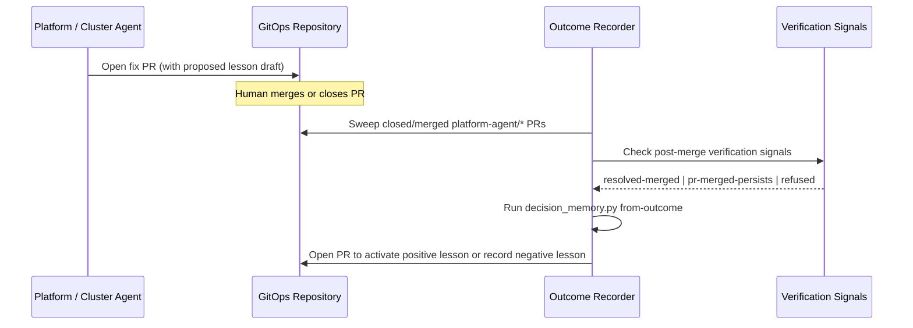

# Decision Memory

## Summary

Enterprise platform teams operate large Kubernetes fleets over many years.
When engineers or AI agents cannot find the rationale behind an infrastructure setting, they undo past fixes or repeat rejected changes.
Previous outages and misconfigurations then return.

[`memory.md`](memory.md) introduced retrieval-backed memory on Hindsight (`kube-agents-memory`).
That design decoupled context window usage from corpus size ($4,264$ tokens vs $110,907$ tokens at $1,414$ records).
However, `memory.md` and feedback from enterprise adopters revealed five remaining gaps:

1. **Chat-only capture.** `kube-agents-memory` learns only when a human speaks in chat. It ignores the operational loop (`troubleshoot -> PR -> merge -> verified resolution`) and historical pull requests.
2. **Stripped identifiers (`id_stripped`).** Hindsight's observation consolidator paraphrases facts and drops record IDs in $11$ of $12$ recall misses ($37$ of $82$ units).
3. **Unresolved contradictions (`0.407` contamination).** Vector similarity ranks superseded policies alongside active ones ($16.7\%$ of queries return a superseded policy first).
4. **Unselective per-turn context injection.** Injecting generic recall on every turn wastes tokens on unrelated tasks and lacks file-scoped precision when an agent edits a manifest.
5. **Runtime coupling.** `kube_agents_memory` is a runtime-specific `MemoryProvider` plugin and does not operate under `spec.mode: next` ([`spec-mode-switch.md`](spec-mode-switch.md)).

This document extends [`memory.md`](memory.md) with **decision memory**:

- **Git is the source of truth.** Decisions (`knowledge/decisions/*.md`) and lessons (`knowledge/lessons/*.md`) live in the GitOps repository as Operational Knowledge Format (OKF) files. Each record declares its `scope`, `evidence`, `supersedes` chain, and an optional machine-checked `guard`.
- **Memory populates from three paths.** The system drafts records from verified PR outcomes, incremental triage of historical PRs and docs, and explicit chat decisions. A human merges every record via pull request.
- **Context injection is task-scoped and bounded.** Chat turns keep `kube-agents-memory` prefetch. During change drafting, submission, or review, the workflow injects only matching records and a **Prior decisions and lessons** block.
- **Agents retrieve memory on demand.** Agents query rationale and validate diffs through the standalone `decision_memory.py` CLI and Hindsight's read-only MCP endpoint (`/mcp/kube-agents-decisions/`).
- **Nightly dreams maintain the corpus.** A scheduled `dream` job checks guards against git `HEAD`, detects reverts and conflicts, finds uncovered changes, and refreshes mental models.

## How to read this document

| Section | Audience | Question answered |
| --- | --- | --- |
| [Why](#why) | Engineering leads, product managers, senior engineers | What adopter expectations and `memory.md` findings drive this design? |
| [Background](#background) | Engineers familiar with `kube-agents` | What did `memory.md` establish, and where do the current memory and audit paths fall short? |
| [Decision](#decision) | Architects and tech leads | How does decision memory extend `memory.md`, and why were alternative designs rejected? |
| [Design](#design) | Implementers and AI agents | How is memory populated, injected into context, retrieved on demand, and maintained by dreams? |
| [Experiment](#experiment) | Evaluators and operators | Which `memory.md` measurements ground this design, and what evaluation criteria gate activation? |

---

## Why

### Enterprise adopter expectations and needs

Enterprise platform teams managing tens of mega-clusters and thousands of workloads report two recurring operational failures:

1. **Engineers or agents undo a protective fix.** An engineer or agent changes a memory request, `PodDisruptionBudget`, resource quota, or node pool setting to reduce cost. Because no record links that setting to the outage it fixed, the outage returns.
2. **Engineers or agents repeat a failed fix.** A team or agent proposes a change that reviewers previously rejected or that failed in production. Without a record of the negative outcome, the organization repeats the failed change.

From these pain points, enterprise adopters defined six expectations for long-term memory:

| Adopter expectation | Operational requirement |
| --- | --- |
| **Explain past rationale** | Answer *"Why is X configured this way?"* with the exact decision ID, the pull request URL, and the approver. |
| **Day-one "first two hours" bootstrap** | Scan the past 2 years of repository pull requests within 2 hours of onboarding and produce a baseline "state of being" for the environment. |
| **Triage history at scale** | Scan years of past pull requests, `/docs` folders, and external wikis incrementally. Separate active rules from superseded, rejected, or anachronistic changes. |
| **Resolve contradictory PRs** | When one pull request accepted a change and another rejected or reversed it, apply deterministic precedence rules instead of similarity ranking. |
| **Learn from agent actions** | Capture lessons automatically when an agent fix pull request merges and resolves the issue, or when a fix fails or is rejected. |
| **Prioritize relevance over recall** | Surface records only when they apply to the target files or question. Avoid noisy recall that distracts the model. |
| **Keep telemetry inside the boundary** | Keep all pull request outcomes, records, and metrics inside the local installation with zero automatic outbound telemetry. |

### How this design addresses adopter needs

- **Verifiable citations instead of paraphrased chat.** Storing records in git and indexing them with `retain_extraction_mode: chunks` preserves exact record IDs, quantities, and pull request links.
- **Prevention at the point of change.** Running deterministic guard checks inside `submit-suggestion`, fleet audit `remediate`, and pull request CI blocks regressions before merge.
- **Explicit precedence.** Five deterministic precedence rules and `status: active | superseded` tags ensure that active decisions always outrank obsolete history.
- **Continuous accuracy.** Nightly dreams detect silent reverts, deleted files, and unrecorded changes without manual upkeep.

---

## Background

### Findings from `memory.md`

[`memory.md`](memory.md) evaluated Hindsight against a file-based store across a 500-cluster, 1,664-record synthetic fleet (`tests/memory-scale/`) and a 4-run GitOps fix cycle pilot ([`gitops-fix-cycle.md`](gitops-fix-cycle.md)).
Six empirical findings from those runs motivate this design:

| Finding in `memory.md` / `gitops-fix-cycle.md` | Measured result | Impact on decision memory |
| --- | --- | --- |
| **Observation consolidation strips identifiers** ([`memory.md` §Is 0.702 gold recall bad](memory.md#is-0702-gold-recall-bad-and-what-is-lost)) | $11$ of $12$ recall misses at rung $1,414$ were `id_stripped` ($37$ of $82$ units lost their ID). | Decision records must bypass LLM observation consolidation (`enable_observations: false`, `chunks` mode). |
| **Multi-item retain corrupts document labels** ([`memory.md` §How to read the numbers](memory.md#how-to-read-the-numbers)) | Retaining 5 items per call collapsed $1,664$ records into $335$ documents and hid $156$ citations. | The indexer must upsert exactly one record per document (`document_id = okf:<repo>:<path>`). |
| **Superseded policies contaminate recall** ([`memory.md` §How Hindsight answers it](memory.md#how-hindsight-answers-it)) | Contamination was $0.407$; $16.7\%$ of contested policy queries ranked an older version first. | Records require explicit `status: active` tags and `supersedes` links enforced at recall time. |
| **Cross-encoder reranking dominates latency** ([`memory.md` §What a recall costs](memory.md#what-a-recall-costs)) | Scoring 300 candidates on CPU took $14.2\text{ s}$ ($\approx 7\text{ s}$ with bucket batching). | File-scoped checks must run deterministically in git ($< 200\text{ ms}$) before calling semantic recall. |
| **Specialists without memory improvise unsafe caches** ([`memory.md` §Specialists with no memory improvise one](memory.md#specialists-with-no-memory-improvise-one)) | A specialist wrote a $79,815$-byte private copy of the corpus into its own skill file. | Specialist workers need sanctioned, read-only access to decision records via CLI and MCP. |
| **Prompt instructions do not stop repeat bad fixes** ([`gitops-fix-cycle.md`](gitops-fix-cycle.md#findings-from-the-runs-2026-09-09-2026-09-10-and-2026-09-15)) | In runs 7, 13, 15, and 16, the agent repeatedly raised the `payments` quota on `b-0011`. | Prevention must execute as a deterministic guard check inside the submission tool path. |

### Limitations of the existing action and audit paths

- **`submit-suggestion` is stateless.** Once `submit-suggestion` opens a pull request, it stores no state and never checks whether the PR merged or resolved the issue.
- **Fleet audit drops outcome signals.** `audit_report.py finish` computes `resolved-merged`, `pr-merged-persists`, and `refused` ([`fleet-audit-issue-ledger.md` §4](fleet-audit-issue-ledger.md#4-finding-lifecycle)), but nothing turns those states into reusable lessons.
- **`memory_candidates` requires manual relay.** In `memory.md`, a specialist nominates facts on a card, and a user must ask the Chat Agent to retain them. Unattended runs have no human in chat to relay nominations.
- **`pr-comment-conversation` ignores human pull requests.** The scan gate filters to `is_agent_pull_request`, so the agent never checks human pull requests against past incidents ([`pr-comment-conversation.md` §7](pr-comment-conversation.md#7-out-of-scope)).

---

## Decision

### Architectural improvements over `memory.md`

Decision memory keeps `kube-agents-memory` unchanged for conversational memory and adds a second, git-backed layer for infrastructure decisions and lessons:

| Dimension | `memory.md` (`kube-agents-memory`) | Decision memory (`knowledge/` + `kube-agents-decisions`) |
| --- | --- | --- |
| **Primary store** | Hindsight PostgreSQL PVC (ephemeral across PVC resets). | GitOps repository `knowledge/decisions/*.md` and `knowledge/lessons/*.md` (durable, versioned). |
| **Hindsight role** | Primary store using LLM fact extraction and observation synthesis. | Rebuildable index using `retain_extraction_mode: chunks` and `enable_observations: false`. |
| **How memory is populated** | Automatic personal capture from chat turns; manual `memory_retain(scope="shared")`. | PR-reviewed drafts from verified PR outcomes, incremental history harvest, and chat decisions. |
| **How memory enters context** | Per-turn semantic prefetch injected into every `api_content` user message. | Task-scoped deterministic injection on target files/resources during drafting, submission, and review. |
| **How agents retrieve memory** | Hermes `MemoryProvider` tools (`memory_recall`, `memory_reflect`). | Harness-neutral CLI (`decision_memory.py check`, `why`) and read-only Hindsight MCP server. |
| **Contradiction handling** | Implicit consolidation and vector similarity ranking. | Five deterministic precedence rules, explicit `supersedes` links, and `status: active` tag filters. |
| **Maintenance** | Deferred TTL checkpoint curator (`memory_ttl_curator.py`). | Nightly `dream` job that verifies guards against git `HEAD`, flags drift, and refreshes mental models. |

### Alternatives rejected

- **Write lessons directly into `kube-agents-memory` from the outcome recorder.** Rejected. Unreviewed writes bypass human approval, observation synthesis strips record IDs, PVC deletion erases the decision log, and CI pipelines cannot read cluster-internal storage.
- **Enforce all decisions as admission policies (`policy/`) immediately.** Rejected. Many architectural decisions capture trade-offs or rejected approaches that cannot be expressed in CEL or Rego. Recurring lessons graduate into `policy/` over time.
- **Inject all decision records into the system prompt.** Rejected. As proven in `memory.md`, injecting $1,414$ records consumes $110,907$ tokens per turn and breaks multi-agent delegation.

---

## Design

### Architecture overview



### Record schema

Decision memory defines two record types in `knowledge/decisions/` and `knowledge/lessons/`:

- **`decision` (`DEC-YYYY-NNN`)**: A forward-looking choice and its architectural rationale.
- **`lesson` (`LES-YYYY-NNN`)**: A backward-looking operational rule learned from a verified pull request outcome.

```yaml
---
type: lesson                                   # decision | lesson
id: LES-2026-001                               # DEC-YYYY-NNN | LES-YYYY-NNN
title: checkout OOM-kills below 256Mi under JVM off-heap growth
status: active                                 # proposed | active | superseded | retired
date: 2026-09-10
scope:                                         # required; at least one key must be non-empty
  paths: ["clusters/*/payments/checkout.yaml"]
  resources: ["Deployment/payments/checkout"]  # kind/namespace/name (globs allowed)
  clusters: [prod-eu]
  checks: [oom-kill]                           # fleet-audit check identifiers
guard:                                         # optional machine-checked invariant
  rule: Keep checkout memory request at or above 256Mi.
  severity: block                              # block | warn | info
  expect:
    file: "clusters/*/payments/checkout.yaml"
    path: "spec.template.spec.containers[name=app].resources.requests.memory"
    op: ">="                                   # == | != | >= | > | <= | < | in | contains
    value: 256Mi                               # parses Kubernetes quantities (Ki, Mi, Gi, m)
evidence:                                      # pull_request is mandatory for type: lesson
  pull_request: https://github.com/acme/gitops/pull/31
  commit: 1a2b3c4
  merged_by: alice
  finding_id: oom-kill.prod-eu.payments.checkout
  outcome: resolved-merged                     # resolved-merged | pr-merged-persists | refused
  resolution:
    verified_by: fleet-audit
    at: 2026-09-11T02:00:00Z
supersedes: []                                 # record IDs replaced by this record
superseded_by: null                            # record ID that replaced this record
---
## What happened
## What fixed it
## How we know it worked
## Prevent it next time
```

---

### 1. How memory is populated

No agent or background job writes directly to the default branch or to the Hindsight index.
Every write path produces a pull request against `knowledge/`.
The indexer updates Hindsight only after a human merges the pull request to the default branch.

#### Path W1 — Populate from verified agent outcomes

This path closes the loop between agent actions (`submit-suggestion`, `fleet-audit remediate`) and long-term memory.



1. **Attach a proposed lesson at PR creation.** When the agent opens a remediation pull request, it includes a `Lesson draft` section in the PR description. It can also commit `knowledge/lessons/LES-YYYY-NNN.md` with `status: proposed` in the same branch so one human review covers both the fix and its rationale.
2. **Verify resolution after merge.** The outcome recorder sweeps closed and merged `platform-agent/*` branches and checks four deterministic signals (ordered strongest to weakest):
   - **Fleet audit `resolved-merged`**: `audit_report.py finish` confirms that a complete audit run no longer reproduces the finding targeted by the merged pull request.
   - **Incident event silence**: `intercepted_events` shows zero occurrences of the workload failure reason for $N$ hours (default $24\text{ hours}$) after the merge timestamp.
   - **GitOps controller health**: Argo CD or Flux reports `Synced` at or after the merge commit SHA and `Healthy`.
   - **Findings queue verification**: `findings_queue.py` marks `pr_state=merged` and verifies that the finding is gone.
3. **Capture negative outcomes (`pr-merged-persists` and `refused`).** The ledger records `pr-merged-persists` when a merged fix fails and `refused` when a reviewer closes a PR. In both cases, the outcome recorder runs `decision_memory.py from-outcome` to draft a negative lesson (*"Approach X does not resolve Y"*). The record cites the reviewer's comment and attaches a `warn` or `block` guard to prevent repeat proposals.

#### Path W2 — Populate from historical pull requests and documentation

To solve the cold-start problem on existing repositories, an incremental harvester mines past decisions:

1. **Sources.** The harvester reads the GitOps repository, registered `context_repos`, in-repository decision directories (`docs/adr/`, `docs/decisions/`, `/docs`), and Markdown exports from external wikis or document stores.
2. **Incremental watermark.** To handle repositories with thousands of pull requests, the harvester records a watermark (the last processed PR number or commit SHA). Forward runs scan only new merges. Backfill runs scan history newest-first in bounded slices (for example, $100$ PRs per run, capped at $10$ drafted records per area per week).
3. **Five-way triage.** Before drafting files, the harvester classifies every historical candidate against git `HEAD`:

| Triage class | Condition at git `HEAD` | Harvester output |
| --- | --- | --- |
| `current` | The setting or resource introduced by the PR still holds at `HEAD`. | Draft an `active` decision record (`DEC-YYYY-NNN.md`). |
| `superseded` | A newer merged PR modified the same field or resource. | Draft a `superseded` record with `superseded_by` set to preserve the rationale chain. |
| `rejected` | A reviewer closed the PR unmerged with an architectural or operational reason. | Draft a negative `lesson` record so the rejected approach is not repeated. |
| `anachronistic` | The target cluster, API version, or workload no longer exists at `HEAD`. | Do not draft a record; list in the PR summary for human confirmation. |
| `noise` | Formatting edits, version bumps, or commits with no stated rationale. | Ignore. |

4. **Priority ordering.** Each curation PR orders drafts by impact: paths with incident findings first, repeatedly edited guarded fields second, and newest merges third.

##### The "first two hours" bootstrap

When an organization installs `kube-agents`, the agent starts with zero institutional context—like a new junior engineer on day one.
Adopters expect the system to scan 2 years of pull requests within 2 hours and produce a baseline "state of being".

Scanning 2 years of pull requests sequentially with an LLM would exceed the 2-hour window.
The bootstrap mode (`decision_memory.py bootstrap --since 2y --budget-minutes 120`) meets the 2-hour target through four deterministic stages before calling the model:

| Stage | Time budget | Operation | Output |
| --- | --- | --- | --- |
| **1. Fast git & metadata scan** | $0\text{–}15\text{ min}$ | Scan 2 years of `git log` and forge PR metadata (`gh pr list --state all`) without LLM calls. Identify governed files, revert commits, high-churn resource fields (`memory`, `cpu`, `limits`, `replicas`, `maxSurge`, `PodDisruptionBudget`, `ResourceQuota`), and PRs linked to incidents. | Ranked candidate list of $50\text{–}150$ high-signal PRs out of thousands. |
| **2. Five-way deterministic triage** | $15\text{–}30\text{ min}$ | Compare each candidate's diff against the current `HEAD` tree. Classify candidates into `current`, `superseded`, `rejected`, `anachronistic`, or `noise`. | Filtered set of `current` and `rejected` candidates that still govern `HEAD`. |
| **3. Parallel draft generation** | $30\text{–}90\text{ min}$ | Synthesize `DEC-YYYY-NNN.md` and negative `LES-YYYY-NNN.md` drafts (`status: proposed`) for the top-ranked candidates per area (namespace, cluster family, or build pipeline). | Scoped record drafts with `guard` blocks and PR evidence links. |
| **4. Baseline "state of being" PR** | $90\text{–}120\text{ min}$ | Open a bootstrap pull request containing `knowledge/STATE_OF_BEING.md` (architecture summary, hot spots, active constraints, and uncovered areas) plus the initial batch of proposed records. | Reviewable day-one baseline ready for the platform team within 2 hours. |

Once the initial bootstrap completes, the harvester switches to incremental watermark mode and backfills any remaining lower-priority history in bounded weekly slices.

#### Path W3 — Populate from explicit chat statements

When a user states an architectural decision in chat, the Chat Agent offers to draft a `DEC-YYYY-NNN.md` pull request instead of only calling `memory_retain(scope="shared")`.
Following `SOUL.md` §1.6, the agent never infers decisions silently and states the exact record content in chat before opening the pull request.

#### Path W4 — Populate the Hindsight index from git

Whenever `knowledge/` changes on the default branch (or during phase 1 of the nightly dream), `decision_memory.py index` synchronizes git records into the `kube-agents-decisions` Hindsight bank:

- **One document per record.** Each record is retained individually with `document_id: okf:<repo>:<path>` and `update_mode: replace`, avoiding the multi-item batch packing bug documented in `memory.md`.
- **Verbatim chunk extraction.** The bank uses `retain_default_strategy: record` (`retain_extraction_mode: chunks`) and `enable_observations: false`. Hindsight embeds the exact Markdown and YAML frontmatter without calling an LLM or stripping record IDs.
- **Structured tags.** Every document carries `scope:shared`, `kind:<decision|lesson>`, `status:<status>`, `id:<id>`, `cluster:<cluster>`, and `check:<check>`.

---

### 2. What and how memory is injected into context

A key lesson from `memory.md` and enterprise feedback is that **unselective memory injection degrades agent performance**.
Decision memory separates conversational prefetch from task-scoped decision injection:

| Workflow stage | What is injected | How it is injected | Token budget & latency |
| --- | --- | --- | --- |
| **1. Interactive chat turn** (Chat Agent) | Conversational facts and ownership from `kube-agents-memory`. Decision records are **not** auto-injected on every chat turn. | `prefetch_all(user_message)` injects a budget-bounded block into the turn's `api_content` sidecar ([`memory.md` §Channel 2](memory.md#how-recalled-memories-reach-the-model)). | `recall_budget: mid` ($\approx 4.2\text{k}$ tokens). |
| **2. Change drafting** (`gke-manifest-generation`, `gke-golden-path`, `fleet-audit`) | Active `DEC` and `LES` records whose `scope.paths`, `scope.resources`, `scope.clusters`, or `scope.checks` match the target workload. | The skill runs `decision_memory.py check --files <targets>` before editing and injects matching records into the worker's tool-result context. | Typically $1\text{–}5$ records ($< 500$ tokens, $< 100\text{ ms}$, zero LLM calls). |
| **3. Proposal submission gate** (`submit-suggestion`, `audit_report.py remediate`) | Deterministic guard verdicts (`violates`, `consistent`, `related`) plus optional top-$k$ `semantic` matches from `kube-agents-decisions`. | Runs inside the Python tool path before `git push`. Injects a formatted **Prior decisions and lessons** Markdown section into the PR body and returns any `block` error to the agent loop. | Blocks invalid proposals in $< 200\text{ ms}$ (local) or $< 1\text{ s}$ (with `--semantic`). |
| **4. Human PR review** (CI job or `agent:review` worker) | Guard verdicts and governing records for all files modified in `BASE..HEAD`. | The CI action or review worker runs `decision_memory.py check --base $BASE --head $HEAD --markdown` and injects the resulting Markdown table into a single sticky PR comment. | Deterministic; zero model tokens in CI mode. |

#### Why decision records are not injected into every chat turn

1. **Zero irrelevant recall on non-infrastructure turns.** Most chat turns ask about live pod status, logs, or ownership. Injecting infrastructure guard rules into those turns wastes context and increases irrelevant recall.
2. **No double cross-encoder penalty.** In [`memory.md`](memory.md#what-a-recall-costs), one cross-encoder rerank takes $\approx 7\text{–}14\text{ s}$ on CPU, and concurrent recalls halve throughput. Keeping `kube-agents-decisions` out of per-turn chat prefetch avoids doubling turn latency.
3. **Quoted data framing prevents prompt injection.** `decision_memory.py` wraps each injected record in a structured envelope (`id`, `status`, `evidence.pull_request`, `guard`, and quoted `body`). This framing ensures that the model treats recalled text strictly as data rather than system instructions.

---

### 3. How memory is retrieved by agent request

Agents retrieve decision memory on demand when they answer rationale questions, investigate incidents, or search fleet decision history.
Two harness-neutral surfaces serve these requests.

#### Surface A — Deterministic and hybrid CLI (`decision_memory.py`)

Both the default runtime and `spec.mode: next` workers load the [`decision-memory`](../../agents/platform/skills/decision-memory/SKILL.md) skill and call `decision_memory.py`:

| Command | Input parameters | What it retrieves and returns |
| --- | --- | --- |
| `why <path>` | File path in the GitOps repo; optional `--hindsight-url` | Returns JSON with `records` governing `<path>` (active first, then superseded), recent `git log` `history`, `history_without_record` (uncovered commits), and an absence-reporting `note`. |
| `check` | `--base <ref> --head <ref>` or `--files <list>`; optional `--semantic`, `--markdown` | Matches changed files by path glob (`scope.paths`) and Kubernetes object identity (`kind/namespace/name` in `scope.resources`). Evaluates `guard.expect` against the new YAML, queries Hindsight when `--semantic` is set, and returns `violates`, `consistent`, `related`, and `semantic` verdicts. Exits with code `2` on any `block` violation. |
| `validate` | Repository path | Validates YAML frontmatter, ID formats, scope keys, mandatory lesson PR links, and `supersedes` integrity across all records. |

**Enforcing honest absence reporting.** Just as [`memory.md`](memory.md#a-read-names-its-outcome) separated `found`, `no_match`, and `unreachable`, `decision_memory.py` enforces explicit absence semantics:
- When `records` is empty, the tool returns `status: no_match` and instructs the model to report *"No recorded decision governs this path"* alongside the raw `git log` history.
- The agent must never invent a rationale from commit messages or claim that no decision exists in the organization.

#### Surface B — Read-only Hindsight MCP endpoint (`/mcp/kube-agents-decisions/`)

Agents use this endpoint for conceptual queries (*"Which namespaces have quota cap exceptions?"*) when they do not know the file path:

- Hindsight 0.10.2 exposes a native per-bank MCP server at `/mcp/kube-agents-decisions/`.
- The configuration restricts `mcp_enabled_tools` to read-only operations: `recall`, `reflect`, `list`, and `get`.
- Unlike `kube-agents-memory` (where personal `user:<id>` tags share the bank and prohibit exposing raw MCP), `kube-agents-decisions` contains only `scope:shared` organizational records. Exposing read-only MCP on this bank cannot leak personal user data.
- In `spec.mode: today`, the profile registers the MCP server in `mcp_servers`. In `spec.mode: next`, the gateway passes the vetted server in the worker adapter's `--mcp-config`.
- Active queries pass `tag_groups: [{"tags": ["scope:shared", "status:active"], "match": "all_strict"}]` so superseded and retired records never contaminate current answers. Historical queries (*"Why did this policy change?"*) query `status:superseded` explicitly.

---

### 4. Precedence rules and nightly dreams

#### Precedence for contradictory history

When multiple pull requests or records touch the same configuration, vector similarity must never decide which rule applies.
`decision_memory.py` resolves precedence using five deterministic rules in order:

1. **Explicit `supersedes` link wins.** If active record `B` declares `supersedes: [A]`, record `A` is marked `status: superseded` (`superseded_by: B`) and excluded from active guard checks and active recall.
2. **Git `HEAD` state detects at-risk records.** If an active record's guard no longer holds at `HEAD`, the record is not silently dropped. The dream job flags it **at-risk** with the breaking commit SHA so a human either reverts the unintended change or supersedes the record.
3. **Merged outranks rejected, and newer beats older.** For unlinked records on one field, a merged PR beats a closed PR, and a newer merge wins. Closed PRs remain active as negative lessons (*"do not repeat rejected approach X"*) unless superseded by a later merged PR.
4. **Narrower scope outranks broader scope.** A cluster-specific record (`clusters: [prod-eu]`) overrides a fleet-wide rule (`clusters: []`) for resources in `prod-eu`.
5. **Unresolved ties surface as explicit conflicts.** Two active records may guard the same file and YAML path with incompatible expectations. If rules 1–4 do not separate them, `dream` emits a `conflicts` entry and proposes superseding the older ID.

**Human override workflow.** To override a `block` guard on a pull request, a human adds the `decision-override:<RECORD-ID>` label and explains why.
After merge, the nightly dream detects the override label and opens a pull request to supersede `<RECORD-ID>`.

#### Nightly dreams (`decision_memory.py dream`)

A scheduled job runs `decision_memory.py dream` nightly and after merges to `knowledge/`:

| Phase | Action | Deterministic? | Output |
| --- | --- | --- | --- |
| 1. Reconcile index | Upsert valid records into `kube-agents-decisions` by `document_id`; delete removed records. | Yes | Synchronizes Hindsight bank. |
| 2. Verify against git tree | Check every active record at `HEAD`: verify governed files exist (`obsolete`), evaluate guards (`at_risk` with breaking commit), and scan for `Revert` commits (`reverted`). | Yes | Flags regressions the morning after an unguarded merge. |
| 3. Verify against clusters | Optional read-only check comparing live cluster resources against active guards. | Yes | Emits drift findings to the fleet audit ledger. |
| 4. Supersession & conflicts | Mirror `supersedes` into `superseded_by`; detect conflicting active guards on the same YAML path. | Yes | Proposes frontmatter updates in a `knowledge:dream` PR (`--apply`). |
| 5. Recurrence graduation | Detect $\ge K$ active lessons (default $K=2$) sharing a `check` ID or guarded path across clusters. | Yes | Proposes a fleet-wide `DEC` record and a `policy/` admission rule. |
| 6. Coverage scan | Find commits to governed paths (`clusters/`, `apps/`, `base/`, `infrastructure/`, `manifests/`) with no governing record, plus merged `decision-override:<id>` PRs. | Yes | Queues uncovered commits for the harvester; proposes supersession for overrides. |
| 7. Synthesis refresh | Refresh tag-scoped Hindsight mental models (`[scope:shared, kind:decision, area:<name>]`) via `trigger.refresh_cron`. | No (LLM) | Updates human-readable summary pages in Hindsight. |
| 8. Dream diary | Post `at_risk`, `conflicts`, `obsolete`, `recurrences`, and `uncovered_changes` to the platform chat space. Suppress output when all lists are empty (`silent: true`). | Yes | Zero noise on clean runs. |

---

## Experiment

We did not run a new benchmark suite for this design document.
All empirical numbers come from [`memory.md`](memory.md) and [`gitops-fix-cycle.md`](gitops-fix-cycle.md), alongside the unit tests in [`agents/platform/skills/decision-memory/scripts/test_decision_memory.py`](../../agents/platform/skills/decision-memory/scripts/test_decision_memory.py).

### How existing experimental findings ground this design

| Experimental source | Finding in prior experiment | Architectural mechanism in this design |
| --- | --- | --- |
| [`memory.md` §The retrieval ladder](memory.md#the-retrieval-ladder) | At $1,414$ shared records, file injection consumed $110,907$ tokens per turn ($55\%$ of a $200\text{k}$ window), while Hindsight retrieval used $4,264$ tokens. | Keep full records out of the system prompt; inject only file-scoped matches during change tasks and retrieve via Hindsight for open-ended queries. |
| [`memory.md` §Is 0.702 gold recall bad](memory.md#is-0702-gold-recall-bad-and-what-is-lost) | Hindsight's LLM observation consolidator stripped identifiers in $11$ of $12$ gold misses (`id_stripped`, $37$ of $82$ units). | Disable observation synthesis (`enable_observations: false`) and use `retain_extraction_mode: chunks` in `kube-agents-decisions` so record IDs and PR URLs survive verbatim. |
| [`memory.md` §How to read the numbers](memory.md#how-to-read-the-numbers) | Retaining multiple records per call (`--batch 5`) collapsed $1,664$ records into $335$ documents and lost $156$ citations. | Retain each record individually with a deterministic `document_id` (`okf:<repo>:<path>`) and `update_mode: replace`. |
| [`memory.md` §What survives if honcho gets the wrapper](memory.md#what-survives-if-honcho-gets-the-wrapper) | Returning superseded runbooks contaminated $100\%$ of procedural probes on `honcho` and $40.7\%$ on `hindsight`. | Track `status: active | superseded` in git frontmatter and filter active recall with `tag_groups` (`status:active`, `all_strict`). |
| [`gitops-fix-cycle.md` §Findings](gitops-fix-cycle.md#findings-from-the-runs-2026-09-09-2026-09-10-and-2026-09-15) | On task `b-0011`, the agent repeated the rejected quota-increase fix across runs 7, 13, 15, and 16 despite prompt guidance. | Encode negative lessons from `refused` / `pr-merged-persists` outcomes and run `decision_memory.py check` deterministically inside the submission tool path. |

### Evaluation plan before default activation

Decision memory ships disabled by default.
Enabling it by default requires passing an A/B evaluation (`with-decision-memory` vs `without-decision-memory`) on the existing benchmark harness across six dimensions:

| Evaluation dimension | Method and acceptance bar |
| --- | --- |
| **1. Repeat-failure prevention (Pass rate)** | Replay the `b-0011` quota exhaustion task (`gitops-fix-cycle.md`) with `DEC-2026-001` (payments quota cap guard) and a negative lesson from a refused quota PR present in `knowledge/`. **Bar:** $0$ quota-increase pull requests across $3$ consecutive runs. |
| **2. Negative control (False-positive block rate)** | Run benign manifest changes in a governed namespace where all `guard.expect` assertions remain satisfied. **Bar:** $100\%$ pass rate and $0$ false-positive `block` verdicts. |
| **3. Citation preservation (`id_stripped` rate)** | Run the 26 queries from `tests/memory-scale/queries.json` against `kube-agents-decisions` seeded one document per record in `chunks` mode. **Bar:** $0$ `id_stripped` misses on indexed records. |
| **4. Stale recall contamination** | Query the 6 three-version contested policies from `tests/memory-scale/` with `status:active` tag filtering enabled. **Bar:** $0.000$ superseded contamination on active recall ($100\%$ current policy ranked first). |
| **5. Irrelevant recall rate** | Grade surfaced records on a mixed suite of routine troubleshooting and manifest-change tasks. **Bar:** $< 10\%$ of surfaced records graded unrelated to the active diff or question. |
| **6. Latency and token overhead** | Measure per-task wall time and input tokens. **Bar:** $< 200\text{ ms}$ and $< 500$ tokens added for deterministic `check`; zero additional latency on chat turns that do not invoke `decision-memory`. |

---

## Related documents

- [`memory.md`](memory.md): Conversational memory architecture, scale experiment (`tests/memory-scale/`), and Hindsight operational findings.
- [`fleet-audit-issue-ledger.md`](fleet-audit-issue-ledger.md): Finding identity and lifecycle states (`resolved-merged`, `pr-merged-persists`, `refused`).
- [`gitops-fix-cycle.md`](gitops-fix-cycle.md): Post-merge verification predicates and the `b-0011` repeated quota-raise analysis.
- [`pr-comment-conversation.md`](pr-comment-conversation.md): Pull request sweep and idempotent comment markers.
- [`capability-delivery-vehicle.md`](capability-delivery-vehicle.md): Self-learning safety boundaries (`apply` vs `propose`).
- [`spec-mode-switch.md`](spec-mode-switch.md): `spec.mode: next` runtime architecture.
- [Architecture 02 §2.3](../architecture/02-agent-personas.md) and [06 §5](../architecture/06-api-and-data-contracts.md): Operational Knowledge Format (OKF) specification.
