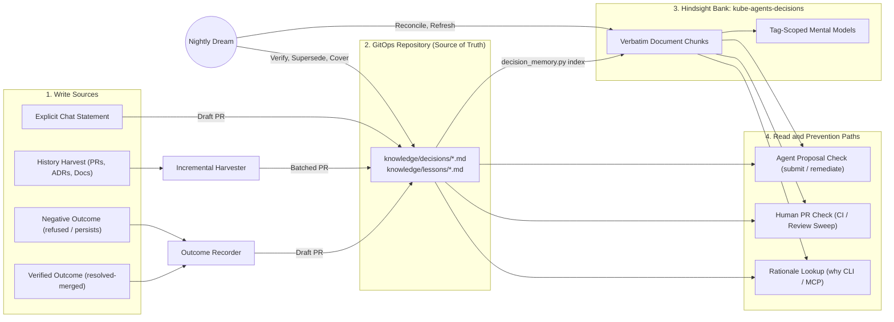
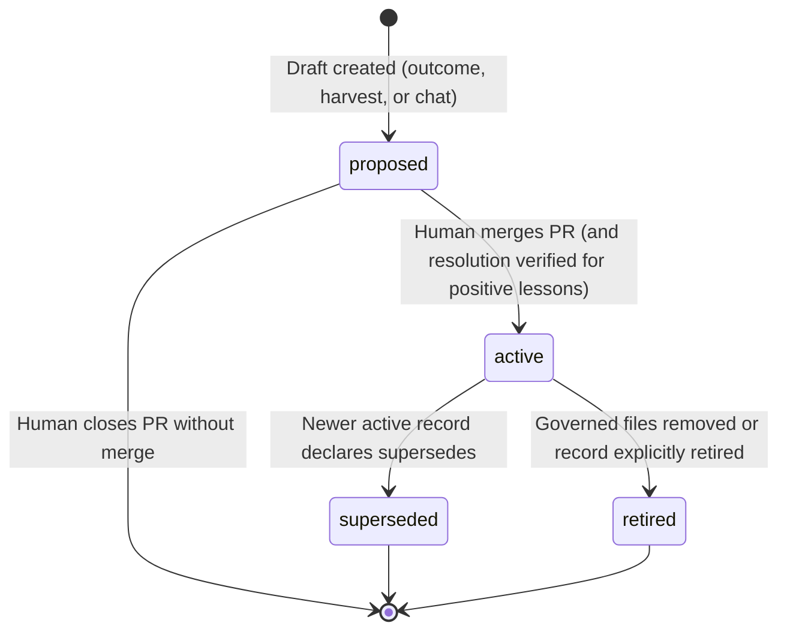
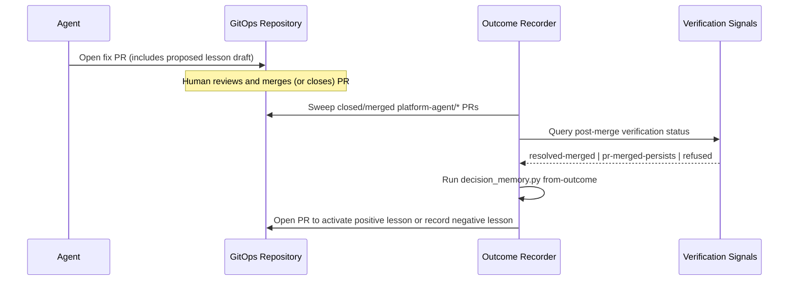

# Decision Memory

## Summary

Engineers and AI agents often change Kubernetes manifests without the context of past incidents.
When they revert a protective setting or repeat a failed fix, previous outages return.

Conversational memory ([`memory.md`](memory.md)) learns only from chat turns.
It does not observe the operational loop where the agent diagnoses an issue, opens a pull request, and resolves the incident.

Decision memory records infrastructure rationale and operational lessons as structured files in the GitOps repository:

- **Git is the source of truth.** Decisions (`knowledge/decisions/*.md`) and lessons (`knowledge/lessons/*.md`) are Operational Knowledge Format (OKF) files with YAML frontmatter. Each record defines its scope and an optional machine-checked **guard**.
- **Outcomes create lessons.** The system drafts a lesson after a fix merges and verification confirms the resolution. It also drafts a negative lesson when a fix fails or a reviewer rejects it.
- **Tool paths prevent regressions.** The `decision-memory` tool checks every agent proposal and human pull request against active guards before merge.
- **Hindsight serves as a rebuildable index.** A dedicated Hindsight bank (`kube-agents-decisions`) stores verbatim records for semantic recall and synthesis.
- **Nightly dreams keep memory accurate.** A scheduled job verifies guards against the repository, detects reverts and conflicts, identifies uncovered changes, and refreshes the index.

The architecture is harness-neutral.
It operates identically on the default runtime and under `spec.mode: next` ([`spec-mode-switch.md`](spec-mode-switch.md)).

## How to read this document

| Section | Audience | Question answered |
| --- | --- | --- |
| [Why](#why) | Engineering leads, product managers, senior engineers | What failure modes does decision memory prevent, and why is chat memory insufficient? |
| [Background](#background) | Engineers familiar with `kube-agents` | How do existing memory, audit, and GitOps components interact today? |
| [Decision](#decision) | Architects and tech leads | What are the core architectural choices and rejected alternatives? |
| [Design](#design) | Implementers and AI agents | What are the exact schemas, CLI contracts, write flows, prevention hooks, and dream phases? |
| [Experiment](#experiment) | Evaluators and operators | How does the system behave against Hindsight 0.10.2, and how do benchmarks measure quality? |

---

## Why

### Problem statement

Platform teams suffer from two recurring failure modes when infrastructure rationale is lost:

1. **Engineers or agents undo a past fix.** A team changes a memory request, `PodDisruptionBudget`, quota, or node pool setting to reduce cost. Because no record links that value to a past incident, the original outage returns.
2. **Engineers or agents repeat a failed fix.** A team or agent proposes an approach that reviewers previously rejected or that failed in production. Without a record of the negative outcome, the team wastes time on the same broken change.

In the [GitOps fix cycle evaluation](gitops-fix-cycle.md#findings-from-the-runs-2026-09-09-2026-09-10-and-2026-09-15), the platform agent repeated the same invalid fix across four separate runs.
The agent diagnosed namespace quota exhaustion (`b-0011`) and raised the `payments` namespace `ResourceQuota` instead of lowering an inflated `64Mi` pod request.
Prompt instructions failed to stop the behavior.
A recorded decision with a deterministic guard on the quota file stops the invalid proposal inside the tool path.

### Why conversational memory is insufficient

The conversational memory system ([`memory.md`](memory.md)) cannot solve this problem for five reasons:

- **Chat-only capture.** Conversational memory captures user chat turns. It does not observe pull request merges, review rejections, or post-merge cluster health.
- **Lossy paraphrase.** Conversational consolidation rewrites text and drops exact resource names, quantities, and pull request URLs.
- **No human review gate.** A model writes shared chat facts directly during a turn. Infrastructure rules require peer review in git.
- **Ephemeral storage.** Deleting the Hindsight PersistentVolumeClaim resets conversational memory. An organization's decision log must survive cluster reinstalls and storage resets.
- **Harness coupling.** The conversational plugin uses a runtime-specific `MemoryProvider` interface that does not exist under `spec.mode: next`.

---

## Background

`kube-agents` already contains four building blocks that decision memory connects:

- **Operational Knowledge Format (OKF).** The architecture ([02 §2.3](../architecture/02-agent-personas.md), [05 C9](../architecture/05-system-architecture.md), [06 §5](../architecture/06-api-and-data-contracts.md)) defines `knowledge/` in git for curated and attributable knowledge.
- **Fleet audit ledger.** The fleet audit skill ([`fleet-audit-issue-ledger.md`](fleet-audit-issue-ledger.md#4-finding-lifecycle)) tracks finding fingerprints across runs and computes lifecycle states: `resolved-merged`, `pr-merged-persists`, and `refused`.
- **GitOps proposal tools.** The `submit-suggestion` skill and fleet audit `remediate` command open pull requests on `platform-agent/*` branches through the credential broker.
- **Hindsight service.** The cluster runs `hindsight-api` backed by PostgreSQL with `pgvector` ([`memory.md`](memory.md#the-two-pods)). A single `hindsight-api` deployment can host multiple isolated memory banks with independent extraction strategies.

---

## Decision

| Area | Decision | Rationale |
| --- | --- | --- |
| System of record | Store decisions and lessons as OKF Markdown files in `knowledge/decisions/` and `knowledge/lessons/` in git. | Git provides peer review, blame history, revert detection, and durability across cluster reinstalls. |
| Semantic index | Index active and superseded records in a dedicated Hindsight bank named `kube-agents-decisions`. | `retain_extraction_mode: chunks` and `enable_observations: false` preserve exact text and identifiers without LLM paraphrasing. |
| Write trigger | Generate lesson drafts from verified pull request outcomes (`resolved-merged`, `pr-merged-persists`, `refused`), historical triage, or explicit chat statements. | Learning from verified outcomes prevents the agent from recording unverified intentions as facts. |
| Human control | Require a human to merge every new record, status change, or supersession via pull request. | Human merge approval satisfies the attributable knowledge requirement and blocks prompt injection from untrusted text. |
| Prevention | Run `decision_memory.py check` deterministically inside the submission tool path and in CI checks. | Deterministic tool-path checks cannot be skipped by the model. |
| Maintenance | Run a nightly `dream` job that audits records against git HEAD and refreshes Hindsight mental models. | Automated verification detects silent reverts, deleted files, conflicting guards, and unrecorded changes. |
| Harness interface | Expose all operations through the standalone `decision_memory.py` CLI and Hindsight's native REST/MCP endpoints. | Standard CLI and MCP interfaces work identically across the default runtime, `spec.mode: next`, and CI runners. |

### Non-goals

- **Replacing conversational memory.** Personal and session context remains in `kube-agents-memory` ([`memory.md`](memory.md)).
- **Replacing Kubernetes admission webhooks.** Decision memory checks changes before merge and proposes admission policies for recurring lessons; the Kubernetes API server enforces deployed policies.
- **Storing full incident timelines.** Records store the root cause, the guard, and links to evidence.

### Alternatives rejected

- **Write lessons directly to Hindsight without git files.** Rejected. Unreviewed writes skip human control, consolidation drops identifiers, PVC resets erase records, and CI jobs cannot read cluster storage.
- **Store records in the existing `kube-agents-memory` bank.** Rejected because conversational memory enables background observation synthesis and shares the ephemeral PVC reset lifecycle.
- **Use policy-as-code (`policy/`) for all rationale.** Rejected because many architectural decisions explain trade-offs or negative lessons that cannot be expressed as admission rules.
- **Use a single `DECISIONS.md` file.** Rejected because a single file exceeds context token budgets and cannot be scoped per file path or Kubernetes resource.

---

## Design

### System architecture



### Component locations

| Layer | Location |
| --- | --- |
| Truth records | `knowledge/decisions/*.md` and `knowledge/lessons/*.md` in the GitOps repository (or a dedicated knowledge repository) |
| Skill and CLI | [`agents/platform/skills/decision-memory/SKILL.md`](../../agents/platform/skills/decision-memory/SKILL.md) and [`scripts/decision_memory.py`](../../agents/platform/skills/decision-memory/scripts/decision_memory.py) |
| Derived index | Hindsight bank `kube-agents-decisions` on the `hindsight-api` service |

### Record schema and lifecycle

Decision memory defines two record types that share one YAML frontmatter schema:

- **`decision` (`DEC-YYYY-NNN`)**: A forward-looking architectural choice and its rationale.
- **`lesson` (`LES-YYYY-NNN`)**: A backward-looking operational rule derived from a verified pull request outcome.

```yaml
---
type: lesson                                   # decision | lesson
id: LES-2026-001                               # DEC-YYYY-NNN | LES-YYYY-NNN
title: checkout OOM-kills below 256Mi under JVM off-heap growth
status: active                                 # proposed | active | superseded | retired
date: 2026-09-10
scope:                                         # required; at least one key must be non-empty
  paths: ["clusters/*/payments/checkout.yaml"]
  resources: ["Deployment/payments/checkout"]  # kind/namespace/name (globs allowed)
  clusters: [prod-eu]
  checks: [oom-kill]                           # fleet-audit check identifiers
guard:                                         # optional machine-checked invariant
  rule: Keep checkout memory request at or above 256Mi.
  severity: block                              # block | warn | info
  expect:
    file: "clusters/*/payments/checkout.yaml"
    path: "spec.template.spec.containers[name=app].resources.requests.memory"
    op: ">="                                   # == | != | >= | > | <= | < | in | contains
    value: 256Mi                               # supports Kubernetes resource quantities
evidence:                                      # pull_request is required for type: lesson
  pull_request: https://github.com/acme/gitops/pull/31
  commit: 1a2b3c4
  merged_by: alice
  finding_id: oom-kill.prod-eu.payments.checkout
  outcome: resolved-merged                     # resolved-merged | pr-merged-persists | refused
  resolution:
    verified_by: fleet-audit
    at: 2026-09-11T02:00:00Z
supersedes: []                                 # list of record IDs this record replaces
superseded_by: null                            # record ID that replaced this record
---
## What happened
## What fixed it
## How we know it worked
## Prevent it next time
```

#### Schema invariants

1. **Mandatory scope.** Every record must declare at least one `scope` key (`paths`, `resources`, `clusters`, or `checks`). `paths` match edited file paths. `resources` match Kubernetes manifests by `kind/namespace/name` even when a workload moves to a new file or cluster directory.
2. **Deterministic guards.** A `guard` evaluates `expect.path` against candidate YAML documents matching `expect.file`. Dots inside YAML keys use backslash escaping (for example, `spec.hard.requests\.memory`). Comparisons parse Kubernetes quantities (`Ki`, `Mi`, `Gi`, `m`) into canonical values.
3. **Mandatory lesson evidence.** Validation rejects any `lesson` record that lacks `evidence.pull_request`.
4. **Explicit lifecycle transitions.** Every record follows a four-state lifecycle managed through pull requests:



### Precedence rules for contradictory history

Repository history often contains contradictory changes, such as a setting that was raised, reverted, and raised again.
Vector similarity scores must never decide which record is currently authoritative.
The tool resolves precedence using five deterministic rules in strict order:

1. **Explicit supersession wins.** If active record `B` lists `supersedes: [A]`, record `A` transitions to `status: superseded` with `superseded_by: B`.
2. **Git HEAD state flags at-risk records.** If an active guard fails against the current `HEAD` tree, the record is not silently ignored. The dream job marks the record **at-risk** and cites the breaking commit so a human either reverts the breaking change or supersedes the record.
3. **Merged beats rejected, and newer beats older.** For two unlinked records on the same field, a merged pull request outranks a closed one. Between two merged pull requests, the later merge date wins. Rejected pull requests remain active as negative lessons ("do not apply X") unless a later merged pull request explicitly supersedes them.
4. **Narrower scope beats broader scope.** A record scoped to a single cluster (`clusters: [prod-eu]`) overrides a fleet-wide record (`clusters: []`) for changes in `prod-eu`.
5. **Unresolved ties become explicit conflicts.** Two active records may guard the same file and YAML path with incompatible expectations. If rules 1–4 do not separate them, `dream` reports a `conflicts` entry and proposes superseding the older ID.

### Hindsight index configuration

The indexer provisions the `kube-agents-decisions` bank on `hindsight-api` with four settings:

| Setting | Value | Purpose |
| --- | --- | --- |
| `retain_default_strategy` | `record` (`retain_extraction_mode: chunks`) | Stores record text, IDs, and URLs verbatim without LLM extraction or paraphrasing. |
| `enable_observations` | `false` | Disables background observation synthesis so Hindsight never paraphrases authoritative records. |
| `document_id` and `update_mode` | `okf:<repo>:<path>`, `replace` | Replaces existing units in place when a record changes status or content. |
| Unit tags | `scope:shared`, `kind:<type>`, `status:<status>`, `id:<id>`, `cluster:<c>`, `check:<k>` | Supports strict tag filtering (`all_strict`) during active recall and historical queries. |

### Write paths

No agent or background job writes directly to the default branch.
All three write paths create pull requests containing record drafts.

#### W1 — Learn from verified outcomes

The outcome loop captures both successful fixes and failed attempts.



1. **Draft at proposal time.** `submit-suggestion` and fleet audit `remediate` add a `Lesson draft` section to the fix pull request. They can also include `knowledge/lessons/LES-YYYY-NNN.md` with `status: proposed` in the same branch.
2. **Verify post-merge outcome.** The outcome recorder evaluates closed and merged `platform-agent/*` pull requests against four verification signals, ordered from strongest to weakest:
   - **Fleet audit `resolved-merged`**: `audit_report.py finish` confirms that a complete audit run no longer reproduces the finding targeted by the merged pull request.
   - **Incident event silence**: `intercepted_events` shows zero occurrences of the failure reason for $N$ hours (default 24) after the merge.
   - **GitOps controller health**: Argo CD or Flux reports `Synced` at or after the merge commit SHA and `Healthy` for the target application.
   - **Findings queue verification**: `findings_queue.py` transitions `pr_state` to `merged` and confirms the finding is absent.
3. **Record negative outcomes.** The fleet audit ledger records `pr-merged-persists` when a merged fix fails and `refused` when a reviewer closes a PR. In both cases, the outcome recorder runs `from-outcome` to draft a negative lesson. The negative lesson records why the approach failed and attaches a `warn` or `block` guard to prevent repeat proposals.

#### W2 — Harvest historical decisions at scale

Organizations adopting decision memory have years of unrecorded rationale in past pull requests and documents.
The harvester processes this backlog incrementally:

1. **Multi-source ingestion.** The harvester reads the GitOps repository, `context_repos`, in-repo docs (`docs/adr/`, `docs/decisions/`, `/docs`), and Markdown exports from external wikis.
2. **Watermark and bounded slices.** Large fleets have thousands of historical pull requests. The harvester stores the last processed pull request number or commit SHA as a watermark. Forward runs process only newly merged changes. Backfill runs walk history newest-first in bounded batches (for example, 100 pull requests per run, capped at 10 drafted records per area per week).
3. **Five-way triage.** Before drafting files, the harvester classifies each historical candidate:

| Triage class | Condition | Harvester action |
| --- | --- | --- |
| `current` | The value or resource set by the historical PR still exists at `HEAD`. | Draft a `decision` record with `status: proposed` (to become `active` on merge). |
| `superseded` | A later merged PR modified the same field or resource. | Draft with `status: superseded` and link `superseded_by` to preserve the historical chain. |
| `rejected` | A reviewer closed the PR unmerged with an explanation. | Draft a negative `lesson` capturing the rejected approach and reviewer rationale. |
| `anachronistic` | The target cluster, API version, or workload no longer exists at `HEAD`. | Exclude from drafts; list in the PR summary table for human confirmation. |
| `noise` | Dependency bumps, formatting edits, or changes without rationale. | Ignore. |

4. **Priority ordering.** Inside each curation pull request, the harvester orders drafts by operational impact:
   - First: paths with active or historical incident findings.
   - Second: guarded fields modified more than once in git history.
   - Third: most recent merge date.

#### W3 — Capture decisions stated in chat

When an engineer states an infrastructure decision in chat, the Chat Agent offers to draft a `DEC-YYYY-NNN.md` pull request.
This pull request complements or replaces `memory_retain(scope="shared")`.
In accordance with `SOUL.md` §1.6, the agent only records explicitly stated decisions and announces the exact record content before opening the pull request.

### Read and prevention paths

#### P1 — Check agent proposals in the tool path

`decision_memory.py check --base <base> --semantic --markdown` runs directly inside `submit_suggestion.py submit` and `audit_report.py remediate` before the tool pushes a branch or opens a pull request.

| Verdict | Meaning | Tool behavior |
| --- | --- | --- |
| `violates` (`severity: block`) | The diff breaks an active `block` guard or deletes a guarded file. | The tool aborts with exit code `2` and prints the violated record ID, rule, and evidence URL. The agent must revise the patch or ask the user. |
| `violates` (`severity: warn`) | The diff breaks an active `warn` guard. | The tool proceeds only if the PR body includes the generated **Prior decisions and lessons** Markdown section explaining why the change is safe. |
| `related` / `consistent` | The diff touches a governed path or satisfies the guard. | The tool appends the **Prior decisions and lessons** section to the PR body for reviewer context. |
| `semantic` | The Hindsight index returned semantically similar active records outside the file's explicit scope. | The tool lists the records under **Possibly related — verify** in the PR body. |

During manifest drafting (`gke-manifest-generation` and `gke-golden-path`), skills also invoke `decision_memory.py why <path>` so the agent reads existing constraints before generating YAML.

#### P2 — Check human pull requests

Organizations can enable either or both human pull request checks:

1. **Agentless CI check.** A GitHub Actions or GitLab CI job executes `decision_memory.py check --base $BASE_SHA --head $HEAD_SHA --markdown` on every pull request. The job posts or updates a sticky comment with the findings and exits with code `2` on any `block` violation. Marking this job as a required status check enforces lessons as a merge gate without running an agent.
2. **Opt-in agent review sweep.** Adding the `agent:review` label (or enabling repository-wide review in the scan gate) triggers the platform review worker. The worker runs `decision_memory.py check`, queries the Hindsight index for semantic implications, and posts a single idempotent review comment citing record IDs and historical pull requests. The worker never approves, merges, or closes a pull request.

**Human override flow.** To override a `block` guard, a human adds the `decision-override:<RECORD-ID>` label and explains the reason in the PR body.
Once merged, the nightly dream detects the override label and opens a pull request to supersede `<RECORD-ID>` with the new decision.

#### P3 — Answer "why" questions with citations

Running `decision_memory.py why <path>` returns a structured JSON object containing:

- `records`: Active and superseded records whose `scope.paths` or `scope.resources` match `<path>`.
- `history`: Recent `git log` commits that modified `<path>`.
- `history_without_record`: Commits that modified `<path>` without an associated record in `knowledge/`.
- `note`: Instructions enforcing accurate reporting when `records` is empty.

When `records` is empty, the agent must report *"No recorded decision governs this path"* and show the git commit history.
The agent must never invent rationale from commit messages or claim that no decision exists.

#### P4 — Graduate recurring lessons to policy

`dream` checks whether $K$ or more active lessons (default $K = 2$) share a `check` ID or guarded YAML path across clusters.
When they do, `dream` proposes graduating the lesson into `policy/`.
The graduation pull request drafts a fleet-wide `DEC-YYYY-NNN.md` record.
It also drafts a `ValidatingAdmissionPolicy`, Gatekeeper constraint, or Kyverno policy that links to the decision record ID.

### Nightly dreams

The `dream` command (`decision_memory.py dream`) runs nightly and after merges to `knowledge/`.
It executes eight phases to keep git records and the Hindsight index synchronized:

| Phase | Operation | Uses LLM? | Output action |
| --- | --- | --- | --- |
| 1. Reconcile index | Upsert valid records into `kube-agents-decisions` by `document_id`; delete removed documents. | No | Updates Hindsight bank directly. |
| 2. Verify against git tree | Check every active record at `HEAD`: verify governed files exist (`obsolete`), evaluate guards (`at_risk` with breaking commit SHA), and scan commit logs for `Revert` of the evidence commit (`reverted`). | No | Opens a `knowledge:dream` PR or flags `at_risk` in the dream report. |
| 3. Verify against clusters | Optional read-only check comparing live cluster resources against guarded values to detect out-of-band edits. | No | Emits drift findings to the fleet audit ledger. |
| 4. Supersession and conflicts | Ensure `supersedes` links have matching `superseded_by` fields; detect active guards that conflict on the same file and YAML path. | No | Proposes frontmatter updates in the `knowledge:dream` PR (`--apply`). |
| 5. Recurrence detection | Group active lessons by `scope.checks` and `guard.expect.path` across clusters to find graduation candidates. | No | Proposes fleet-wide decision and `policy/` draft. |
| 6. Coverage gap scan | Find commits to governed directories (`clusters/`, `apps/`, `base/`, `infrastructure/`, `manifests/`) that lack a governing record, plus merged PRs with `decision-override:<id>`. | No | Enqueues uncovered commits for the harvester; proposes supersession for overrides. |
| 7. Synthesis refresh | Refresh tag-scoped Hindsight mental models (`[scope:shared, kind:decision, area:<name>]`) via `trigger.refresh_cron`. | Yes | Refreshes summary pages in Hindsight. |
| 8. Dream diary report | Format findings (`at_risk` first, then `conflicts`, `obsolete`, `recurrences`, and `uncovered_changes`). Suppress output when all lists are empty (`silent: true`). | No | Posts summary to the platform chat space when non-empty. |

### Harness neutrality (`today` vs `spec.mode: next`)

Decision memory contains zero imports from the agent harness.

| Component | Default runtime (`spec.mode: today`) | Next runtime (`spec.mode: next`) |
| --- | --- | --- |
| CLI & Skill | `agents/platform/skills/decision-memory/scripts/decision_memory.py` executed in the GitOps workspace clone. | Identical `SKILL.md` and Python script executed by the `next` worker pod. |
| Index API | Direct HTTP REST calls to `hindsight-api` (`/v1/default/banks/kube-agents-decisions/...`). | Identical HTTP REST calls; does not use the Hermes `MemoryProvider` class. |
| Read-only MCP | Hindsight native per-bank MCP endpoint `/mcp/kube-agents-decisions/` restricted to read tools (`recall`, `reflect`, `list`, `get`). | Identical MCP endpoint injected via the worker adapter's vetted `--mcp-config`. |
| Scheduled runs | `no_agent: true` cron job in `agents/platform/cron/jobs.json`. | Kubernetes `CronJob` or stage-4 scheduled task submission to the `platform` worker. |
| Outcome events | `github_scan_gate.py` sweep joined with `audit_report.py finish`. | Producers publish `topic-update` artifacts to the `a2a.topics.shared.outcomes` journal topic; the outcome recorder consumes the topic. |

### Security, trust, and local telemetry

- **Untrusted input isolation.** Text harvested from pull requests, issues, or comments only produces `status: proposed` drafts in a pull request. The indexer indexes only records on the repository's default branch. Recalled records include explicit IDs and pull request URLs so the model treats them as data rather than instructions.
- **Protected authorship.** Repository `CODEOWNERS` restricts merges under `knowledge/` to platform owners.
- **No additional cluster privileges.** The CLI, harvester, outcome recorder, and dream job require only GitOps repository access and read-only Hindsight access.
- **No outbound telemetry.** All outcome detection, record storage, Hindsight indexing, and metrics calculation run strictly inside the local installation. No pull request outcomes or decision records leave the environment unless a user explicitly runs an opt-in export command such as `/feedback`.

---

## Experiment

### Verification against Hindsight 0.10.2

We validated [`scripts/decision_memory.py`](../../agents/platform/skills/decision-memory/scripts/decision_memory.py) using a 27-test unit test suite ([`scripts/test_decision_memory.py`](../../agents/platform/skills/decision-memory/scripts/test_decision_memory.py)) and a live `ghcr.io/vectorize-io/hindsight-api:0.10.2` container backed by `pgvector/pgvector:0.8.6-pg15`.
The live container ran with no LLM configured, verifying that the indexing and tag-filtered recall path requires zero LLM calls.

| Tested capability | Observed result on Hindsight 0.10.2 |
| --- | --- |
| Bank provisioning (`enable_observations: false`, `chunks` extraction) | Provisioned bank `kube-agents-decisions` without LLM credentials. |
| Verbatim document indexing | Indexing 2 records created 2 documents and 2 `world` memory units preserving exact record IDs and pull request URLs. |
| Scoped active recall | Querying *"can I lower checkout memory?"* with `tag_groups: [scope:shared, status:active]` (`all_strict`) ranked `LES-2026-001` first and `DEC-2026-001` second. |
| In-place document replacement | Superseding `DEC-2026-001` with `DEC-2026-002` and re-indexing updated `DEC-2026-001` in place (3 documents, 3 units, 0 duplicates). |
| Status-isolated recall | Active recall returned only `DEC-2026-002` and `LES-2026-001`; historical recall (`status:superseded`) returned `DEC-2026-001`. |
| End-to-end dream convergence | Running `dream --apply` followed by `validate` and `index` converged with zero unlinked supersessions and zero errors. |

### Evaluation gates before default activation

Decision memory ships disabled by default and is enabled per installation after passing an A/B benchmark suite (`with-decision-memory` vs `without-decision-memory`):

| Benchmark dimension | Metric and target |
| --- | --- |
| **Repeat-failure prevention (Pass rate)** | Re-run the `b-0011` quota exhaustion benchmark with `DEC-2026-001` (quota cap decision) active. Target: 0 invalid quota-increase pull requests across 3 consecutive runs. |
| **Negative control accuracy** | Run a benign change touching a governed namespace where the guard remains satisfied. Target: 100% pass rate with zero false-positive `block` verdicts. |
| **Latency overhead** | Measure wall-clock time per task. Deterministic `check` adds $< 200\text{ ms}$; optional semantic recall adds $< 1\text{ s}$. |
| **Token budget** | Measure input token delta per turn. Scoped matching injects only matching records, keeping overhead under 500 tokens per check. |
| **Irrelevant recall rate** | Measure the fraction of surfaced `semantic` records graded unrelated to the diff. Target: $< 10\%$. |
| **Stale recall rate** | Measure the fraction of active recall results with `status: superseded` or `status: retired`. Target: $0\%$. |

### Operational metrics

Installations track six local metrics in the nightly dream diary:

1. **Repeat incident rate:** Findings matching the same `check` and resource after an active lesson exists.
2. **Guard interceptions:** Proposed changes blocked or modified by a guard, split by agent vs human author.
3. **Decision coverage:** Percentage of commits to governed paths that match an active record.
4. **Time to active lesson:** Elapsed time from pull request merge to an active `LES-YYYY-NNN` record.
5. **Backed rationale rate:** Fraction of `why` queries answered by an active record vs raw git history alone.
6. **At-risk rate:** Number of active records flagged `at_risk` or `obsolete` per week.

---

## Related documents

- [`memory.md`](memory.md): Conversational memory architecture (`kube-agents-memory`).
- [`fleet-audit-issue-ledger.md`](fleet-audit-issue-ledger.md): Finding identity and lifecycle states (`resolved-merged`, `pr-merged-persists`, `refused`).
- [`gitops-fix-cycle.md`](gitops-fix-cycle.md): Post-merge verification predicates and pilot failure analysis.
- [`pr-comment-conversation.md`](pr-comment-conversation.md): Pull request sweep and idempotent comment markers.
- [`capability-delivery-vehicle.md`](capability-delivery-vehicle.md): Self-learning safety boundaries (`apply` vs `propose`).
- [`spec-mode-switch.md`](spec-mode-switch.md): `spec.mode: next` runtime architecture.
- [Architecture 02 §2.3](../architecture/02-agent-personas.md) and [06 §5](../architecture/06-api-and-data-contracts.md): Operational Knowledge Format (OKF) specification.
