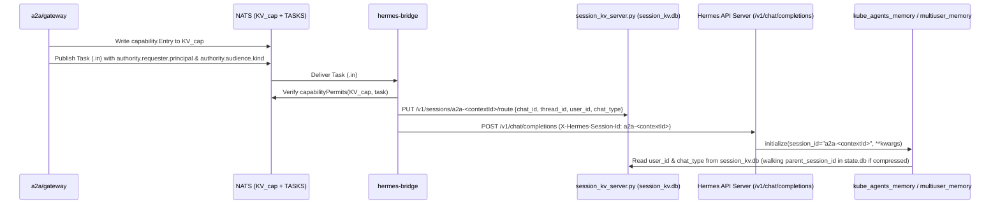
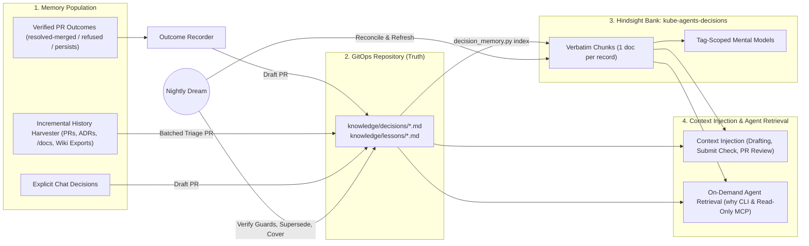
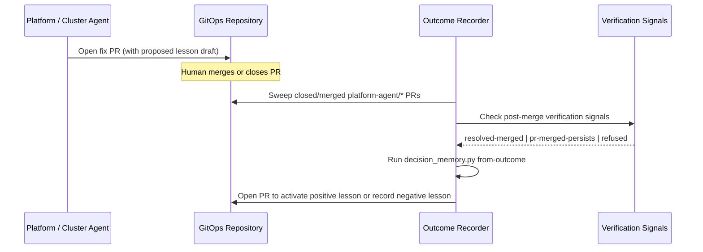

# Memory

## Summary

An agent that runs an enterprise fleet accumulates two kinds of durable knowledge:

1. **Conversational and organisational facts** — who owns a control, user preferences, and team conventions stated in chat (`kube-agents-memory` and `multiuser_memory`).
2. **Infrastructure decisions and operational lessons** — why a workload setting or cluster policy exists, which pull request and incident established it, and which machine-checked guard prevents a repeat outage (`knowledge/decisions/*.md`, `knowledge/lessons/*.md`, and `kube-agents-decisions`).

Hermes ships a single-user file-based memory for conversational facts. At fleet scale it does not hold: left unbounded it consumes most of the model's context window on every turn ($110,907$ tokens at $1,414$ records), and bounded to the size Hermes allows ($2,200$ characters) it holds about seven records. Meanwhile, conversational memory alone learns only from chat turns: it ignores the operational loop (`troubleshoot -> PR -> merge -> verified resolution`), paraphrases text during observation consolidation ($11$ of $12$ recall misses strip the record ID), and ranks superseded policies alongside active ones ($0.407$ contamination). And under `spec.mode: next`, `hermes-bridge` previously passed no user identity or conversation kind to Hermes `api_server`, breaking per-user memory isolation.

This document specifies the unified long-term memory architecture across both `spec.mode: today` and `spec.mode: next`:

- **Layer 1 — Conversational Memory (`kube-agents-memory` and `multiuser_memory`):**
  - Retrieval-backed memory on Hindsight (`kube-agents-memory`) decouples context cost from corpus size ($4,264$ tokens vs $110,907$ tokens at $1,414$ records).
  - In `spec.mode: next`, `hermes-bridge` reads the gateway-verified `authority.requester.principal` (`hmac:<32-hex>`) and `authority.audience.kind` (`"dm"` | `"group"`) from the task's `.in` submission envelope after capability verification and records them on the session route in `session_kv_server.py`. Both memory providers resolve `user_id` and `chat_type` from `session_kv.db` with zero Hermes source patches.
  - Five explicit session attribution states (`attributed-dm`, `unattributable-shared`, `unattributable-interactive`, `unattended`, and `read-only`) ensure that missing identity on a human turn fails closed, refuses unqualified writes, and never leaks across users or into `scope:shared`.
- **Layer 2 — Decision and Lesson Memory (`knowledge/` + `kube-agents-decisions` + `decision_memory.py`):**
  - Git is the source of truth: decisions (`knowledge/decisions/DEC-*.md`) and lessons (`knowledge/lessons/LES-*.md`) live in the GitOps repository as Operational Knowledge Format (OKF) files with `scope`, `evidence`, `supersedes`, and optional machine-checked `guard.expect` blocks.
  - Memory populates from verified PR outcomes, a 2-hour day-one bootstrap across GitHub, GitLab, and Bitbucket (`vcs_client.py`), and explicit chat decisions.
  - `decision_memory.py check` runs deterministically in $< 100\text{ ms}$ inside `submit-suggestion` and CI with zero LLM calls, while Hindsight indexes records as verbatim chunks (`enable_observations: false`) for semantic recall.
  - Across $10$ causal outage scenarios on a $500$-cluster enterprise GitOps repository, Decision Memory improved action accuracy from $10\%$ (baseline `kube_agents_memory`) and $90\%$ (live Git/GitHub rescanning at $2.39\times$ token cost) to **$100\%$** with **$0$ repeat-outage PRs** and **$100\%$ historical PR/issue citations**.

**Status:** Conversational memory (`kube_agents_memory` and `multiuser_memory`) is implemented on the Chat Agent and Platform Agent profiles; the `decision-memory` skill and `decision_memory.py` CLI are implemented in `agents/platform/skills/decision-memory/`. Open follow-ups are in [What is still unproven](#what-is-still-unproven).

| Layer                             | Where it lives                                                                                                                                             |
| --------------------------------- | ---------------------------------------------------------------------------------------------------------------------------------------------------------- |
| The Hindsight chat provider       | [`agents/chat/plugins/memory/kube_agents_memory/`](../../agents/chat/plugins/memory/kube_agents_memory/)                                                   |
| The lighter file alternative      | [`agents/chat/plugins/memory/multiuser_memory/`](../../agents/chat/plugins/memory/multiuser_memory/)                                                       |
| The `mode: next` route store      | [`a2a/hermes-bridge/route.go`](../../a2a/hermes-bridge/route.go), [`agents/platform/scripts/session_kv_server.py`](../../agents/platform/scripts/session_kv_server.py) |
| The decision memory CLI & skill   | [`agents/platform/skills/decision-memory/`](../../agents/platform/skills/decision-memory/SKILL.md) (`scripts/decision_memory.py`)                          |
| The pre-PR submission gate        | [`agents/platform/skills/submit-suggestion/scripts/submit_suggestion.py`](../../agents/platform/skills/submit-suggestion/scripts/submit_suggestion.py)     |
| Which chat provider an install gets | `install.sh --memory=`, carried as `spec.harness.memory.provider` — see [Choosing a provider](#choosing-a-provider)                                      |
| Its recall settings               | [`agents/chat/defaults/hindsight/config.json`](../../agents/chat/defaults/hindsight/config.json)                                                           |
| Its endpoint                      | `HINDSIGHT_API_URL`, derived from the namespace in [`platformagent_manifests.go`](../../k8s-operator/internal/controller/platformagent_manifests.go)       |
| The two pods                      | [`k8s-operator/config/integrations/hindsight/`](../../k8s-operator/config/integrations/hindsight/README.md)                                                |
| Scope rules for the model         | [`agents/chat/SOUL.md`](../../agents/chat/SOUL.md) §1.6                                                                                                    |
| The scale experiment              | [`tests/memory-scale/`](https://github.com/dshnayder/kube-agents/blob/experiment/memory-scale-ab/tests/memory-scale/README.md) (archive branch, see below) |

The conversational scale experiment is about a megabyte of corpus fixtures, job
manifests and raw scorer output. It is kept out of this repository so the
shipped tree carries only design and code, and lives on the
[`experiment/memory-scale-ab`](https://github.com/dshnayder/kube-agents/tree/experiment/memory-scale-ab/tests/memory-scale)
branch of the fork — the same commit as this change, so the harness runs against
exactly the code described here. Every link below into `tests/memory-scale/`
points there.

## How to read this document

Each section goes a level deeper than the one before it, so a human reader can
stop as soon as they have what they came for. An agent should read all of it.

| Section                           | Audience                                              | What it gives you                                                                                               |
| --------------------------------- | ----------------------------------------------------- | --------------------------------------------------------------------------------------------------------------- |
| [Why](#why)                       | Engineering leads, product managers, senior engineers | Enterprise adopter expectations, operational capabilities unlocked, and why pre-analyzed memory beats live scan |
| [Background](#background)         | Engineers familiar with `kube-agents`                 | What Hermes ships, why external providers were filtered to Hindsight, and where chat-only memory falls short    |
| [The decision](#the-decision)     | Architects and tech leads                             | The scale argument for Hindsight and the two-layer split between conversational memory and Git-backed decisions |
| [The design](#the-design)         | Implementers and AI agents                            | Conversational scoping, `mode: next` identity & 5 session states, OKF decision/lesson memory, and `decision_memory.py` |
| [The experiment](#the-experiment) | Evaluators and operators                              | Part 1: 1,664-record retrieval ladder; Part 2: 500-cluster 3-arm A/B evaluation of Decision Memory              |

---

## Why

### Enterprise adopter expectations and needs

Enterprise platform teams managing tens of mega-clusters and thousands of workloads report three recurring memory failures:

1. **Per-user context is lost or cross-contaminated across chat modes.** Engineers expect the agent to remember their personal preferences in direct messages, refuse personal memory in shared group spaces, and maintain strict per-user isolation under both `spec.mode: today` and `spec.mode: next`.
2. **Engineers or agents undo a protective fix.** An engineer or agent changes a memory limit, `PodDisruptionBudget`, resource quota, or node pool setting to reduce cost. Because no record links that setting to the outage it fixed, the outage returns.
3. **Engineers or agents repeat a failed fix.** A team or agent proposes a change that reviewers previously rejected or that failed in production. Without a record of the negative outcome, the organization repeats the failed change.

From these pain points, enterprise adopters defined seven requirements for long-term memory:

| Adopter expectation                     | Operational requirement                                                                                                                                         |
| --------------------------------------- | --------------------------------------------------------------------------------------------------------------------------------------------------------------- |
| **Isolate personal vs. shared memory**  | Keep personal preferences strictly private per user in DMs across `today` and `next`, and fail closed when speaker identity cannot be attributed.               |
| **Explain past rationale**              | Answer _"Why is X configured this way?"_ with the exact decision ID, the pull request URL, and the approver.                                                    |
| **Day-one "first two hours" bootstrap** | Scan the past 2 years of repository pull requests within 2 hours of onboarding and produce a baseline "state of being" for the environment.                     |
| **Triage history at scale**             | Scan years of past pull requests, `/docs` folders, and external wikis incrementally. Separate active rules from superseded, rejected, or anachronistic changes. |
| **Resolve contradictory PRs**           | When one pull request accepted a change and another rejected or reversed it, apply deterministic precedence rules instead of similarity ranking.                |
| **Learn from agent actions**            | Capture lessons automatically when an agent fix pull request merges and resolves the issue, or when a fix fails or is rejected.                                 |
| **Prioritize relevance over recall**    | Surface records only when they apply to the target files or question. Avoid noisy recall that distracts the model.                                              |

### Operational impact: what the agent can do that it could not do before

| Capability                                        | Without unified memory                                                                                                                  | With unified memory (`kube-agents-memory` + `decision-memory`)                                                                                      | Measurable eval / operational impact                                                                               |
| ------------------------------------------------- | --------------------------------------------------------------------------------------------------------------------------------------- | --------------------------------------------------------------------------------------------------------------------------------------------------- | ------------------------------------------------------------------------------------------------------------------ |
| **1. Isolate personal memory in `mode: next`**    | `hermes-bridge` drops user identity; `multiuser_memory` shares one `"default"` file across all users, and `kube_agents_memory` treats DMs as unattended. | `hermes-bridge` records gateway-attested `user_id` (`hmac:<32-hex>`) and `chat_type` in `session_kv`; providers enforce 5 explicit session states. | $0$ cross-user memory leaks; $0$ silent drops on human `"Remember: ..."` requests in `mode: next`.                 |
| **2. Learn from yesterday's trajectories**        | Every run starts stateless. On task `b-0011`, the agent proposed the same invalid quota increase in 4 separate runs.                    | Verified outcomes (`resolved-merged`, `pr-merged-persists`, `refused`) produce scoped `LES` records with deterministic guards.                      | Two-trajectory eval: run 2 achieves $0$ repeat bad fixes after run 1's fix is refused or fails verification.       |
| **3. Block regressions on human and agent PRs**   | Neither CI nor the agent checks diffs against past incident fixes. Engineers accidentally revert protective settings during cost tuning. | `decision_memory.py check` runs in the submission tool path and in pull request CI, blocking any change that violates an active guard.              | $100\%$ of guarded regressions are intercepted before merge with the exact historical PR citation.                 |
| **4. Onboard a 2-year repo in 2 hours**           | A newly installed agent has zero historical context until humans manually state facts in chat.                                          | `decision_memory.py bootstrap --since 2y` triages 2 years of PRs and docs in under 2 hours into a `STATE_OF_BEING.md` baseline and initial records. | Day-one agent answers rationale queries across 2 years of GCP and Kubernetes history immediately after onboarding. |
| **5. Answer "why" with verifiable provenance**    | Observation consolidation paraphrases text and drops record IDs in $11$ of $12$ recall misses (`id_stripped`).                          | Records live in git and index as verbatim chunks (`enable_observations: false`), preserving every ID, quantity, and PR URL.                         | $0$ `id_stripped` citation misses; every rationale answer links to the approving PR and commit.                    |
| **6. Detect silent drift and graduate to policy** | Superseded rules stay in memory ($0.407$ contamination), and out-of-band edits silently break past decisions.                           | Nightly `dream` runs flag `at_risk` records the morning after a breaking change and propose `policy/` admission rules for recurring lessons.        | $0.000$ superseded contamination on active recall; recurring failure classes graduate to API-server enforcement.   |

### Why remember decisions in long-term memory instead of rescanning the repository each time?

A natural question is whether the agent needs pre-analyzed decision memory when `git log`, pull requests, and issues already exist in the repository.
We tested this hypothesis directly in the 500-cluster benchmark (`Arm A+` vs `Arm B`; see [Part 2 of The experiment](#part-2-end-to-end-ab-evaluation-of-decision-memory-on-a-500-cluster-gitops-repository)).
Pre-analyzing and storing decisions outperforms live per-request repository scanning across quality, token cost, and latency:

| Dimension                         | Rescan repository on each request (`Arm A+`)                                                                                                                                                                          | Remember decisions in long-term memory (`Arm B`)                                                                                                                                                         | Measured advantage (`Arm B` vs `Arm A+`)                                                                    |
| --------------------------------- | --------------------------------------------------------------------------------------------------------------------------------------------------------------------------------------------------------------------- | -------------------------------------------------------------------------------------------------------------------------------------------------------------------------------------------------------- | ----------------------------------------------------------------------------------------------------------- |
| **Response quality and accuracy** | **Blind to unmerged rejected PRs and cross-file fixes ($90\%$ accuracy).** `git log <file>` has zero commits from rejected PRs (`BB-02`), and `vcs.py list` defaults to `--state open` and caps at $30$ results.      | **Captures the full causal graph ($100\%$ accuracy).** Bootstrap indexes closed/rejected PRs, cross-file fixes, and `supersedes` chains once, and `submit-suggestion` enforces guards deterministically. | **$+10\text{ pp}$ accuracy ($0/9$ vs $1/9$ repeat-outage PRs)**; survives $2,000\text{+}$ PR repos.         |
| **Token cost**                    | **High and scales with repository history ($130,519$ median / $233,348$ max uncached input tokens).** Dumping `git log` and PR/issue JSON into the context window every turn re-bills those tokens across $10$ turns. | **Bounded and constant ($66,734$ median uncached input tokens on standard path).** Local Python evaluates the guard at $0$ LLM token cost and injects only the matched record ($\approx 500$ tokens).    | **$-41\%$ to $-49\%$ uncached input tokens** in a $33\text{-PR}$ repo (orders of magnitude at $2\text{y}$). |
| **Latency and API load**          | **Slow and rate-limited ($4\text{–}8$ forge API CLI calls, $+15\text{–}35\text{ s}$ scan overhead).** Every change task clones history and queries remote PR and issue endpoints over the network.                    | **Sub-second local check ($< 100\text{ ms}$, $0$ forge API calls).** `decision_memory.py check` evaluates YAML and regex invariants directly against the local git checkout before push.                 | **$< 100\text{ ms}$ check vs $15\text{–}35\text{ s}$ network scan**; $0$ forge API rate-limit usage.        |

---

## Background

### Why the agent needs memory at all

An agent that answers questions about a fleet has to know things nobody will
restate for it in the prompt: which architecture decision is current, which version
of a retention policy still applies, who owns a control, which cluster is the
exception to the rule everyone else follows. None of that is derivable from the
cluster — it is organisational knowledge, and it accrues.

### What Hermes gives you by default

A built-in file memory (`tools/memory_tool.py`): two Markdown files under
`$HERMES_HOME` — `MEMORY.md` and `USER.md` — entries separated by `§`, read once
and injected into the system prompt as a **frozen snapshot at session start**, so
mid-session writes hit disk without moving the prompt or spoiling the prefix
cache. It is **bounded** (2,200 and 1,375 characters) and **single-user**: there
is no `user_id` anywhere in it. The bound is the subject of
[the decision](#a-file-store-is-bounded-or-it-eats-the-window).

### The plugin providers

Exactly one external provider may register at a time (`agent/memory_provider.py`;
`MemoryManager` rejects a second). Eight ship in `plugins/memory/`:

| Plugin        | Shape                                        | Multi-user support               |
| ------------- | -------------------------------------------- | -------------------------------- |
| `hindsight`   | Self-hostable document store + consolidation | Tag scoping (`scope`, `user_id`) |
| `honcho`      | Self-hostable, per-peer conversation memory  | First-class peers, dyadic reads  |
| `mem0`        | Cloud, self-hosted server, or in-process OSS | `user_id` only — no shared scope |
| `retaindb`    | Hosted                                       | `user_id` throughout             |
| `openviking`  | Hosted, tenant-scoped                        | Tenants and namespaces           |
| `byterover`   | Hosted                                       | Minimal                          |
| `supermemory` | Hosted                                       | Minimal                          |
| `holographic` | Local HRR experiment                         | None                             |

Self-hosting is highly desired — the corpus is a bank's internal fleet topology,
ownership map and incident history, and a hosted provider puts all of it outside the
customer's boundary. That alone does not narrow the field to one. `mem0` self-hosts,
either as a server over HTTP or in-process against pgvector, and `honcho` self-hosts
as a container set the plugin will talk to over a configured `baseUrl`
(`plugins/memory/honcho/config_schema.py`). Two other requirements narrow it, and
they eliminate both.

**An embedder you have to supply.** `mem0`'s in-process mode requires an `embedder`
section and accepts exactly two providers for it, `openai` and `ollama`
(`plugins/memory/mem0/_oss_providers.py`). `honcho` is stricter still: its
`EmbeddingTransport` is `Literal["openai", "gemini"]` (`src/config.py`) with no
in-process option at all, and turning embeddings off with `EMBED_MESSAGES=false`
does not degrade search gracefully — it skips the semantic branch entirely
(`src/utils/search.py`) and leaves keyword matching. Either therefore means
declaring a second model, an embedding model, in LiteLLM — which this project does
not do, since LiteLLM carries only the model the installer defines — or running a
second inference server.

The transport list is a constraint on the customer as much as on us. It admits an
OpenAI-compatible `base_url` override, but nothing outside those two wire formats:
an install standardised on Anthropic has no embedding API to point at, and one on
Bedrock, Azure or an in-house embedder has to front it with a compatible shim
first. `hindsight` embeds and reranks in-pod from models baked into the image
(`HF_HUB_OFFLINE=1`, `TRANSFORMERS_OFFLINE=1`), and asks LiteLLM for one model, the
installer's — so the customer's choice of provider is a question the memory store
never asks.

**One principal per read.** `mem0`'s recall filters on `user_id` alone — "scoped to
user_id only — by design", `plugins/memory/mem0/__init__.py`. `honcho` has richer
identity than either of the others — peers are first-class and the plugin resolves
the gateway identity to one natively — but every read is scoped to a perspective:
search filters on `peer_perspective`, and conclusions are dyadic, one observer's
view of one target peer (`plugins/memory/honcho/session.py`). Neither offers an
organisation-wide bucket a read can include, which is the half of the problem this
document is about: a specialist spawned without a human identity would have nothing
to read at all.

Note what that does to the argument that `honcho` needs no wrapper. Its native
tenancy is real, and for per-user isolation alone it would need nothing from us.
But per-user memory _and_ an org-wide corpus is the requirement, and the second
half has no native form: it would have to be a synthetic organisation peer that
every real peer observes and that identity-less specialists read as, plus the code
to keep writes flowing to the right one of the two. That is a wrapper, sitting on
top of a plugin that is already 7,096 lines — and a stranger one than tags, because
it encodes org knowledge as one fictional peer's beliefs inside a model built for
beliefs _about_ peers.

So `hindsight` is the only entry that is self-hostable, multi-user, **and** able to
embed without new infrastructure — the one candidate that does not trade one of those
against the others. Two smaller differences point the same way: `honcho` self-hosts
as four workloads against Hindsight's two, and the two that are its own code — the
API and the background deriver, both built from the `plastic-labs/honcho` tree —
are AGPL-3.0 where Hindsight is MIT. The other two are stock images, `pgvector` and
`redis`. A copyleft licence on a service the customer runs inside its own boundary
is a question their legal review will ask.

What the extra workloads do _not_ buy is a better database story. `honcho` runs one
`pgvector` service behind one volume, exactly as this does; its `redis` adds a second
stateful component rather than removing the first. Single-instance Postgres is a
property of both, and of anything else Postgres-backed — an availability question
answered by ordinary Postgres HA, not by the choice of memory provider.

#### What survives if `honcho` gets the wrapper

Every ground above is a property of `honcho`'s shape, so the obvious rebuttal is to
build the wrapper and answer all of them at once. `honcho` was therefore self-hosted
and run against the same 26 probes and the same 1,664-document corpus at an equal
context budget —
[full results](https://github.com/dshnayder/kube-agents/blob/experiment/memory-honcho-ab/tests/memory-scale/honcho/RESULTS.md).
Grant the wrapper, and one finding survives it.

**Superseded content.** On the message-search surface the plugin's `honcho_search`
uses, `honcho` put a retired value in front of the model on _every_ procedural probe
at the largest rung — contamination 1.000 against `hindsight`'s 0.000. The cause is
structural, not a tuning gap: consolidation deletes retired content at write time, so
`hindsight` cannot return what is no longer there, while in `honcho` a retired runbook
is still a message and still a legitimate hit. Scoping does not touch that, and a
`dream` is not expected to either — dreams consolidate conclusions, and a conclusion
does not unwrite the message that search reads. For a fleet agent this is the
governing failure mode, because the wrong answer to "what is the current runbook" is
a previously correct one.

Two costs the a-priori argument did not predict point the same way: derivation is
asynchronous, so a fact is not queryable for minutes after it is written, where
`hindsight` pays that cost inline at write; and embedding every _query_ puts LiteLLM
in the read path rather than only the write path.

One result goes the other way, and it is a real gap rather than a rounding error.
`honcho` returns messages verbatim, so a document identifier always survives into the
context; `hindsight` paraphrases and drops the identifier in 37 of 82 units, which is
why its measured gold recall understates what it actually retrieved. That argues for
provenance metadata on `hindsight` units, not for a different store.

### `multiuser_memory`, the provider this displaces

This repository already carried its own provider
([`agents/chat/plugins/memory/multiuser_memory/`](../../agents/chat/plugins/memory/multiuser_memory/)):
one Markdown file per user under `memories/users/<id>.md`, one shared
`memories/MEMORY.md`, and `system_prompt_block()` concatenating both into the
prompt.

It isolated users correctly — **zero tag leaks** at every corpus size. What it
originally lost in the port from the built-in was everything the built-in does
that the file format does not show: the file-level character bound, the file
lock, the external-drift guard, the prompt-injection scan, and the frozen
snapshot. Prompt-injection scanning and entry-level length bounds were later
restored, but the store-level capacity bound remains absent. A lookalike is
indistinguishable from its reference right up until one of the invisible
behaviours is needed. That capacity bound is what this document is about.

**It stays in the tree**, as the choice for an install that will not run a
database for memory. Everything below argues that a file store does not hold at
fleet scale, and none of it argues that a file store is wrong for a fleet of five
clusters and three people. What it costs to run is nothing; what it costs to use
is the whole store in the window on every turn, which is affordable exactly as
long as the store is small. Which provider an install gets is the operator's
choice, not this document's — see
[Choosing a provider](#choosing-a-provider).

---

## The decision

Every load-bearing number below is measured in [the experiment](#the-experiment)
or arithmetic on two measured quantities. Anything unmeasured is labelled and
carries no weight.

### The fleet the memory has to serve

The A/B ran against a synthetic bank's platform team: **500 GKE clusters and two
years of accumulated decisions.** 1,664 records, of which **1,414 are shared**,
across eleven families — architecture decisions, runbooks, postmortems,
conventions, deprecations, ownership, exceptions, gotchas, capacity, migrations,
inventory. Six policies exist in three dated versions each, 55 records are
exceptions contradicting the rule they name, and the inventory disagrees with
itself about the same clusters ([What was built](#what-was-built)).

That shape is the problem, not the volume. 443,196 characters is a third of a
novel. But it is knowledge nobody restates in the prompt, it is contested, and it
only accrues — and any real fleet of that size looks like it after two years.

### A file store is bounded, or it eats the window

Hermes bounds its file memory in source — `MemoryStore.__init__` in
`tools/memory_tool.py` — at **2,200 characters** for `MEMORY.md` and **1,375** for
`USER.md`, as admission control on writes: a write that would exceed the limit is
refused, and the model is told to consolidate and retry.

That bound is load-bearing. **Nothing else in a file store ever removes an
entry** — no eviction, no TTL, no relevance filter, no compaction. Admission
control on total store capacity is the sole mechanism keeping the file a summary
rather than an append-only log. [`multiuser_memory`](#multiuser_memory-the-provider-this-displaces)
lost that store-wide bound in the port (bounding per-entry length and entry count
instead), so the file arm the experiment measured is a defect rather than a
configuration anyone would choose.

**Unbounded, memory is 55% of the window before the user speaks.** The store is
concatenated into the system prompt at session start, on every turn: 443,196
characters ≈ **110,799 tokens** against Opus 5's 200k. What must share the rest,
measured from this repository at `TOK_PER_CHAR = 0.25` — the Chat Agent's persona
is 7,061 tokens, the Platform Agent's seventeen skill bodies 25,358, then Hermes'
base prompt, the tool schemas and the conversation itself. The window exhausts at
roughly **2,600 records** with all of that at zero, and delegation is already
impossible: Chat Agent → specialist → cluster agent is `3 × 110,799 = 332,397
tokens`, **1.66 windows of memory alone**.

**Bounded, it holds about seven records of 1,414.** 2,200 of 443,196 characters is
**0.50% of the corpus**; at the corpus mean of 313 characters per record, roughly
**seven records** for about 550 tokens a turn. No recall figure is reported for
this arm and none is needed — a measurement would describe one consolidation
strategy, while the capacity bound holds for _every_ strategy including a perfect
one. An upper bound of 0.50% is the stronger claim.

Raising the ceiling does not escape the trade, because **the tax _is_ the file,
injected whole**. The two settings are one curve read at two points, exchanging
recall for window one for one. There is no setting of a file store that is both
affordable and complete.

### Why retrieval is the way out

Both settings pay for the whole corpus on every turn, because both decide what the
model sees at **session start** — before the question exists. Any given question
needs a handful of records, and which handful is unknowable until it is asked.

So stop injecting the store and start searching it: pay for the corpus once, in
storage, and per turn only for what the current question needs. Storage grows with
the fleet; context does not. That is retrieval, and of the eight plugin providers
only Hindsight is both self-hostable and multi-user.

**The same conclusion, reached independently.** A separate internal agent platform —
Google's hosted agent — uses a similar architecture for the same reason: a file
loaded whole on every turn wastes tokens and degrades as it grows. The two designs match mechanism for mechanism — one document per memory
rather than one file for all of them, embedding search putting only the relevant few
into the current turn, the agent writing its own observations as it works, and a
nightly consolidation pass that merges duplicates, resolves contradictions between
older and newer observations, and prunes what has stopped earning its place. They
diverge on one point, instructively: theirs serves a single engineer and needs no
scope model at all, where a shared fleet agent needs
[one bank and two scopes](#one-bank-two-scopes). This is corroboration and not
evidence — none of it is measured on this corpus and no number here depends on it.
What it establishes is that the failure being designed around is not an artefact of
this repository's file provider.

### How Hindsight answers it

Hindsight is a document store with an LLM consolidation layer in front of it.
Writes go in as _facts_; a background pass consolidates them into _observations_;
recall does semantic search over the observation layer and returns a
**budget-bounded** set of results, injected into the **current turn** rather than
into the system prompt.

It has every mechanism this needs except one: no way to learn who is speaking. So
the provider here is a slim wrapper, [`kube_agents_memory`](#the-design), which
resolves the gateway identity and stamps `user:<id>` on a personal write and
`scope:shared` on a deliberate shared one, then asks recall for
`[user:<id>, scope:shared]` and nothing else. One bank holds every user's memory
and the fleet's; the tags keep them apart. Everything else is stock, so a
base-image bump brings upstream fixes with no port to redo. Detail in
[the design](#the-design).

The store therefore holds everything and the window carries only what the turn
needs — context cost decouples from corpus size:

| Provider   | Rung | Gold recall | Contamination | Current ranked first | Context tokens |
| ---------- | ---: | ----------: | ------------: | -------------------: | -------------: |
| Hindsight  |  100 |       0.718 |         0.407 |                0.833 |          4,588 |
| Hindsight  |  200 |       0.718 |         0.407 |                0.833 |          4,544 |
| Hindsight  |  400 |       0.718 |         0.407 |                0.833 |          4,468 |
| Hindsight  |  800 |       0.718 |         0.407 |                0.833 |          4,322 |
| Hindsight  | 1414 |       0.702 |         0.407 |                0.833 |      **4,264** |
| File-based |  100 |       1.000 |         0.722 |                0.429 |         13,780 |
| File-based |  200 |       1.000 |         0.722 |                0.429 |         24,661 |
| File-based |  400 |       1.000 |         0.722 |                0.429 |         46,633 |
| File-based |  800 |       1.000 |         0.722 |                0.429 |         79,616 |
| File-based | 1414 |       1.000 |         0.722 |                0.429 |    **110,907** |

The file column grows 8× across the ladder; the Hindsight column **shrinks**
(4,588 → 4,264) as consolidation compresses. That divergence, not any single row,
is the result. Retrieval also buys ranking and provenance: contamination —
superseded or out-of-scope material in the window — is **0.407 against 0.722**, the
current version of a contested policy arrives first **83.3%** of the time against
**42.9%**, and because a document store carries identifiers out-of-band instead of
hoping they appear in prose, **964 distinct corpus identifiers** sit on retrieval
labels against 193 reachable in the file.

### What is adopted

**Hindsight becomes the Chat Agent's default memory provider**. Default, not only:
the argument above is about fleet scale, and an install that is not at fleet scale
can still choose the file store or no memory at all
([Choosing a provider](#choosing-a-provider)). What the default settles is which
way an install goes when nobody has an opinion, and everything from here on
describes that path.

---

## The design

One Hindsight bank, `kube-agents-memory`, behind a slim wrapper around the stock
Hindsight provider. Every memory carries a scope tag; the wrapper's entire job is
to resolve the current human's identity into the right tags and pin the four
settings that would otherwise leak or silently lose data.

### Choosing a provider

**Which one to pick, in one line each.** `multiuser_memory` for a small or personal
deployment: it costs nothing to run and holds everything verbatim, and the whole
store rides in the context window on every turn, so it is bounded by the window
rather than by disk. `kube_agents_memory` for an enterprise fleet: it retrieves
only what a question needs, so the per-turn cost barely moves as the corpus grows,
and it pays for that with an API server and a Postgres database. The number that
separates them is measured in [the experiment](#the-experiment) — at fleet scale
the file store is 55% of the window before the user has spoken, while retrieval
answered the same questions from a small fraction of it. Below the bound there is
nothing to buy: a handful of clusters and a handful of people will not reach it,
and a database there is cost without a benefit.

**Memory is on by default, and `multiuser_memory` is what it means.** An install
that says nothing about memory gets the file store; `--memory=hindsight` steps up
to ranked recall and the two workloads behind it, and `--memory=off` retains
nothing. Two things decide the default, and they point the same way.

The first is that the cheap thing here is not free. An agent that forgets every
conversation makes the same person re-state the same context indefinitely, and
that is the cost paid by every install that never found the flag — so the default
is a store, not `off`.

The second is backward compatibility, and it is what picks _which_ store. The file
store is what this repository shipped before `kube_agents_memory` existed. Every
place a default is taken is a place something older is being read: an upgrade
re-running `install.sh` with no `--memory`, a CR written against the previous CRD
schema and reconciled by a newer operator, an install configuration from before
the memory question was prompted for. Defaulting those to ranked recall would grow
each of them an API server and a Postgres database nobody asked for, and would
point the agent at a Hindsight service the install never deployed. Taking a
default has to mean "keep what you have". An enterprise fleet that wants ranked
recall is in a position to say so, and `--memory=hindsight` is how. Consequently
`multiuser_memory` is the provider named wherever there is no install to ask — the
CRD default, `install.defaults.env`, and the Chat Agent's `config.yaml`. The specialist
profile names no provider at all, because a file store has no gateway identity for
a specialist to key on; see the overlay rule below.

The choice is made once, at install, and then carried by the CR. Four places have
to agree about it, and the reason they are listed together is that a disagreement
between any two of them is silent: the install still succeeds, and what is wrong
is either a database nobody asked for or a memory tool that never loads.

| Where                                      | What it holds                                                                  |
| ------------------------------------------ | ------------------------------------------------------------------------------ |
| `install.sh --memory=file\|hindsight\|off` | the question a human answers, also prompted interactively                      |
| `MEMORY` in `install.env`                  | the answer, as the mode the flag takes; `memory_provider_from_mode` maps it    |
| `spec.harness.memory.provider`             | the answer, on the CR — the only copy the running system reads                 |
| `MEMORY_PROVIDER` env on the pod           | the same value, for the entrypoint, which runs before `config.yaml` is in play |

`MEMORY_PROVIDER` is the only variable in that answer. The install also renders
`MEMORY_ENABLED` into the tfvars, and it is deliberately **not** consulted anywhere in the list
above: it switches on Hermes' own `MEMORY.md`/`USER.md`, a store with no per-user
scoping that each provider here replaces rather than supplements, so every install
this repository has ever written set it `false` while running a provider quite
happily. Deriving one from the other — reading a false `MEMORY_ENABLED` as "this
install wants no memory" — would switch off a working file store on the next
upgrade and strand every user's `USER.md`. Whether the agent remembers anything is
`MEMORY_PROVIDER`'s question, and `none` is how it answers no.

`file` maps to `multiuser_memory` rather than to Hermes' built-in file store,
because the built-in is gated by `memory_enabled`, and the operator disables the
`memory` toolset whenever that flag is on — an install choosing "files" would get a
`MEMORY.md` the agent could read and not write. `multiuser_memory` has real
per-user scoping and runs with `memory_enabled: false`, so the toolset gate stays
open.

`off` maps to **`none`**, not to an empty string. Hermes spells "no provider" as
`""`, but an empty string cannot survive the trip: an absent CR field takes the
kubebuilder default, so `""` round-trips back to `multiuser_memory`. The sentinel
is translated back to Hermes' spelling at the single point where `config.yaml` is
rendered — `resolveMemoryProvider` in
[`platformagent_manifests.go`](../../k8s-operator/internal/controller/platformagent_manifests.go).

Three things then read the choice rather than assuming it:

- **The chart's `hindsight.*` values render nothing** unless the provider is
  Hindsight-backed. That is the whole gate — `multiuser_memory` and `none` stand
  up no database, and switching the provider later is a matter of re-running the
  install (one `terraform apply` reconciles the store in or out). The dev copy
  behaves the same way through `make -C k8s-operator deploy-hindsight`.
- **The specialist profiles get a provider only if it is Hindsight-backed**, via
  the platform profile's overlay. Anything else is blanked there, because
  [what makes a specialist's memory safe](#what-subagents-get-shared-memory-read-only)
  is `read_only` plus tag scoping, and a per-user file provider has neither an
  identity to key on nor a read-only mode.
- **The one-way file import** below is gated the same way.

The dev-path undeploy (`make -C k8s-operator undeploy-hindsight`) is deliberately
**not** gated. Undeploy is idempotent, and a gate there would orphan the workloads
of any install that changed its provider after the fact.

### The two pods

Hindsight is self-hosted in-cluster, rendered by the chart's `hindsight.*` values from the same manifests kept in
[`k8s-operator/config/integrations/hindsight/`](../../k8s-operator/config/integrations/hindsight/README.md).
It adds exactly two workloads to `kubeagents-system`.

**1. `hindsight-api` — a `Deployment`, one replica** (`api.yaml`).

- Image `ghcr.io/vectorize-io/hindsight-api:0.10.2`, pinned by digest. The pin
  lives in `images.json` at the repository root and the manifest takes it as a
  variable, so a mirrored install can point it at an approved registry.
- Serves HTTP on **8888** behind a ClusterIP `Service` of the same name;
  `/health` backs all three probes. Model loading dominates cold start, so the
  budget for it sits in a **`startupProbe`**, and liveness and readiness do not
  run until that first succeeds. Before
  [#712](https://github.com/gke-labs/kube-agents/issues/712) a 30s liveness delay
  carried that budget instead, which put the third failure at t=50s and killed
  cold containers mid-load. The timings and the reasoning behind each are in
  `api.yaml`'s probe comment, which is canonical for them; any rollout wait on
  this Deployment is sized to cover a pull plus that budget.
- `HF_HUB_OFFLINE=1` and `TRANSFORMERS_OFFLINE=1`. The embedding and reranking
  models are baked into the image, so the pod needs **no Hugging Face egress** —
  and both flags must stay set, or the libraries reach out on every cold start and
  hang where there is no route out of the cluster.
- Extraction and consolidation call an LLM. That goes through the **same inference
  gateway the agents use** (`HINDSIGHT_API_LLM_BASE_URL=http://inference-gateway/v1`,
  model `model-default`), so routing and cost attribution stay in one place. The
  API key is the literal string `none`, matching how the agents authenticate;
  it is a placeholder the client library insists on, not a credential.
  `HINDSIGHT_API_LLM_TEMPERATURE=none` omits `temperature` from those calls.
  Hindsight would otherwise send one, and a model that refuses an explicit
  temperature answers 400 — which reaches the agent as
  `500 Fact extraction failed`, so memory records nothing at all rather than
  recording it badly. Which models refuse it is not knowable here, since the
  model is whatever the installer chose. It applies to all four operations,
  which is deliberate — any of them sending a temperature draws the same 400 —
  and each therefore falls back from a tuned value to the model's default:
  retain from 0.1, reflect from 0.9, consolidation and verification from 0.0.
  Consolidation writes the observations recall reads, so its dedup and delta
  passes stop being pinned; `HINDSIGHT_API_LLM_TEMPERATURE_RETAIN` narrows the
  omission to fact extraction where a model tolerates the rest.
  The gateway is the wrong place to fix this. `litellm_settings` is the only
  gateway-wide place to put it, and neither switch there does the job:
  `drop_params` drops what LiteLLM believes the provider rejects, and it
  believes Vertex Claude accepts `temperature`; `additional_drop_params` set
  there was measured against a live install and the retain still returned 400,
  because LiteLLM honours it in a model entry's `litellm_params` rather than
  globally. Per-model it would work, at the price of editing a config every
  agent request passes through in order to accommodate one caller. The chart
  has since paid that price for every caller on a Claude model: it renders
  per-model `additional_drop_params` for `temperature`, `top_p` and `top_k`
  ([inference gateway](../site/src/content/docs/concepts/inference-gateway.md#setting-the-default-model)).
  The `none` stays, for a model outside that test that refuses temperature.
- Requests 250m CPU/1Gi, limits 4 CPU/4Gi. The request covers steady state, reported at
  about 9m on a live install when the request came down from 2 CPU; the install and the
  sampling window were not recorded, so read it as an order of magnitude. The limit is
  the ceiling the reranker may burst to during recall, and raising it buys nothing — see
  [What a recall costs](#what-a-recall-costs). CPU above the request is best-effort, so
  on a node shared with other CPU-heavy tenants the request is the number to raise. An
  Autopilot cluster without Pod bursting sets the limit equal to the request, which caps
  recall at 250m until the request is raised.
  Runs non-root under a `RuntimeDefault` seccomp profile, no privilege escalation, all
  capabilities dropped; its root filesystem stays writable, and what the API writes
  under `/` has not been enumerated.

**2. `hindsight-postgresql` — a `StatefulSet`, one replica** (`postgresql.yaml`).

- The pg15 line of `pgvector/pgvector`, digest-pinned in `images.json` alongside the
  API image, because upstream rebuilds a version tag in place when the Postgres base
  is patched and a reschedule could otherwise move to a Postgres minor nobody chose.
  pgvector supplies the vector extension the embeddings need. `images.json` is also
  where the constraints on that tag are written, the pg15 line among them.
- **Bumping the image does not move the extension in a database that already
  exists.** Postgres records the version at `CREATE EXTENSION` and keeps it until
  someone runs `ALTER EXTENSION vector UPDATE`, so a fresh install gets whatever the
  image ships while an upgraded one stays where it was — an install created under
  the 0.5.1 image still reads `0.5.1` from `pg_extension` afterwards. Nothing here
  runs the update, and an un-updated extension keeps working: the upgrade scripts
  across this range only add objects, and the HNSW on-disk format is unchanged
  between the two versions, so the newer library serves the older declarations and
  reads the existing index. pgvector's own upgrade procedure does say to run the
  statement, so it is appropriate rather than forbidden. What it gates is mostly
  SQL-level additions Hindsight does not use — `halfvec` and `sparsevec` among them
  — but not only those: `vector--0.5.1--0.6.0.sql` sets `STORAGE = external` on the
  `vector` type, which stops Postgres compressing embeddings and does apply to the
  column Hindsight writes. At 384 dimensions that is 1,544 bytes, compressed only
  when the whole row crosses the TOAST threshold, so the effect here is small — but
  it is not nothing, and "nothing this deployment needs" would be too strong.
- **The library moves even when the extension does not, and that is the part you
  feel.** GUCs are registered by the shared library at load, not declared in the
  extension's SQL, so a new one appears as soon as a backend loads the new library —
  which the StatefulSet restart guarantees. `hnsw.iterative_scan` is the one that
  matters: Hindsight has defaulted `HINDSIGHT_API_ANN_ITERATIVE_SCAN=true` since 0.9
  and asks for it on every pooled connection. Without it an HNSW scan makes one ground-layer
  pass and ends when that pass is exhausted, which can happen before the query's
  `LIMIT` is met; with it the scan resumes in `ef_search`-sized rounds until the
  `LIMIT` is met or `hnsw.max_scan_tuples` is reached. Hindsight sets that ceiling to
  4,000 against pgvector's own default of 20,000, and both are tunable through
  `HINDSIGHT_API_ANN_*`. It needs pgvector 0.8.0, a higher floor than the 0.5.0
  Hindsight needs overall. Measured on a 20,000-row table at pgvector's default
  `ef_search=40` — the shipped recall path uses 200 and `strict_order` — a
  `LIMIT 500` query on a forced HNSW index scan returned 391 rows with the setting
  off and 500 with it on. Note that 391 is neither the `LIMIT` nor `ef_search`: how
  far a single pass gets is a property of the graph, so "capped at `ef_search`" is
  the wrong mental model even though Hindsight's own comments use it.
  `HINDSIGHT_API_ANN_ITERATIVE_SCAN=false` is the kill switch.
- **The switch lands on existing installs with no `ALTER EXTENSION`, no config
  change, and no API restart** — worth spelling out, because the API caches any GUC
  the server rejects in a process-wide set it never clears, which would otherwise
  mean a pod that had probed against the old library skipped the setting forever.
  That path is never taken: pgvector only began reserving the `hnsw.` prefix in
  0.6.0, so on 0.5.1 the setting was accepted all along as an inert placeholder
  rather than rejected, and Postgres applies a placeholder's value to the real
  variable the moment the library defining it loads. Upstream's comment on that
  branch says an older pgvector rejects the setting; that is true from 0.6.0 onward
  and not of the 0.5.1 this install is coming from.
- One 8Gi `ReadWriteOnce` volume from a `volumeClaimTemplate`. `PGDATA` points at a
  **subdirectory** of the mount, not the root: the RWO volume arrives with a
  `lost+found` entry and `initdb` refuses a non-empty data directory.
- Runs as uid 999, the image's `postgres` user, rather than letting the entrypoint
  start as root and drop to it, under a `RuntimeDefault` seccomp profile with no
  privilege escalation and all capabilities dropped. The root filesystem is read-only;
  the writable paths are `emptyDir`s at `/var/run/postgresql` (socket and pid, which
  the entrypoint's temporary init server and the readiness probe use) and `/tmp`, and
  `PGDATA` on the volume. `fsGroup: 999` with `fsGroupChangePolicy: OnRootMismatch`
  relabels a volume the old root entrypoint initialised once, the entrypoint's
  `chmod 700` on `PGDATA` keeps Postgres's data-directory mode check passing, and a
  fresh volume needs a storage driver that applies `fsGroup` (GKE's Persistent Disk
  CSI driver does). The comment on the StatefulSet in the chart template holds the
  full account; `tests/test_workload_security_context.py` pins the fields.
- **Passwordless** (`POSTGRES_HOST_AUTH_METHOD=trust`). It is reachable only from
  the API pod, holds nothing that is not already in the agent's context, and a
  password would have to be generated, agreed between two keys and rotated by
  someone. Note this is read by `initdb` once and written into `pg_hba.conf`;
  flipping it on an existing volume does nothing.
- A `NetworkPolicy` (`networkpolicy.yaml`) permits ingress on 5432 **only** from
  pods labelled as the API component. Ingress only — Postgres makes no outbound
  calls.

Deleting the Postgres PVC is a complete, safe reset of memory — see
[Bank provisioning is lazy](#bank-provisioning-is-lazy).

### How Hindsight itself works

Enough of the model to read the wrapper.

- **Bank.** The top-level container, addressed as
  `/v1/{tenant}/banks/{bank_id}`; this deployment uses tenant `default` and the
  single bank `kube-agents-memory`. A bank carries a **mission** (free text telling
  the extractor what this bank is for) and a **config** (retain strategies, default
  strategy, and so on). Note `PUT /banks/{id}` is both create and update — `POST`
  is 405 — and `PATCH /banks/{id}/config` wraps its payload as `{"updates": {...}}`.
- **Two layers.** A write lands in the **fact** layer. A background consolidation
  pass groups related facts into **observations** — the LLM-written synthesis layer.
  **Recall reads observations, not facts.** Everything about scoping, and the whole
  TTL problem below, follows from that one sentence. It is a default rather than a
  law: the plugin sends `types` on every recall from `recall_types`, which defaults
  to `["observation"]` and which this deployment does not set. Note the layer is
  _not_ what `memory_mode` selects — that is `context`/`tools`/`hybrid`, and it
  chooses whether memories arrive by injection, by tool call, or both.
  Querying the API directly without `types` returns both layers, so a probe that
  bypasses the plugin will not show you what the agent sees.
- **Retain strategies.** Named bundles of extraction settings selected per write.
  A missing strategy is _not_ an error — `apply_strategy` logs a warning and
  silently falls back to the bank default — so callers that depend on one must
  check for it themselves.
- **Tags and `observation_scopes`.** Facts carry tags. `observation_scopes`
  controls how the consolidator groups them, which is a separate decision from how
  recall filters them.
- **Three operations.** `retain` writes; `recall` does semantic search and returns
  matching units; `reflect` asks the LLM to synthesise an answer across the bank
  rather than return individual matches. All three take a **budget**
  (`low`/`mid`/`high`) that bounds how much comes back — this is the mechanism that
  makes context cost independent of corpus size.

#### What a recall costs

Everything measured here and in the section below was taken against the pgvector
0.5.1 library, which could not run iterative scans. That changes which units the
retrieval stages return, not how many the reranker scores — its input is bounded by
the recall budget, which the paragraphs below show this bank already saturates — so
the stage-4 cost these numbers are dominated by stands.

A recall is not a database query with a model bolted on; it is a model inference
with a database query in front of it, and the two differ by three orders of
magnitude. A live chat turn against the 4,427-unit bank:

```
[2] Parallel retrieval (1 fact_types): semantic=300(0.028s), bm25=84, graph=282(0.096s) ... 0.395s
[4] Reranking [cross-encoder]: 300 candidates scored in 14.195s (pre-filtered 220)
Complete: 52 facts (3750 tok) | 14.637s
```

Stage 4 is effectively all of it, and the reason is the kind of model it uses.
Stages 1–3 run a **bi-encoder**: every unit was embedded once at write time, the
query is embedded once, and ranking is arithmetic over vectors in an index — hence
300 semantic hits in 28 milliseconds. Stage 4 runs a **cross-encoder**, which
concatenates the query with one candidate and runs a full transformer forward pass
over the pair. It is much the better ranker, because the query's tokens attend to
the document's, and it is unbatchable across queries and uncacheable by
construction: the input does not exist until the query arrives and is different for
every candidate. `300 candidates scored` means 300 forward passes on CPU, inside the
request. Two concurrent recalls do not queue, they halve each other.

**A large bank is therefore felt as latency, not just as storage — but as a
threshold, not a slope.** A bank small enough that the tag filter cannot fill the
budget reranks only what it found, and is quick. Once it is large enough to fill the
budget, every question pays the full-size rerank, and growth past that point costs
almost nothing further. The live bank holds 4,427 units, of which the 1,595
observations are eligible — five times what the budget will take — and stage 2 still
finds candidates in 0.4s. Ten times the bank would rerank the same 300 pairs.

Two things follow. The user-visible symptom is a slow agent with nothing in the reply
to suggest memory is the reason, and it appears abruptly, at a corpus size in the low
hundreds rather than at any size worth calling large. And because the cost is flat
above the threshold, **bounding the bank does not fix it** — see
[Bounding the bank](#bounding-the-bank--built-deferred-and-not-urgent), which
is worth doing for context quality and storage, not for latency.

What does fix it is making stage 4 itself cheaper.
`HINDSIGHT_API_RERANKER_LOCAL_BUCKET_BATCHING` sorts candidates by length before
batching them, so a short candidate is no longer padded out to the longest one in
its batch. Hindsight ships it **off**, with a source comment reading
`opt-in, 36-54% speedup`. Enabling it in
[`api.yaml`](../../k8s-operator/config/integrations/hindsight/api.yaml) roughly
halved recall latency against the default on the agent's own path, and it costs
nothing: it changes how pairs are grouped, not how they are scored, and the same
query returns the same units before and after. No new dependency, no egress, no
model change, no loss of ranking quality.

Three other levers were measured and are not worth retrying. Raising the pod's CPU
limit from 500m/2 to 2/4 changed nothing — the quota _is_ read
(`hindsight_api/_thread_limits.py` sizes native pools from it), but an
`e2-standard-4` is two physical cores behind four hyperthreads, and threads sharing
a core share the vector units this work saturates. Dropping `recall_budget` from
`mid` to `low` bought 16% at the cost of narrowing what the reranker may choose
from, which is why the Chat Agent stayed at `mid` — see
[Where the connection settings come from](#where-the-connection-settings-come-from).
And `RERANKER_LOCAL_FP16` is documented as faster on MPS and CUDA, not on CPU.

The remaining knobs are untried: `RERANKER_LOCAL_BATCH_SIZE` (32),
`RERANKER_LITELLM_MAX_TOKENS_PER_DOC`, and `HINDSIGHT_API_RERANKER_PROVIDER`, which
can hand stage 4 to `litellm`, `cohere`, `openrouter` or a `tei` sidecar. The
`litellm` route would need a rerank model added to the LiteLLM config, which the
install script does not define — see
[`k8s-operator/config/integrations/litellm/base/config.yaml`](../../k8s-operator/config/integrations/litellm/base/config.yaml),
which deliberately declares `model-default` and nothing else. The local model is
already `cross-encoder/ms-marco-MiniLM-L-6-v2`, six layers, so shrinking it is not
the lever either.

#### A second pod buys throughput, not speed

Every lever above makes one recall cheaper. A second replica makes none of them
cheaper; it makes more recalls fit at once. That is the other axis, and it is the one
the CPU-limit null result points at. Measured on `kage-management` against the live
bank at `budget: mid`, twelve recalls per concurrency level, one run per
configuration, driven from an in-cluster Job so kube-proxy is in the path — a
`kubectl port-forward` binds one endpoint for the life of the tunnel and would have
measured a single pod twice:

| Concurrent recalls | 1 replica | 2 replicas    | p50: 1 → 2 replicas |
| ------------------ | --------- | ------------- | ------------------- |
| 1                  | 0.073 rps | 0.076 rps     | 13.6s → 13.2s       |
| 2                  | 0.087 rps | 0.096 rps     | 22.7s → 20.5s       |
| 4                  | 0.089 rps | **0.162 rps** | 44.1s → **22.8s**   |

At one replica, throughput is flat from concurrency 2 upward while latency rises
linearly — "two concurrent recalls halve each other" as a curve rather than a
sentence. The second replica returns 82% of a theoretical doubling at concurrency 4,
and aggregate CPU across the two pods was 3,600m against 1,830m for the single pod,
so the extra cores are working rather than idling behind the scheduler.

**This is the counterpart to the CPU-limit result above.** Raising the limit on one
`e2-standard-4` bought nothing because the node has two physical cores behind its
four hyperthreads; a pod on a _different_ node is the only way to add cores the
cross-encoder can use. Required pod anti-affinity is therefore load-bearing, not
hygiene — two co-scheduled replicas reproduce the null result.

Concurrency 2 gains only 10% because kube-proxy balances per connection, at random:
with two requests in flight both land on the same pod about half the time, which
predicts a p50 near 20.3s against the 20.5s measured. That is the production shape
too, since each agent turn opens its own connection.

Two things this does not buy. Single-user latency is unchanged — 13.2s against 13.6s
— so replicas add capacity, not speed. And a replica is not free of Postgres:
the Postgres image ships stock `max_connections = 100` while
`HINDSIGHT_API_DB_POOL_MAX_SIZE` defaults to 100 _per pod_, so one replica already
sits at parity with the server. The runs above pinned it to 40. Postgres itself never
participated, at 12–19m of CPU throughout.

The topology is supported rather than tolerated: the API runs the worker in-process
(`WORKER_ENABLED` defaults true), workers claim tasks with `SELECT … SKIP LOCKED`,
and startup migrations take a `pg_advisory_lock`, so replicas neither double-run
consolidation nor race Alembic.

[`api.yaml`](../../k8s-operator/config/integrations/hindsight/api.yaml) still ships
`replicas: 1`, and `kage-management` runs two by hand. Two replicas add a second
250m request, which fits almost anywhere, but the gain above came from the pods
sitting on different nodes: two replicas sharing one `e2-standard-4` share the two
physical cores the single-pod result already saturates, and a small cluster has no
second node to offer. Nothing in either manifest keeps the pair apart — neither carries
pod anti-affinity or a topology spread constraint — so on a cluster that does have a
second node the two replicas rely on the scheduler's default spreading, where a 2-CPU
request used to force the split. Read the 82% as the size of the effect rather than as a
figure to three digits: it is one run per configuration, and only the concurrency-4
row is outside the noise the random load-balancing introduces.

### One bank, two scopes

| Scope    | Tag            | Written by                             | Read by        |
| -------- | -------------- | -------------------------------------- | -------------- |
| Personal | `user:<id>`    | automatic capture, and `memory_retain` | that user only |
| Shared   | `scope:shared` | `memory_retain(scope="shared")` only   | everyone       |

`<id>` is the caller's user identity run through
`sanitize_user_id`, which produces `<readable>_<digest>`. The readable half
mirrors Hindsight's own `_sanitize_bank_segment`: non-alphanumerics collapse to
`-`, runs of `-` collapse to one, and leading or trailing `-`/`_` are stripped.
The digest is `sha256(raw)[:12]`, and it is there because the readable half alone
is lossy while the tag is the entire isolation boundary — identities are
email-shaped or HMAC-shaped, punctuation is what distinguishes many of them, and
`alice.smith@corp.example` and `alice+dev@corp.example`-style pairs otherwise
land on one tag and read each other's private facts. `multiuser_memory` guards
the same boundary the same way in its filenames. An empty identity produces an
empty string rather than a hash of nothing, which is what lets both providers fail
closed on personal memory; see
[`tests/memory/test_user_tag_isolation.py`](../../tests/memory/test_user_tag_isolation.py).
Recall asks for `[user:<id>, scope:shared]` with match mode `any_strict`, and
nothing else can come back.

One bank rather than one bank per user is a deliberate choice. Per-user banks make
shared knowledge either impossible or duplicated, and each bank carries its own
mission, config and consolidation state to keep in sync. Tags do the same job in
one place.

#### Identity propagation in `spec.mode: today` and `spec.mode: next`

Both `kube_agents_memory` and `multiuser_memory` must receive the caller's user identity (`user_id`) and conversation audience (`chat_type`: `"dm"` or `"group"`) at `initialize(session_id, **kwargs)` across both runtime modes:

| Runtime mode       | How chat turns enter Hermes                                                                 | How `user_id` and `chat_type` reach `initialize()`                                                                                                                                                                                             | Personal tag / file prefix (`sanitize_user_id(user_id)`)               |
| ------------------ | ------------------------------------------------------------------------------------------- | ---------------------------------------------------------------------------------------------------------------------------------------------------------------------------------------------------------------------------------------------- | ---------------------------------------------------------------------- |
| `spec.mode: today` | In-process Hermes platform adapter (`gateway/run.py`)                                       | Passed directly in `initialize(..., user_id=agent._user_id, chat_type=...)`.                                                                                                                                                                   | `<sanitized-email>_<sha12>`                                            |
| `spec.mode: next`  | `a2a/gateway` $\to$ NATS `a2a.tasks.chat.general.in` $\to$ `hermes-bridge` $\to$ HTTP `/v1` | `hermes-bridge` writes `user_id` and `chat_type` to `PUT /v1/sessions/a2a-<contextId>/route` on [`session_kv_server.py`](../../agents/platform/scripts/session_kv_server.py); `initialize()` resolves them from `session_kv.db` by `session_id`. | `hmac-<32-hex>_<sha12>` (derived by `a2a/gateway` with `SESSION_KV_SALT`) |



Four rules govern this path in `spec.mode: next`:

1. **Zero NATS payload or `KV_cap` schema changes.** The `a2a/gateway` already populates `metadata["kube-agents.io/authority"].requester.principal` (`hmac:<32-hex>`) and `metadata["kube-agents.io/authority"].audience.kind` (`"dm"` or `"group"`) on every `.in` task submission ([`a2a/gateway/bridge.go`](../../a2a/gateway/bridge.go)).
2. **Narrow documented exception for memory scoping.** [`spec-a2a-payloads.md`](spec-a2a-payloads.md) directs workers to read authorization from `KV_cap` rather than the task envelope. On the A2A bus, `a2a/gateway` is the **sole principal with NATS publish permission on `a2a.tasks.*.*.in`** (enforced by [`tests/conformance/test_A_authority.py`](../../tests/conformance/test_A_authority.py)). After `capabilityPermits` succeeds in [`a2a/workers/hermes-bridge/main.go`](../../a2a/workers/hermes-bridge/main.go), `hermes-bridge` reads `authority.requester.principal` and `authority.audience.kind` from the `.in` task metadata solely to scope conversational memory (not to grant tool or cluster capabilities) and includes `user_id` and `chat_type` in its existing `PUT /v1/sessions/a2a-<contextId>/route` request to `session_kv_server.py`.
3. **Zero Hermes source patches.** The Hermes HTTP API server (`run_agent_turn` in `gateway/api_server.py`) calls `memory_manager.initialize(session_id=session_id, ...)` without passing `user_id` or `chat_type`. Rather than patching Hermes source code, both `kube_agents_memory` and `multiuser_memory` query `session_kv.db` (`SESSION_KV_DB_PATH`) when `kwargs.get("user_id")` is empty and `session_id` (or its compression ancestor via `parent_session_id` in `state.db`) starts with `a2a-`.
4. **Pseudonymous personal tags and one-time mode cutover.** In `spec.mode: next`, `a2a/gateway` hashes the speaker's email with `SESSION_KV_SALT` before publishing to NATS (`hmac:<32-hex>`), keeping plaintext emails off NATS streams and out of `session_kv.db`. Because `a2a/gateway` cannot invert the HMAC and the chat pod does not hold `SESSION_KV_SALT`, switching an existing installation from `spec.mode: today` to `spec.mode: next` performs a one-time cutover of personal memory tags from `user:<sanitized-email>_<sha12>` to `user:hmac-<32-hex>_<sha12>`. Shared memory (`scope:shared`) is unaffected.

### Why a wrapper rather than configuration

Hindsight has every mechanism this needs. What it has no way to do is learn the
**current user's id**. `{user}` substitution is applied by
`_resolve_bank_id_template`, which the plugin calls for `bank_id` and for nothing
else. `retain_tags` and `recall_tags` are read as **literal config strings**, so a
configured `retain_tags: "user:{user_id}"` tags every user with the eleven
characters `user:{user_id}` — no isolation, no error, and a config file that reads
as though it were working.

Resolving that identity into the right tags is most of what the wrapper does.
Everything else is still the stock provider, loaded at runtime through
`load_memory_provider("hindsight")` and mutated in place after `initialize()` —
never forked. Every value the wrapper overrides is read by the stock provider at
call time, which is why attribute assignment is sufficient and no config-file
contract is needed. Not forking means a Hermes base-image bump brings Hindsight
fixes with it.

`register(ctx)` calls `ctx.register_memory_provider(KubeAgentsMemoryProvider())`;
`deploy/shared/defaults/config.yaml` sets `provider: custom`, and
`agents/chat/config.yaml` names `kube_agents_memory`.

One subtlety worth knowing before editing: Hermes calls `is_available()` **before**
`initialize()` and drops the provider outright if it says no
(`agent/agent_init.py`), so it must be answerable with no bank built. It answers by
delegating to a throwaway stock provider, whose own availability check is stateless
— it reads the config file.

### The four pinned settings

Each is set by the wrapper rather than left to configuration, because each is a
silent leak or a silent loss if it is wrong. This is the section to read before
changing anything in `apply_scoping`.

**1. `recall_tags_match = "any_strict"`.** Hindsight's tag matcher treats `any` and
`all` as _"matching tags **or** no tags at all"_; only the `_strict` variants
exclude untagged rows. The plugin's default is `any`, which in a shared bank
returns every untagged memory to every user. The corollary matters as much: under
`any_strict` an **untagged memory is invisible to everyone**, so anything written
into this bank must carry a scope tag or it is silently lost. That is why the
wrapper attaches one on every write path, and why the TTL curator aborts outright
on an observation it cannot scope.

**2. `observation_scopes = [[scope_tag]]`.** Recall returns observations, so
isolation is only real if the observation layer is scoped too. Hindsight's default,
`combined`, scopes an observation by the full tag set of its sources — and the
stock provider attaches a `session:<id>` lineage tag to every auto-retained turn,
which would make each session its own scope and mean nothing said last week ever
consolidates with what is said today. Pinning the scope to the single scope tag
fixes isolation and cross-session consolidation together. `per_tag` is the wrong
tool despite sounding right: it emits one observation per individual tag, so a fact
tagged `["user:alice", "cluster:foo"]` yields a `cluster:foo` observation carrying
no user tag at all.

**3. Prefetch is forced to `recall` mode, and `memory_reflect` is
reimplemented.** `hindsight_reflect` and reflect-mode prefetch both call
`areflect(bank_id, query, budget)` with **no tag arguments**. In one bank that
synthesises across every user — the one path that would cross users even with
everything else correct. The REST API and the generated client both accept `tags`,
`tags_match` and `exclude_mental_models` on reflect; only the plugin omits them. So
the wrapper implements `memory_reflect` against the client directly and pins
`_prefetch_method = "recall"`, whose filter path does apply the tags. Mental models
are excluded because they are bank-level and not tag-scoped; this deployment creates
none, so the exclusion costs nothing and closes the last unscoped path.

**4. Shared writes bypass the stock retain path.** `_build_retain_kwargs` merges the
instance's `_retain_tags` into every write and offers no per-call
`observation_scopes` or `strategy`. A shared fact must not inherit the caller's
`user:` tag — it would consolidate into that person's scope and become invisible to
everyone else. `_retain()` therefore builds its own item and calls `aretain_batch`
directly, which also avoids swapping instance attributes around an asynchronous
writer thread.

The bank name is pinned the same way, for a different reason: `apply_scoping` sets
`DEFAULT_BANK_ID` and clears `_bank_id_template`, so a hand-edited config file cannot
move the bank.

### Bank provisioning is lazy

A Hindsight bank does not exist until something is written to it, so there is
nothing to provision at install time. `ensure_bank()` runs on **session creation**:
it reads the bank config, compares `retain_strategies` and
`retain_default_strategy` against the provider's constants, and if they differ
calls `create_bank(mission=BANK_MISSION)` followed by `update_bank_config(...)`.
`create_bank` doubles as the update path — it is what Hindsight's own deprecated
`set_mission()` calls — and leaves existing facts intact, so this is safe to
re-run.

Three details that are easy to get wrong:

- `_bank_provisioned` is a **process-level set, recorded before the attempt, not
  after**. If the API is down, every subsequent session in that process would
  otherwise retry a known-failing call on the session-creation path.
- The strategies are the sentinel for "already done" because the bank-level
  `mission` is _not_ part of the `get_bank_config` payload (which returns
  `{bank_id, config}`). Mission and strategies are always written together, which
  makes the strategies a sound proxy for both.
- Failures are logged and **swallowed**. An unguided bank is worse than a guided
  one but still works, and memory must never be the reason a session fails to
  start.

The upside of doing it here is that deleting the Postgres PVC is a complete reset:
the first DM afterwards rebuilds the bank correctly, with no operator step for
anyone to forget. The downside is that between a wipe and the first chat the bank
is bare, which is why the test harness ships
[`rounda2-provision-bank.yaml`](https://github.com/dshnayder/kube-agents/blob/experiment/memory-scale-ab/tests/memory-scale/jobs/rounda2-provision-bank.yaml)
— a Job that does exactly what `ensure_bank` does, parsing the constants straight
out of the installed plugin source with `ast` rather than retyping them.

The three retain strategies:

| Strategy     | Settings                           | Used by                                   |
| ------------ | ---------------------------------- | ----------------------------------------- |
| `personal`   | personal extraction mission        | automatic capture; an attributable retain |
| `shared`     | shared extraction mission          | `memory_retain(scope="shared")`           |
| `checkpoint` | `retain_extraction_mode: "chunks"` | the TTL curator (built, not running)      |

`retain_default_strategy` is `personal`, so anything that reaches the bank without
naming a strategy is treated as one person's fact rather than as org knowledge.

### How memory is populated

Two paths, and the split between them is the safety property.

**Automatic capture — always personal, never shared.** `sync_turn(user, assistant)`
fires after each completed turn and `on_session_end(messages)` at teardown, both
delegating to the stock provider, which extracts durable facts under the `personal`
strategy. Both are **gated on `self._user_tag`**: if the speaker cannot be
attributed, nothing is captured at all. Interrupted turns are skipped by Hermes
before the provider ever sees them — a partial assistant output is not durable
conversational truth.

**Explicit writes — the only way anything becomes shared.** `memory_retain` builds
one item with `tags`, `observation_scopes: [tags]`, the matching `strategy`, and an
optional short `context` label, then calls `aretain_batch(..., retain_async=False)`.
Synchronous, so the tool result reflects the write.

Because automatic capture is personal-only, **nothing reaches shared memory except
through a `memory_retain` the model chose to make**. That is the floor the rest of
the scope design sits on, and it holds in every session: no transcript is ever
absorbed into the corpus everyone reads.

What the write is _spelled_ varies, because the safe reading of an unqualified
retain is not the same everywhere. Wherever a person is in the conversation it
stays `scope="shared"`, explicitly; in an unattended session — cron, the k8s event
watcher — there is no personal scope to write to and an unqualified retain resolves
to shared instead of failing. The three cases are in
[The tools](#the-tools).

#### What goes in which scope

Tag isolation works, and the first thing that proved was that it isolates too much.
_"Alice is a tech lead in GKE"_, said by Alice in her own DM, is captured by the
automatic path — which is always personal — and lands under `user:alice`, where no
other user can reach it. Asked _"who can approve this?"_ as a different user, the
agent answered _"ask a tech lead."_ Re-stated as `scope:shared`, the same question
answered _"Alice is a tech lead in GKE who can review and approve these changes."_
The org-chart knowledge the fleet most needs is exactly what automatic capture
files privately.

The discriminator: **would another user need this to know who to ask, or who
approves?** Roles, ownership and approval authority are shared. Preferences,
defaults, possessions and working style are personal.

This is enforced in the **persona, not in the wrapper**.
[`agents/chat/SOUL.md`](../../agents/chat/SOUL.md) §1.6 carries the rule and four
conditions on it: stated not inferred, roles and ownership only, never automatic,
and the agent says out loud that it wrote something org-wide so the user can
object. The alternatives — a classifier in the wrapper deciding scope per fact, or
a second retain strategy splitting each turn into a personal and a shared
extraction — both put a judgement about meaning into a layer that only manipulates
tags. The wrapper would stop being slim, and a misclassification would be a silent
leak of a personal fact into shared memory with no human in the loop. The model is
already making that judgement; the persona is where it is directed.

#### The third path, once: the old file store

A volume that predates this provider still has its memory in Markdown, and the new
provider never reads those files. Without something to move them, the day the image
rolls is the day everything the agent had learned goes dark while staying perfectly
intact on disk — neither reachable nor gone, and unnoticed until a question that
used to work stops working.

[`agents/chat/scripts/memory_file_import.py`](../../agents/chat/scripts/memory_file_import.py)
runs from the entrypoint on every start (step 5.6), backgrounded and non-fatal, and
exits immediately when there is nothing to move — which is every start after the one
that moved it. It runs **only for a Hindsight-backed provider**, which is the one
irreversible step in the entrypoint: it moves the Markdown into the provider and
unlinks the original. The gate used to be the presence of
`hindsight/config.json`, an image-owned file and therefore always present, so an
install that had deliberately kept the file store had it taken away on the next
roll. `MEMORY_PROVIDER` on the pod is what it reads instead, and an _unset_
variable — an operator too old to send it — still takes the old file-presence
path, which is the safe reading of an install that predates the choice. It reads both layouts, the built-in `MEMORY.md`/`USER.md` and
`multiuser_memory`'s `memories/`, retains each entry under the scope its file
implies, verifies the entry is in the bank, and only then deletes the file. What
stays behind is a receipt under `$HERMES_HOME/hindsight/imported/` carrying the
source path, its hash and the entry count, and none of the text — leaving the
content readable on the volume is the thing being undone.

Two decisions are worth stating here because they are properties of the design
rather than of the script:

- **A personal store has to arrive under the tag its owner will read back with.**
  `multiuser_memory` named its files `<sanitized>_<sha256(raw)[:12]>.md`, and the
  sanitized half is lossy — `alice@corp.com` and `alice_corp.com` collide. The
  twelve hex characters are not: they are a checksum over the raw id, so the
  original is recovered by search and then _confirmed_ by hash. Where nothing
  matches, the file is left where it is and reported. A personal memory filed under
  the wrong tag is a leak, and one filed under a tag nobody carries is a silent
  loss; a guess risks both. The recovered id then goes through the same
  `sanitize_user_id` the provider uses, digest and all, so the entry arrives under
  the exact tag its owner recalls with.
- **The delete is gated per entry, on the bank.** An entry the extractor discards as
  non-durable produces no memory unit, so its file survives and the run says which
  entry it was. The one unrecoverable mistake available here is deleting the last
  copy of something.

The built-in `USER.md` carries no identity at all — it belonged to whoever ran a
single-user agent — so it is migrated only when `--user-id` says who that was, and
skipped otherwise.

### How recalled memories reach the model

Two distinct channels, and conflating them is the most common misreading of this
design.

**Channel 1 — the system prompt block: instructions only, no content.**
`system_prompt_block()` returns a fixed header plus one of two bodies, chosen at
`initialize()` time: `SYSTEM_PROMPT_BODY` when both scopes are reachable, or
`SYSTEM_PROMPT_SHARED_ONLY` plus an explanation when personal memory is off. It
tells the model that it has memory, what the two scopes mean, and when to write.
**It never contains recalled facts.** This is the structural difference from the
file provider, whose `system_prompt_block()` _was_ the corpus.

**Channel 2 — per-turn prefetch, injected into the user message.** On each turn
Hermes calls `on_turn_start()`, then `prefetch_all(user_message)` before the tool
loop (`agent/turn_context.py`). The wrapper delegates to the stock provider's
recall-mode prefetch, which runs a semantic search over the observation layer with
the pinned tag filter and the configured budget, and returns a text block. The
wrapper sets `provider._recall_prompt_preamble = RECALL_PREAMBLE`, which frames
that block as:

> Durable facts recalled from previous sessions… Do not look these up with a tool —
> they are already here.

That block is composed into the **API copy** of the current user message — Hermes
stamps it as an `api_content` sidecar, deliberately _not_ into the stored content.
The reason is prefix-cache stability: if the injection were persisted, the next
turn would replay the message without it, diverging the request prefix at that
point and re-prefilling everything after it. So the recalled block is sent, is not
replayed, and does not accumulate.

After the turn, `queue_prefetch_all()` warms the next turn's recall in the
background against the message just handled, so the latency is usually paid off the
critical path.

The net effect: **memory content enters the context per turn, sized by budget, and
leaves again**. That is why the context column in the ladder is flat.

### The tools

The Chat Agent gets three, from `get_tool_schemas()`:

| Tool             | Scope parameter                                   | Notes                                              |
| ---------------- | ------------------------------------------------- | -------------------------------------------------- |
| `memory_retain`  | `personal` \| `shared` — see the default below    | Requires `content`; optional short `context` label |
| `memory_recall`  | `personal` \| `shared` \| `both` — default `both` | Semantic search; returns matches                   |
| `memory_reflect` | same as recall                                    | Synthesises an answer across memories              |

`handle_tool_call` validates scope before dispatch, rejects `scope="both"` on a
write, and degrades a read: with no user identity, `both` narrows to `shared` (the
shared half is still answerable and the system prompt has already explained why the
personal half is not), while an explicit `personal` returns the disabling reason as
an error. `_tags_for(scope)` is the single place tags are derived, used by both the
read and write paths.

A write that names no scope is the model declining to state intent, so the default
is the safe reading of that silence — which depends on who is in the room, not on
whether the session happens to hold a user tag:

| Session                                                     | Write default | An unqualified retain                            |
| ----------------------------------------------------------- | ------------- | ------------------------------------------------ |
| Attributed DM (`user_id` present, `chat_type == "dm"`)      | `personal`    | filed under that user (`user:<id>`)              |
| Group space or thread (`SHARED_SESSION_NOTICE`)             | `personal`    | refused, with the reason, and nothing is written |
| Unattributable interactive (`NO_IDENTITY_NOTICE`)           | `personal`    | refused, with the reason, and nothing is written |
| Unattended cron / event-watcher (`UNATTENDED_NOTICE`)       | `shared`      | filed under `scope:shared`                       |

Separating **Unattributable interactive** from **Unattended** prevents a critical failure mode: if an interactive session loses its `user_id` or `chat_type` (for example, an `a2a-*` session whose route entry is missing), treating it as `_unattended = True` would silently route a human's unqualified `memory_retain` call to `scope:shared` and publish a private fact org-wide. Therefore, `_unattended` is set **only** when the session positively identifies as a background cron or event-watcher turn (never on `a2a-*` chat sessions or interactive sessions with missing metadata). In both shared spaces and unattributable interactive sessions, `get_tool_schemas()` keeps `personal` in the write enum as the default so an unqualified write fails closed and returns an explicit refusal.

Neither read delegates to the stock tool. `memory_reflect` cannot, because
`hindsight_reflect` drops the tag filter (pinned setting 3). `memory_recall` no
longer does either, for the reason below; both call the client directly, and
`_tags_for(scope)` supplies the filter, so every scope takes one code path.

#### A read names its outcome

Three things can happen to a read, and they are not interchangeable:

| `status`      | What happened                                  | What the caller may conclude          |
| ------------- | ---------------------------------------------- | ------------------------------------- |
| `found`       | The store answered and matched                 | These are matches, not the full index |
| `no_match`    | The store answered; this query matched nothing | Nothing — the record may still exist  |
| `unreachable` | The store did not answer; nothing was searched | Nothing about the contents at all     |

The stock tools collapse the last two into one string, `"No relevant memories
found."`, and a model reads that as _no such record exists_ — then says so with
full confidence. The experiment caught exactly that: a specialist reported a real
decision record as "zero records — its content isn't recorded anywhere retrievable"
while that record's text sat in the store it was nominally reading
([Answer quality, head to head](#answer-quality-head-to-head)). The failure is in
the return value, not the model.

So every read also returns a **`searched` envelope** — bank, scope tags, query,
and for recall the layer (`_recall_types`, `observation` by default) — which makes
an empty result attributable to a search that was run rather than a property of
the world. `no_match` and `unreachable` each carry standing guidance
(`NO_MATCH_GUIDANCE`, `UNREACHABLE_GUIDANCE`) naming what may not be inferred.
`unreachable` is returned through `tool_error`, so it is an error in the
transcript as well as a status field.

The rule is also stated in the system prompt (`MEMORY_ABSENCE_RULE`), because one
surface has no return value to carry it: when the per-turn prefetch matches
nothing, **no memory block appears at all**, and silence is the one outcome a tool
cannot annotate. `tests/memory/test_recall_reporting.py` locks the contract down.

For the Chat Agent to see any of this, `memory` must be listed in
`platform_toolsets` **and** absent from `agent.disabled_toolsets`; the denylist is
applied last, over every platform key, and silently wins. `memory` there is a
**gate for the provider, not a tool grant** — `inject_memory_provider_tools()` bails
unless the gate is on, and that injection is the only path by which the provider's
tools reach the model.

#### What subagents get: shared memory, read-only

Kanban-spawned specialists used to carry **no memory provider, no memory tools, and
no injected memory block**. That was deliberate — a specialist carries no human
identity, so it cannot scope a write, and pooling every specialist's writes into one
anonymous bucket is worse than not writing. It is also what the experiment measured
on both arms, which makes specialists a **constant in the A/B rather than a
variable**.

What the experiment then showed is that withholding memory did not stop the
specialist needing the corpus; it stopped it getting the corpus from a curated
source. Across ten probes it improvised five routes to the same data, the worst of
them durable: a 79,815-byte fork of the shared corpus written into its own skill
file, reloaded into context on every invocation, curated by nobody and auditable by
nobody. See
[Specialists with no memory improvise one](#specialists-with-no-memory-improvise-one)
for the full accounting. **A stale private copy is a worse outcome than a read.**

So the platform profile now reads shared memory and writes nothing
([`agents/platform/config.yaml`](../../agents/platform/config.yaml)):

```yaml
memory:
  memory_enabled: false
  provider: ""
  read_only: true
  user_profile_enabled: false
```

`memory_enabled: false` is not a contradiction. It gates Hermes' **built-in**
`MEMORY.md`/`USER.md` file store, which the `memory` toolset surfaces on any profile
that lists it; the provider loads off `provider` alone. Leaving it false is what
keeps the built-in tool inert — a null store, short-circuited before it touches disk
— and so what makes the profile read-only in fact rather than only in the provider.

The empty `provider` is the same rule as the overlay above, applied to the baked
file: the default store is the per-user file one, which a specialist has no identity
to key on, so an image running without the operator gives its specialists no
provider at all. `--memory=hindsight` is what fills this key in, and it does so
through the overlay rather than by editing the image.

The specialist gets both forms of read, and they are not separable: enabling the
provider gives Hermes something to `prefetch` from, and prefetch is the injection.

- **Injected context** is the floor — it guarantees the specialist starts with the
  shared corpus whether or not it thinks to ask. A tool alone can be skipped in
  favour of something improvised, and one such improvisation proved durable.
- **`memory_recall` as a tool** is the loop. Specialist work is iterative — it
  writes its own verification harnesses and scans for contradictions — and a block
  fixed at session start cannot answer a follow-up.

The decisive argument for including the tool is **failure legibility**. Injected
context that is unavailable arrives as an absent block, indistinguishable from
"nothing is recorded about this". A tool call returns a named outcome, and a named
outcome is a fact the agent can report — which is what
[a read names its outcome](#a-read-names-its-outcome) builds, and why it landed
first.

What is tunable is how much gets injected, not whether. The platform profile's
`recall_budget` is `low`, on the reasoning that a specialist arrives with a task
already stated and a long tool loop ahead of it, so context spent at turn start is
context it does not have for the work. The Chat Agent is at `mid`, because for it
the injected block _is_ the work. The budget is also the count of pairs the reranker
scores, so it is a latency knob as well as a context one — but a weak one, and
dropping the Chat Agent to `low` was tried and reverted; see
[What a recall costs](#what-a-recall-costs).

**Personal memory stays impossible here**, and always will be: it keys off the
gateway identity, which only the Chat Agent has. The provider fails closed on this
by itself — with no `user_id` it recalls `scope:shared` and nothing else.

##### What `read_only` does

It is a profile setting rather than something inferred from the session, because the
two identity-less cases are not the same. A shared Google Chat space also has no
single `user_id`, and it deliberately **keeps** shared writes: there are humans in
the room who can vouch for one. A dispatcher-spawned specialist has nobody. Only the
profile config knows which case it is in.

`memory_is_read_only()` reads `memory.read_only` through `load_config()`, which
resolves via `HERMES_HOME` and is therefore profile-scoped — a kanban worker is
launched with `HERMES_HOME` pointed at `profiles/platform`
(`hermes_cli/kanban_db_dispatch.py`, `env["HERMES_HOME"] = profile_home`). It
**defaults to False**: a profile that says nothing
keeps its write tools, and a config read that raises does not silently disarm the
front door.

When it is on, four things change, because one of them failing open would be silent:

| Surface            | Behaviour under `read_only`                                                                                                  |
| ------------------ | ---------------------------------------------------------------------------------------------------------------------------- |
| Tool schemas       | `memory_retain` is not advertised at all                                                                                     |
| `handle_tool_call` | A `memory_retain` call is refused with `status: read_only`, worded so it does not read as retryable                          |
| Automatic capture  | `sync_turn` and `on_session_end` do not fire, and `_auto_retain` is cleared on the stock provider                            |
| System prompt      | `SYSTEM_PROMPT_READ_ONLY` — says there is no write path, where to nominate a finding instead, and not to cache what was read |

Omitting the schema is the primary control; advertising the tool and refusing the
call would spend a turn and read as a transient failure worth retrying. The refusal
is the backstop for an invented call or a schema cached across a config change.

**Not `memory_retain`, in any form.** A specialist that could write shared memory
could launder its own derived-from-prior-runs conclusions into the corpus as facts.
What it works out during a task is a finding for its result, not a recorded fact —
which leaves the question of how a finding that _should_ be recorded ever gets
there. [Nominating a finding](#nominating-a-finding-the-card-is-the-write-path)
below is the answer, and it keeps this objection intact by putting a person between
the finding and the write.

The prompt's "do not cache what you read" is a partial, prose-only mitigation for
the skill-file fork; the durable control — making the specialist's own skill
directory unwritable — is tracked separately.

[`tests/memory/test_read_only_profile.py`](../../tests/memory/test_read_only_profile.py)
locks down all four surfaces, that reads are untouched, and that the setting
defaults off.

##### Nominating a finding: the card is the write path

Read-only closes the write and leaves a gap it does not close: the agent best placed
to discover a durable operational fact is the one that cannot record one. A
specialist works out that an image crash-loops until a particular environment
variable is set; the next card to deploy that image works it out again, at the same
cost. Nothing in the shared corpus could have come from a card, because a discovery
had no route out of the run it happened in.

The route is the card, and what travels along it is a nomination rather than a
write:

1. The worker puts the fact in `result`, in a short `**Worth remembering**` block,
   and repeats the same sentences in
   `kanban_complete(metadata={"memory_candidates": [...]})` as a flat list of
   strings. `result` is what the gateway posts into the user's thread verbatim, so
   the person sees it with no extra turn spent; `metadata` is the machine-readable
   copy `kanban_show` hands back later.
2. A Platform Agent that fanned the work out carries its sub-workers'
   `memory_candidates` onto its own card — it reads every child's `metadata` with
   `kanban_show` while waiting the children out (`SOUL.md` §6; the fan-in card
   that used to carry this hop was retired by #1010) — so a nomination survives a
   hop of delegation instead of dying with the sub-card.
3. If the user asks to keep it, the Chat Agent reads the card with `kanban_show`,
   takes the sentence verbatim rather than from the thread it never saw, and writes
   it with `memory_retain(scope: "shared")`.

The person in step 3 is the control, not a formality: it is what keeps **Not
`memory_retain`, in any form** true. Nothing a specialist concluded enters the
corpus because the specialist thought it should. The bar the Chat Agent applies is
`SHARED_SCOPE_TEST` unchanged, and the worker prompts state the same bar, so the
filtering happens twice and the second time with someone watching.

Why the user has to ask, rather than the harness offering: a completed card does not
wake the Chat Agent. `completed` is deliberately absent from `wake_on_events` in
[`agents/chat/config.yaml`](../../agents/chat/config.yaml), because the woken turn
would re-read a card whose full result the user is already looking at — measured at
5.9 s and 32,460 input tokens on one card, for nothing. Auto-triaging nominations
would mean buying that turn back. Putting the nomination in `result` instead spends
no turn at all: it is sitting in the message the user is reading, and "keep that" is
a turn that was going to happen anyway.

None of this is new machinery. `memory_candidates` is an ordinary key in an
already free-form `metadata` dict, alongside `pr_url` and `proposed_patch`; what
changed is prose — the three personas and `SYSTEM_PROMPT_READ_ONLY`.

Three limits follow from that, and prose cannot lift any of them. The relay's
middle hop is prose-only: nothing checks that the waiting Platform Agent actually
copies its children's `memory_candidates` into its own card's `metadata`, so a
nomination it drops while synthesizing is gone, and a `kanban_show` on the id the
Chat Agent knows returns nothing — indistinguishable from nobody having nominated
anything. (Before #1010 retired the fan-in card this was worse: the collection
point was a card nothing linked back to the one the user was looking at, and the
fan-in context serialised each prerequisite's `metadata` with a per-field cap and
sorted keys, so `memory_candidates` sorted after a large `findings` payload and
could be truncated away silently.) And a nomination copied **verbatim** is a faithful
relay of text the specialist read somewhere — a pod annotation, an issue comment —
which the person approving "remember that" is reading as a fact rather than
auditing as a string. The control is a person, and a person is the right control
for whether something is worth keeping, not for whether it was authored in good
faith.

### Where the connection settings come from

They come from two places, split by whether the value is the same in every
install.

**What is the same everywhere** lives in `$HERMES_HOME/hindsight/config.json`,
which is **image-owned**:

```json
{
  "mode": "local_external",
  "memory_mode": "hybrid",
  "recall_budget": "mid"
}
```

It ships as
[`agents/chat/defaults/hindsight/config.json`](../../agents/chat/defaults/hindsight/config.json)
and `deploy/shared/docker-entrypoint.sh` force-copies it over the PVC copy on every
start (step 2a), alongside `config.yaml` and the persona files. `_apply_budget()`
honours `recall_budget` if it is one of `low`/`mid`/`high`, and otherwise leaves
Hindsight's own resolution alone.

**What depends on the install** — the endpoint — is not in that file at all. The
operator derives it from the agent's namespace and passes it as an environment
variable:

```go
Value: fmt.Sprintf("http://hindsight-api.%s.svc.cluster.local:8888", agent.Namespace)
```

`buildDeployment` in
[`platformagent_manifests.go`](../../k8s-operator/internal/controller/platformagent_manifests.go),
next to the `cfg.Model.BaseURL` that derives the LiteLLM endpoint the same way. The
two are the same class of value and were briefly two mechanisms — one namespace-aware,
one a literal naming `kubeagents-system` — which meant a release installed into any
other namespace would have reached its model gateway and not its memory. The plugin
reads `api_url` from the file and `HINDSIGHT_API_URL` only as a fallback, so the key
has to be **absent** here for the operator's value to be used at all; an `api_url`
left in the file would outrank it silently, which is the same failure the force-sync
above exists to prevent. `memory_file_import.py` and `memory_ttl_curator.py` resolve
it with the same precedence.

`$HERMES_HOME` is per-profile, so the platform specialist needs **its own copy** —
[`agents/platform/hindsight/config.json`](../../agents/platform/hindsight/config.json),
identical but for `recall_budget: low`. The duplication is the point: the default
profile's copy is not on the specialist's path, and without one the provider has
nothing to connect to.
It is force-synced the same way, by step 2.6, for the same reason.

### Failing closed

Personal memory is switched off — leaving only `scope:shared` reachable — whenever
the speaker cannot be attributed. Both `kube_agents_memory` and `multiuser_memory`
resolve the session into one of five attribution states at `initialize()`:

| Session state                | Condition at `initialize()`                                                   | Personal memory (`user:<id>` / `users/<id>.md`) | Shared memory (`scope:shared` / `MEMORY.md`) | Unqualified `memory_retain` / `memory(target="user")` | System prompt instruction                                                                                               |
| ---------------------------- | ----------------------------------------------------------------------------- | ----------------------------------------------- | -------------------------------------------- | ----------------------------------------------------- | ----------------------------------------------------------------------------------------------------------------------- |
| `attributed-dm`              | `user_id` non-empty and not `"default"`, `chat_type == "dm"`                  | Enabled (read & write)                          | Enabled (read & write)                       | Writes to personal memory                             | Normal personal + shared guidance                                                                                       |
| `unattributable-shared`      | `chat_type == "group"` or (`chat_type != "dm"` and `thread_id` non-empty)     | Disabled                                        | Enabled (read & write)                       | Refused (`SHARED_SESSION_NOTICE`)                     | Instructs the model to refuse personal `"Remember: ..."` requests in group spaces and explain that DMs are required     |
| `unattributable-interactive` | Interactive / `a2a-*` session with empty `user_id` or missing `session_kv.db` | Disabled                                        | Enabled (read & write)                       | Refused (`NO_IDENTITY_NOTICE`)                        | Instructs the model to refuse personal `"Remember: ..."` requests when caller identity is unavailable; never silent no-op |
| `unattended`                 | Non-`a2a-*` background cron or event-watcher session with no `user_id`        | Disabled                                        | Enabled (read & write)                       | Writes to `scope:shared`                              | Background operational mode (`UNATTENDED_NOTICE`)                                                                       |
| `read-only`                  | Kanban-spawned specialist worker (`read_only: true`)                          | Disabled                                        | Read-only (`recall` & `reflect` only)        | Tool not registered                                   | Read-only shared memory guidance                                                                                        |

Three implementation invariants enforce this table across both memory providers:

1. **No `"default"` user fallback in `multiuser_memory` ([#3596](https://github.com/gke-labs/kube-agents/issues/3596)).** Previously, `multiuser_memory` fell back to `raw_user = kwargs.get("user_id") or "default"`, which placed every unattributed `spec.mode: next` user into a single shared `default_<sha12>.md` file labelled `"private to the current user"`. `multiuser_memory` now treats `"default"` and empty `user_id` identically: personal memory is disabled (`self._user_path = None`), `UsersMdBlock` is omitted from the system prompt, and `memory(..., target="user")` returns an explicit error refusal.
2. **Group audience detection without `thread_id`.** In `spec.mode: today`, group threads always carry `thread_id`. In `spec.mode: next`, `authority.audience.kind` is `"group"` while `thread_id` in `initialize()` is empty. Both providers classify a session as shared whenever `chat_type == "group"` or (`chat_type` is non-empty, not `"dm"`, and `thread_id` is present).
3. **Explicit refusal instructions in the system prompt.** When personal memory is disabled in an interactive session (`unattributable-shared` or `unattributable-interactive`), the system prompt block explicitly instructs the model: if the user asks to remember a personal preference or private fact (for example, `"Remember: my test cluster is ..."`), do **not** silently drop the write or claim to have saved it — explain why personal memory is unavailable in this session and offer `scope="shared"` only if the fact is genuinely team-wide.

Both cases put an explanation into the system prompt, so the agent tells the user
why rather than appearing to have forgotten them. This is what makes personal memory
DM-only by design.

#### Why a space stays on one session

`thread_sessions_per_user` would restore attribution, and with it personal memory,
by giving each participant their own session. It is deliberately left off: a space's
value is the shared thread, and with per-user sessions Bob's follow-up lands in a
session that never saw Alice ask the question.

The cost of that choice is that **failing closed protects the store, not the
transcript.** A space is one conversation, so Alice's "my cluster is clusterA" is in
the model's context when Bob later says "delete my cluster" — and nothing in the
memory layer was involved in binding the two. Switching personal memory off does not
prevent it. The control is in the persona: SOUL.md §1.6 requires a possessive in a
space to resolve only from the current speaker's own words, and requires a
destructive delegation to be confirmed against a named target first.

### Bounding the bank — built, deferred, and not urgent

Hindsight never forgets. There is no TTL, no decay and no eviction anywhere in its
bank configuration or its API. A mechanism to bound it exists and **nothing runs
it**:
[`agents/chat/scripts/memory_ttl_curator.py`](../../agents/chat/scripts/memory_ttl_curator.py)
is on no cron schedule and defaults to dry run. **This is deferred, not dropped** —
it has been built and tested and its failure mode is understood, but nothing is
pushing it, for the reasons at the end of this section. The rest of what follows is
written for whoever picks it up.

Plain expiry does not work. Facts and observations live in one table, and recall
returns observations. An observation records provenance in `source_memory_ids` with
no foreign key, so the cascade is application code with an explicit contract
(`delete_stale_observations_for_memories`): delete any observation referencing a
removed fact — _its text is stale once even one source disappears_ — and reset the
survivors for re-consolidation. Every removal path runs it. So _"retire the
evidence, keep the conclusion"_ is not something the API can be asked for.

**Distill, then retire** was the answer: write the observation layer back down into
the fact layer as fresh unrewritten checkpoints, then retire the aged cohort, so the
conclusion survives its evidence. Checkpoints use the `checkpoint` strategy pinning
`retain_extraction_mode: chunks`, because re-summarising a summary every cycle walks
the bank away from what was said; they carry their source observation's scope
tag, because under `any_strict` an unscoped checkpoint consolidates into an
observation no recall will ever match; and they are marked by `context` rather than
by a tag (tags are what consolidation is scoped by) or a document id (the caller's
is not what comes back). Each run retires the previous run's checkpoints, so exactly
one generation is ever live.

It was deferred because the end-to-end run took the observation layer from 22 rows to
10 to 2 over three cycles. That was re-run at scale on an isolated 300-fact scratch
bank, and the finding held — but the explanation in this document did not, so the
rest of this section is what the re-test actually showed.

**Two bugs had to be fixed before a single pass could complete at all.** Both are
fixed in the script and the provisioning; both are worth knowing about because they
are properties of Hindsight's retain endpoint, not of this script.

The first is that `retain` is neither atomic nor idempotent. A multi-item call that
fails returns 500 having already persisted the items that succeeded, and the client
retried 500s six times — so one malformed extraction response turned a 646-unit bank
into 1,959, most of them duplicate checkpoints. Checkpoints are now written one item
per call, and a 500 is the one status the retain path does not retry.

The second is that the `checkpoint` strategy was provisioned as
`retain_extraction_mode: verbatim`, which preserves the text but still calls the
extraction LLM to attach entities and dates — and asks it to re-emit the observation
inside a JSON response schema. 10 of 207 observations (5%) came back as
`JSONDecodeError`, and since an observation that cannot be checkpointed is one whose
evidence must not be retired, every pass aborted at the safety check with
`distilled=0 retired=0`. The mode that runs no LLM at all is `chunks`, which stores
each chunk as-is; the strategy now uses it. Nothing failed afterwards, and writing
300 items went from 55 minutes to under 100 seconds. The price is that checkpoints
carry no extracted entities, so the graph retriever cannot see them.

**With both fixed, three full cycles ran, and the collapse is real and worse than
row counts suggest.** From 300 facts and 295 observations:

| after   | world | observations | distinct identifiers reachable |
| ------- | ----- | ------------ | ------------------------------ |
| seed    | 300   | 295          | 162                            |
| cycle 1 | 295   | 53           | —                              |
| cycle 2 | 53    | 32           | —                              |
| cycle 3 | 32    | 32           | 50                             |

The observation layer converges rather than vanishing, but it converges at about a
tenth of what went in: 73,588 characters of seeded fact became 7,437, and 112 of the
162 distinct identifiers in the corpus — `RB-100` through `RB-109`, `ADR-2026` and
the rest — are gone from the bank entirely. There is also a window in every cycle,
between the retire and the next consolidation, where the bank holds **zero**
observations and recall returns nothing at all.

Two corrections follow, and they matter more than the numbers. **The cause is not
paraphrase drift.** `chunks` rewrites nothing, and the collapse is unchanged, so it
is not a game of telephone: it is consolidation's fan-in. Consolidation turns N facts
into fewer than N observations by design, and feeding the observation layer back in
as facts asks it to do that again to its own output, every cycle. **And the
checkpoints do not survive as a safety net.** This document previously said they sit
unread in the fact layer while recall looks elsewhere; they do not, because each
cycle's checkpoints are copies of the already-collapsed observation layer rather than
of the original facts. The fact layer is denuded in lockstep — 50 of 162 identifiers
in _either_ layer after three cycles. That also kills the repair recorded here
earlier: `recall_types` takes a list, and `"observation,world"` is a one-line config
change, but there is nothing left in the fact layer for it to find.

What must be settled before this runs is therefore no longer "what recall reads" but
**what gets checkpointed**. Distilling the observation layer is what compounds;
checkpointing the aged _facts_ themselves, or exempting checkpoints from
re-consolidation so they cannot be merged a second time, are the two directions worth
trying, and neither has been tested.

**None of that is urgent, and the deferral is open-ended rather than a queued task.**
Storage is not going to force the question. Postgres sits on an 8Gi volume
(`data-hindsight-postgresql-0`), and a unit costs about 1.5KB of embedding — 384
dimensions at four bytes, `DEFAULT_EMBEDDING_DIMENSION` against
`BAAI/bge-small-en-v1.5` — plus the text itself, which measures around 250 bytes a
unit across the live bank. Allowing generously for row overhead and the vector index,
that volume holds on the order of a million units. This deployment's real
conversational memory is in the tens; the 4,427 units in the bank today are almost
entirely the synthetic corpus from [the experiment](#the-experiment), and the
script's `--min-units` default of 200 makes the curator a no-op at the real size even
if something ran it. At any plausible rate of accumulation that is years of headroom,
not months.

Nor does latency force it, for the reason given in
[What a recall costs](#what-a-recall-costs): the rerank cost is flat above a
threshold the bank has already crossed, so a smaller bank is not a faster one. What
would eventually force it is context quality — a bank crowded enough that the
reranker's 300 candidates are worse than they could be — and that is a judgement
call, not a disk alarm. Until someone can point at that, this stays where it is: the
mechanism is built and its failure mode is now understood and written down, which is
the state it should be parked in.

---

## Decision and lesson memory

Conversational memory (`kube-agents-memory`) stores user preferences and operational notes, while **decision and lesson memory** turns the GitOps repository (`knowledge/decisions/*.md` and `knowledge/lessons/*.md`) into the authoritative source of truth for architectural decisions and verified operational lessons, backed by a rebuildable Hindsight index (`kube-agents-decisions`).

### Why conversational memory alone does not prevent repeat mistakes

Six empirical findings from the 500-cluster retrieval experiment ([The experiment](#the-experiment)) and the GitOps fix cycle pilot ([`gitops-fix-cycle.md`](gitops-fix-cycle.md)) motivate a separate, git-backed layer for decisions and lessons:

| Empirical finding                                                                                                                 | Measured result                                                                                    | Impact on decision and lesson memory                                                                      |
| --------------------------------------------------------------------------------------------------------------------------------- | -------------------------------------------------------------------------------------------------- | --------------------------------------------------------------------------------------------------------- |
| **Observation consolidation strips identifiers** ([§Is 0.702 gold recall bad](#is-0702-gold-recall-bad-and-what-is-lost))         | $11$ of $12$ recall misses at rung $1,414$ were `id_stripped` ($37$ of $82$ units lost their ID).  | Decision records must bypass LLM observation consolidation (`enable_observations: false`, `chunks` mode). |
| **Multi-item retain corrupts document labels** ([§How to read the numbers](#how-to-read-the-numbers))                             | Retaining 5 items per call collapsed $1,664$ records into $335$ documents and hid $156$ citations. | The indexer must upsert exactly one record per document (`document_id = okf:<repo>:<path>`).              |
| **Superseded policies contaminate recall** ([§How Hindsight answers it](#how-hindsight-answers-it))                               | Contamination was $0.407$; $16.7\%$ of contested policy queries ranked an older version first.     | Records require explicit `status: active` tags and `supersedes` links enforced at recall time.            |
| **Cross-encoder reranking dominates latency** ([§What a recall costs](#what-a-recall-costs))                                      | Scoring 300 candidates on CPU took $14.2\text{ s}$ ($\approx 7\text{ s}$ with bucket batching).    | File-scoped checks must run deterministically in git ($< 200\text{ ms}$) before calling semantic recall.  |
| **Specialists without memory improvise unsafe caches** ([§Specialists with no memory](#specialists-with-no-memory-improvise-one)) | A specialist wrote a $79,815$-byte private copy of the corpus into its own skill file.             | Specialist workers need sanctioned, read-only access to decision records via CLI and MCP.                 |
| **Prompt instructions do not stop repeat bad fixes** ([`gitops-fix-cycle.md`](gitops-fix-cycle.md))                               | In runs 7, 13, 15, and 16, the agent repeatedly raised the `payments` quota on `b-0011`.           | Prevention must execute as a deterministic guard check inside the submission tool path.                   |

In addition, the existing action and audit paths drop outcome signals:
- **`submit-suggestion` is stateless.** Once `submit-suggestion` opens a pull request, it stores no state and never checks whether the PR merged or resolved the issue.
- **Fleet audit drops outcome states.** `audit_report.py finish` computes `resolved-merged`, `pr-merged-persists`, and `refused` ([`fleet-audit-issue-ledger.md` §4](fleet-audit-issue-ledger.md#4-finding-lifecycle)), but nothing turns those states into reusable lessons.
- **`memory_candidates` requires manual relay.** A specialist nominates facts on a kanban card, and a user must ask the Chat Agent to retain them. Unattended runs have no human in chat to relay nominations.
- **`pr-comment-conversation` ignores human pull requests.** The scan gate filters to `is_agent_pull_request`, so the agent never checks human pull requests against past incidents ([`pr-comment-conversation.md` §7](pr-comment-conversation.md#7-out-of-scope)).

### Two-layer architecture

| Dimension                      | Layer 1: Conversational memory (`kube-agents-memory`)                               | Layer 2: Decision and lesson memory (`knowledge/` + `kube-agents-decisions`)                           |
| ------------------------------ | ----------------------------------------------------------------------------------- | ------------------------------------------------------------------------------------------------------ |
| **Primary store**              | Hindsight PostgreSQL PVC (or file-based `MEMORY.md` + `users/<id>.md`).             | GitOps repository `knowledge/decisions/*.md` and `knowledge/lessons/*.md` (durable, versioned).        |
| **Hindsight role**             | Primary store using LLM fact extraction and observation synthesis.                  | Rebuildable index using `retain_extraction_mode: chunks` and `enable_observations: false`.             |
| **How memory is populated**    | Automatic personal capture from DM turns; manual `memory_retain(scope="shared")`.   | PR-reviewed drafts from verified PR outcomes, incremental history harvest, and chat decisions.         |
| **How memory enters context**  | Per-turn semantic prefetch injected into every `api_content` user message.          | Task-scoped deterministic injection on target files/resources during drafting, submission, and review. |
| **How agents retrieve memory** | Hermes `MemoryProvider` tools (`memory_recall`, `memory_reflect`).                  | Harness-neutral CLI (`decision_memory.py check`, `why`) and read-only Hindsight MCP server.            |
| **Contradiction handling**     | Implicit consolidation and vector similarity ranking.                               | Five deterministic precedence rules, explicit `supersedes` links, and `status: active` tag filters.    |
| **Maintenance**                | Deferred TTL checkpoint curator (`memory_ttl_curator.py`).                          | Nightly `dream` job that verifies guards against git `HEAD`, flags drift, and refreshes mental models. |

**Alternatives rejected for Layer 2:**
- **Rescan `git log`, pull requests, and issues live on every change request instead of storing decision memory (`Arm A+`).** Rejected. Unmerged rejected pull requests and cross-file fixes leave zero commits on `git log <target-file>`, `vcs.py` list commands default to `--state open` and paginate at $30$ items, and dumping historical PR/issue JSON into every task consumes $2.39\times$ more uncached input tokens (up to $233,348$ tokens on a single probe).
- **Write lessons directly into `kube-agents-memory` from the outcome recorder.** Rejected. Unreviewed writes bypass human approval, observation synthesis strips record IDs, PVC deletion erases the decision log, and CI pipelines cannot read cluster-internal storage.
- **Enforce all decisions as admission policies (`policy/`) immediately.** Rejected. Many architectural decisions capture trade-offs or rejected approaches that cannot be expressed in CEL or Rego. Recurring lessons graduate into `policy/` over time.



### Record schema (OKF extension)

Decision memory defines two record types in `knowledge/decisions/` and `knowledge/lessons/`:
- **`decision` (`DEC-YYYY-NNN`)**: A forward-looking choice and its architectural rationale.
- **`lesson` (`LES-YYYY-NNN`)**: A backward-looking operational rule learned from a verified pull request outcome.

```yaml
---
type: lesson # decision | lesson
id: LES-2026-001 # DEC-YYYY-NNN | LES-YYYY-NNN
title: checkout OOM-kills below 256Mi under JVM off-heap growth
status: active # proposed | active | superseded | retired
date: 2026-09-10
scope: # required; at least one key must be non-empty
  paths: ["clusters/*/payments/checkout.yaml"]
  resources: ["Deployment/payments/checkout"] # kind/namespace/name (globs allowed)
  clusters: [prod-eu]
  checks: [oom-kill] # fleet-audit check identifiers
guard: # optional machine-checked invariant
  rule: Keep checkout memory request at or above 256Mi.
  severity: block # block | warn | info
  expect:
    file: "clusters/*/payments/checkout.yaml"
    path: "spec.template.spec.containers[name=app].resources.requests.memory"
    op: ">=" # == | != | >= | > | <= | < | in | contains
    value: 256Mi # parses Kubernetes quantities (Ki, Mi, Gi, m)
evidence: # pull_request is mandatory for type: lesson
  pull_request: https://github.com/acme/gitops/pull/31
  commit: 1a2b3c4
  merged_by: alice
  finding_id: oom-kill.prod-eu.payments.checkout
  outcome: resolved-merged # resolved-merged | pr-merged-persists | refused
  resolution:
    verified_by: fleet-audit
    at: 2026-09-11T02:00:00Z
supersedes: [] # record IDs replaced by this record
superseded_by: null # record ID that replaced this record
---
## What happened
## What fixed it
## How we know it worked
## Prevent it next time
```

[Architecture 06 §5](../architecture/06-api-and-data-contracts.md#5-okf-knowledge-contract) defines the base Operational Knowledge Format (OKF) as Markdown with YAML frontmatter under `knowledge/<type>/*.md`. Decision memory extends base OKF with five structured frontmatter fields so records can be enforced and superseded deterministically:

| Field / section                     | Base OKF (`06-api-and-data-contracts.md` §5) | Decision memory extension (`type: decision \| lesson`)                                   | Purpose                                                                                    |
| ----------------------------------- | -------------------------------------------- | ---------------------------------------------------------------------------------------- | ------------------------------------------------------------------------------------------ |
| `knowledge/<type>/*.md` + body      | Included                                     | Unchanged (`knowledge/decisions/*.md`, `knowledge/lessons/*.md`)                         | Stores human-readable rationale in Git outside cluster-applied directories.                |
| `type` and `title`                  | Included (`type` required)                   | Adds `decision` and `lesson` types                                                       | Identifies the record category and summary title.                                          |
| `id` (`DEC-YYYY-NNN`, `LES-...`)    | Not present                                  | Required                                                                                 | Provides a stable identifier for citations, `decision-override:<id>` labels, and links.    |
| `status` and `supersedes`           | Not present                                  | Required `status` (`proposed \| active \| superseded \| retired`); optional `supersedes` | Prevents superseded lessons from blocking later valid changes (`BB-10`).                   |
| `scope` (`paths`, `resources`, ...) | Single `resource` string or `declares:`      | Required (`paths`, `resources`, `clusters`, `checks`)                                    | Enables $< 100\text{ ms}$ local file and Kubernetes object matching without vector search. |
| `guard` (`severity`, `expect`)      | Not present                                  | Optional (`severity: block \| warn`, `rule`, `expect: {file, path, op, value}`)          | Turns a prose record into a machine-checked invariant enforced before PR creation.         |
| `evidence` (`pull_request`, ...)    | Not present                                  | Required on lessons (`pull_request`, `breaking_pr`, `incident`, `commit`, `verified_by`) | Preserves verbatim PR and issue citations when the agent explains or blocks a change.      |

### 1. How decision and lesson memory is populated

No agent or background job writes directly to the default branch or to the Hindsight index. Every write path produces a pull request against `knowledge/`. The indexer updates Hindsight only after a human merges the pull request to the default branch.

#### Path W1 — Populate from verified agent outcomes



1. **Attach a proposed lesson at PR creation.** When the agent opens a remediation pull request, it includes a `Lesson draft` section in the PR description and can commit `knowledge/lessons/LES-YYYY-NNN.md` with `status: proposed` in the same branch so one human review covers both the fix and its rationale.
2. **Verify resolution after merge.** The outcome recorder sweeps closed and merged `platform-agent/*` branches and checks four deterministic signals (ordered strongest to weakest):
   - **Fleet audit `resolved-merged`**: `audit_report.py finish` confirms that a complete audit run no longer reproduces the finding targeted by the merged pull request.
   - **Incident event silence**: `intercepted_events` shows zero occurrences of the workload failure reason for $N$ hours (default $24\text{ hours}$) after the merge timestamp.
   - **GitOps controller health**: Argo CD or Flux reports `Synced` at or after the merge commit SHA and `Healthy`.
   - **Findings queue verification**: `findings_queue.py` marks `pr_state=merged` and verifies that the finding is gone.
3. **Capture negative outcomes (`pr-merged-persists` and `refused`).** The ledger records `pr-merged-persists` when a merged fix fails and `refused` when a reviewer closes a PR. In both cases, the outcome recorder runs `decision_memory.py from-outcome` to draft a negative lesson (_"Approach X does not resolve Y"_). The record cites the reviewer's comment and attaches a `warn` or `block` guard to prevent repeat proposals.

#### Path W2 — Populate from historical pull requests and documentation

To solve the cold-start problem on existing repositories across GitHub, GitLab, and Bitbucket, an incremental harvester mines past decisions:

1. **Sources.** The harvester reads the GitOps repository, registered `context_repos`, in-repository decision directories (`docs/adr/`, `docs/decisions/`, `/docs`), and Markdown exports from external wikis or document stores.
2. **Incremental watermark.** To handle repositories with thousands of pull requests, the harvester records a watermark (the last processed PR number or commit SHA). Forward runs scan only new merges. Backfill runs scan history newest-first in bounded slices (for example, $100$ PRs per run, capped at $10$ drafted records per area per week).
3. **Five-way triage.** Before drafting files, the harvester classifies every historical candidate against git `HEAD`:

| Triage class    | Condition at git `HEAD`                                                        | Harvester output                                                                      |
| --------------- | ------------------------------------------------------------------------------ | ------------------------------------------------------------------------------------- |
| `current`       | The setting or resource introduced by the PR still holds at `HEAD`.            | Draft an `active` decision record (`DEC-YYYY-NNN.md`).                                |
| `superseded`    | A newer merged PR modified the same field or resource.                         | Draft a `superseded` record with `superseded_by` set to preserve the rationale chain. |
| `rejected`      | A reviewer closed the PR unmerged with an architectural or operational reason. | Draft a negative `lesson` record so the rejected approach is not repeated.            |
| `anachronistic` | The target cluster, API version, or workload no longer exists at `HEAD`.       | Do not draft a record; list in the PR summary for human confirmation.                 |
| `noise`         | Formatting edits, version bumps, or commits with no stated rationale.          | Ignore.                                                                               |

4. **Priority ordering.** Each curation PR orders drafts by impact: paths with incident findings first, repeatedly edited guarded fields second, and newest merges third.

##### The "first two hours" bootstrap

When an organization installs `kube-agents`, the agent starts with zero institutional context. Adopters expect the system to scan 2 years of pull requests within 2 hours and produce a baseline "state of being".

Scanning 2 years of pull requests sequentially with an LLM would exceed the 2-hour window. The bootstrap mode (`decision_memory.py bootstrap --since 2y --budget-minutes 120`) meets the 2-hour target through four deterministic stages before calling the model:

| Stage                                | Time budget                | Operation                                                                                                                                                                                                                                                                                                             | Output                                                                        |
| ------------------------------------ | -------------------------- | --------------------------------------------------------------------------------------------------------------------------------------------------------------------------------------------------------------------------------------------------------------------------------------------------------------------- | ----------------------------------------------------------------------------- |
| **1. Fast git & metadata scan**      | $0\text{–}15\text{ min}$   | Scan 2 years of `git log` and forge PR/issue metadata via the configured forge client (`vcs.py` across GitHub, GitLab, and Bitbucket, or `gh`) without LLM calls. Identify governed files, revert commits (GitHub `Merge pull request #N`, GitLab `See merge request !N`, Bitbucket `Pull request #N`), and high-churn resource fields. | Ranked candidate list of $50\text{–}150$ high-signal PRs out of thousands.    |
| **2. Five-way deterministic triage** | $15\text{–}30\text{ min}$  | Compare each candidate's diff against the current `HEAD` tree. Classify candidates into `current`, `superseded`, `rejected`, `anachronistic`, or `noise`.                                                                                                                                                             | Filtered set of `current` and `rejected` candidates that still govern `HEAD`. |
| **3. Parallel draft generation**     | $30\text{–}90\text{ min}$  | Synthesize `DEC-YYYY-NNN.md` and negative `LES-YYYY-NNN.md` drafts (`status: proposed`) for the top-ranked candidates per area (namespace, cluster family, or build pipeline).                                                                                                                                        | Scoped record drafts with `guard` blocks and PR evidence links.               |
| **4. Baseline "state of being" PR**  | $90\text{–}120\text{ min}$ | Open a bootstrap pull request containing `knowledge/STATE_OF_BEING.md` (architecture summary, hot spots, active constraints, and uncovered areas) plus the initial batch of proposed records.                                                                                                                         | Reviewable day-one baseline ready for the platform team within 2 hours.       |

Once the initial bootstrap completes, the harvester switches to incremental watermark mode and backfills any remaining lower-priority history in bounded weekly slices.

#### Path W3 — Populate from explicit chat statements

When a user states an architectural decision in chat, the Chat Agent offers to draft a `DEC-YYYY-NNN.md` pull request instead of only calling `memory_retain(scope="shared")`. Following `SOUL.md` §1.6, the agent never infers decisions silently and states the exact record content in chat before opening the pull request.

#### Path W4 — Populate the Hindsight index from git

Whenever `knowledge/` changes on the default branch (or during phase 1 of the nightly dream), `decision_memory.py index` synchronizes git records into the `kube-agents-decisions` Hindsight bank:
- **One document per record.** Each record is retained individually with `document_id: okf:<repo>:<path>` and `update_mode: replace`, avoiding the multi-item batch packing bug documented in [How to read the numbers](#how-to-read-the-numbers).
- **Verbatim chunk extraction.** The bank uses `retain_default_strategy: record` (`retain_extraction_mode: chunks`) and `enable_observations: false`. Hindsight embeds the exact Markdown and YAML frontmatter without calling an LLM or stripping record IDs.
- **Structured tags.** Every document carries `scope:shared`, `kind:<decision|lesson>`, `status:<status>`, `id:<id>`, `cluster:<cluster>`, and `check:<check>`.

### 2. What and how decision memory is injected into context

Unselective memory injection degrades agent performance. Decision memory separates conversational prefetch from task-scoped decision injection:

| Workflow stage                                                                       | What is injected                                                                                                                          | How it is injected                                                                                                                                                                         | Token budget & latency                                                                       |
| ------------------------------------------------------------------------------------ | ----------------------------------------------------------------------------------------------------------------------------------------- | ------------------------------------------------------------------------------------------------------------------------------------------------------------------------------------------ | -------------------------------------------------------------------------------------------- |
| **1. Interactive chat turn** (Chat Agent)                                            | Conversational facts and ownership from `kube-agents-memory`. Decision records are **not** auto-injected on every chat turn.              | `prefetch_all(user_message)` injects a budget-bounded block into the turn's `api_content` sidecar ([§Channel 2](#how-recalled-memories-reach-the-model)).                                  | `recall_budget: mid` ($\approx 4.2\text{k}$ tokens).                                         |
| **2. Change drafting** (`gke-manifest-generation`, `gke-golden-path`, `fleet-audit`) | Active `DEC` and `LES` records whose `scope.paths`, `scope.resources`, `scope.clusters`, or `scope.checks` match the target workload.     | The skill runs `decision_memory.py check --files <targets>` before editing and injects matching records into the worker's tool-result context.                                             | Typically $1\text{–}5$ records ($< 500$ tokens, $< 100\text{ ms}$, zero LLM calls).          |
| **3. Proposal submission gate** (`submit-suggestion`, `audit_report.py remediate`)   | Deterministic guard verdicts (`violates`, `consistent`, `related`) plus optional top-$k$ `semantic` matches from `kube-agents-decisions`. | Runs inside the Python tool path before `git push`. Injects a formatted **Prior decisions and lessons** Markdown section into the PR body and returns any `block` error to the agent loop. | Blocks invalid proposals in $< 200\text{ ms}$ (local) or $< 1\text{ s}$ (with `--semantic`). |
| **4. Human PR review** (CI job or `agent:review` worker)                             | Guard verdicts and governing records for all files modified in `BASE..HEAD`.                                                              | The CI action or review worker runs `decision_memory.py check --base $BASE --head $HEAD --markdown` and injects the resulting Markdown table into a single sticky PR comment.              | Deterministic; zero model tokens in CI mode.                                                 |

**Why decision records are not injected into every chat turn:**
1. **Zero irrelevant recall on non-infrastructure turns.** Most chat turns ask about live pod status, logs, or ownership. Injecting infrastructure guard rules into those turns wastes context and increases irrelevant recall.
2. **No double cross-encoder penalty.** As shown in [What a recall costs](#what-a-recall-costs), one cross-encoder rerank takes $\approx 7\text{–}14\text{ s}$ on CPU, and concurrent recalls halve throughput. Keeping `kube-agents-decisions` out of per-turn chat prefetch avoids doubling turn latency.
3. **Quoted data framing prevents prompt injection.** `decision_memory.py` wraps each injected record in a structured envelope (`id`, `status`, `evidence.pull_request`, `guard`, and quoted `body`). This framing ensures that the model treats recalled text strictly as data rather than system instructions.

### 3. How decision memory is retrieved by agent request

Agents retrieve decision memory on demand when they answer rationale questions, investigate incidents, or search fleet decision history. Two harness-neutral surfaces serve these requests:

#### Surface A — Deterministic and hybrid CLI (`decision_memory.py`)

Both `spec.mode: today` and `spec.mode: next` workers load the [`decision-memory`](../../agents/platform/skills/decision-memory/SKILL.md) skill and call `decision_memory.py`:

| Command      | Input parameters                                                                     | What it retrieves and returns                                                                                                                                                                                                                                                                                                                      |
| ------------ | ------------------------------------------------------------------------------------ | -------------------------------------------------------------------------------------------------------------------------------------------------------------------------------------------------------------------------------------------------------------------------------------------------------------------------------------------------- |
| `why <path>` | File path in the GitOps repo; optional `--hindsight-url`                             | Returns JSON with `records` governing `<path>` (active first, then superseded), recent `git log` `history`, `history_without_record` (uncovered commits), and an absence-reporting `note`.                                                                                                                                                         |
| `check`      | `--base <ref> --head <ref>` or `--files <list>`; optional `--semantic`, `--markdown` | Matches changed files by path glob (`scope.paths`) and Kubernetes object identity (`kind/namespace/name` in `scope.resources`). Evaluates `guard.expect` against the new YAML, queries Hindsight when `--semantic` is set, and returns `violates`, `consistent`, `related`, and `semantic` verdicts. Exits with code `2` on any `block` violation. |
| `validate`   | Repository path                                                                      | Validates YAML frontmatter, ID formats, scope keys, mandatory lesson PR links, and `supersedes` integrity across all records.                                                                                                                                                                                                                      |

Just as [A read names its outcome](#a-read-names-its-outcome) separated `found`, `no_match`, and `unreachable`, `decision_memory.py` enforces explicit absence semantics: when `records` is empty, the tool returns `status: no_match` and instructs the model to report _"No recorded decision governs this path"_ alongside the raw `git log` history rather than inventing a rationale from commit messages.

#### Surface B — Read-only Hindsight MCP endpoint (`/mcp/kube-agents-decisions/`)

Agents use this endpoint for conceptual queries (_"Which namespaces have quota cap exceptions?"_) when they do not know the file path:
- Hindsight 0.10.2 exposes a native per-bank MCP server at `/mcp/kube-agents-decisions/`, restricted via `mcp_enabled_tools` to read-only operations (`recall`, `reflect`, `list`, and `get`).
- Unlike `kube-agents-memory` (where personal `user:<id>` tags share the bank and prohibit exposing raw MCP), `kube-agents-decisions` contains only `scope:shared` organizational records. Exposing read-only MCP on this bank cannot leak personal user data.
- Active queries pass `tag_groups: [{"tags": ["scope:shared", "status:active"], "match": "all_strict"}]` so superseded and retired records never contaminate current answers. Historical queries (_"Why did this policy change?"_) query `status:superseded` explicitly.

### 4. Precedence rules and nightly dreams

#### Precedence for contradictory history

When multiple pull requests or records touch the same configuration, vector similarity must never decide which rule applies. `decision_memory.py` resolves precedence using five deterministic rules in order:

1. **Explicit `supersedes` link wins.** If active record `B` declares `supersedes: [A]`, record `A` is marked `status: superseded` (`superseded_by: B`) and excluded from active guard checks and active recall.
2. **Git `HEAD` state detects at-risk records.** If an active record's guard no longer holds at `HEAD`, the record is not silently dropped. The dream job flags it **at-risk** with the breaking commit SHA so a human either reverts the unintended change or supersedes the record.
3. **Merged outranks rejected, and newer beats older.** For unlinked records on one field, a merged PR beats a closed PR, and a newer merge wins. Closed PRs remain active as negative lessons (_"do not repeat rejected approach X"_) unless superseded by a later merged PR.
4. **Narrower scope outranks broader scope.** A cluster-specific record (`clusters: [prod-eu]`) overrides a fleet-wide rule (`clusters: []`) for resources in `prod-eu`.
5. **Unresolved ties surface as explicit conflicts.** Two active records may guard the same file and YAML path with incompatible expectations. If rules 1–4 do not separate them, `dream` emits a `conflicts` entry and proposes superseding the older ID.

**Human override workflow.** To override a `block` guard on a pull request, a human adds the `decision-override:<RECORD-ID>` label and explains why. After merge, the nightly dream detects the override label and opens a pull request to supersede `<RECORD-ID>`.

#### Nightly dreams (`decision_memory.py dream`)

A scheduled job runs `decision_memory.py dream` nightly and after merges to `knowledge/`:

| Phase                       | Action                                                                                                                                                                       | Deterministic? | Output                                                                           |
| --------------------------- | ---------------------------------------------------------------------------------------------------------------------------------------------------------------------------- | -------------- | -------------------------------------------------------------------------------- |
| 1. Reconcile index          | Upsert valid records into `kube-agents-decisions` by `document_id`; delete removed records.                                                                                  | Yes            | Synchronizes Hindsight bank.                                                     |
| 2. Verify against git tree  | Check every active record at `HEAD`: verify governed files exist (`obsolete`), evaluate guards (`at_risk` with breaking commit), and scan for `Revert` commits (`reverted`). | Yes            | Flags regressions the morning after an unguarded merge.                          |
| 3. Verify against clusters  | Optional read-only check comparing live cluster resources against active guards.                                                                                             | Yes            | Emits drift findings to the fleet audit ledger.                                  |
| 4. Supersession & conflicts | Mirror `supersedes` into `superseded_by`; detect conflicting active guards on the same YAML path.                                                                            | Yes            | Proposes frontmatter updates in a `knowledge:dream` PR (`--apply`).              |
| 5. Recurrence graduation    | Detect $\ge K$ active lessons (default $K=2$) sharing a `check` ID or guarded path across clusters.                                                                          | Yes            | Proposes a fleet-wide `DEC` record and a `policy/` admission rule.               |
| 6. Coverage scan            | Find commits to governed paths (`clusters/`, `apps/`, `base/`, `infrastructure/`, `manifests/`) with no governing record, plus merged `decision-override:<id>` PRs.          | Yes            | Queues uncovered commits for the harvester; proposes supersession for overrides. |
| 7. Synthesis refresh        | Refresh tag-scoped Hindsight mental models (`[scope:shared, kind:decision, area:<name>]`) via `trigger.refresh_cron`.                                                        | No (LLM)       | Updates human-readable summary pages in Hindsight.                               |
| 8. Dream diary              | Post `at_risk`, `conflicts`, `obsolete`, `recurrences`, and `uncovered_changes` to the platform chat space. Suppress output when all lists are empty (`silent: true`).       | Yes            | Zero noise on clean runs.                                                        |

### 5. Reference implementation: how `decision_memory.py` works

[`decision_memory.py`](../../agents/platform/skills/decision-memory/scripts/decision_memory.py) uses only the Python standard library and `PyYAML`. It executes zero LLM calls and zero local embedding calculations. Its core commands operate directly on the local Git repository and `knowledge/*.md` files, while an optional HTTP client (`class Hindsight`) synchronizes and queries the Hindsight server when `--hindsight-url` is set:

| Subcommand     | Calls LLM? | Calls Hindsight?                       | Mechanism                                                                                                                                                                                      |
| -------------- | ---------- | -------------------------------------- | ---------------------------------------------------------------------------------------------------------------------------------------------------------------------------------------------- |
| `check`        | No         | No (optional with `--semantic`)        | Diffs modified files, matches `scope.paths` and `scope.resources`, evaluates `guard.expect` rules on the YAML AST or file text, and returns `block`, `warn`, or `ok` in $< 100\text{ ms}$.     |
| `bootstrap`    | No         | No                                     | Scans `git log --reverse` and closed/merged PR and issue metadata across GitHub, GitLab, and Bitbucket (`vcs.py` or `gh`). Diffs pre-revert and post-revert ASTs to synthesize `guard.expect` rules and writes `DEC`, `LES`, and `STATE_OF_BEING.md`. |
| `why`          | No         | No                                     | Matches `scope.paths` and `scope.resources` for a target path, sorts active records ahead of superseded ones, and lists uncovered `git log` commits (`history_without_record`).                |
| `dream`        | No         | Optional (Phase 1 if URL is provided)  | Checks governed paths and active guards against `HEAD` (`obsolete`, `at_risk`), verifies `supersedes` symmetry, detects guard conflicts, and identifies uncovered commits.                     |
| `from-outcome` | No         | No                                     | Converts a verified outcome JSON payload from `audit_report.py finish` or `submit-suggestion` into a scoped `LES-YYYY-NNN.md` draft.                                                           |
| `validate`     | No         | No                                     | Validates YAML frontmatter fields, ID syntax (`DEC-YYYY-NNN`, `LES-YYYY-NNN`), guard operators, and `supersedes` references.                                                                   |
| `index`        | No         | Yes (REST `POST /memories` & `DELETE`) | Reconciles `knowledge/*.md` into the `kube-agents-decisions` Hindsight bank (`retain_extraction_mode: chunks`, `update_mode: replace`). Runs on merges to `knowledge/` and in `dream` Phase 1. |

#### How `decision_memory.py check` runs without Hindsight

When `submit_suggestion.py` (or a CI job) runs `decision_memory.py check --repo <clone> --base origin/main --head HEAD` without `--hindsight-url`, it executes five deterministic steps in local Python:

1. **Collect modified files (`changed_files`).** Runs `git diff --name-status <base>...<head>` and reads the new content of each modified file via `git show <head>:<path>` (or marks deleted files as `None`).
2. **Parse OKF records (`load_records`).** Reads `knowledge/decisions/*.md` and `knowledge/lessons/*.md` from the repository checkout and splits each file on `---` into YAML frontmatter (`meta`) and Markdown explanation (`body`).
3. **Match active records by path and Kubernetes identity (`match_change`).** Skips records with `status: superseded` or `status: retired`. Matches each remaining record against the modified files using two checks:
   - **File path glob (`scope.paths`).** Checks `fnmatch(changed_path, glob)`.
   - **Kubernetes object identity (`scope.resources`).** Parses `kind`, `metadata.namespace`, and `metadata.name` from the modified YAML (`Kind/namespace/name`) and matches them against `scope.resources`. This check catches governed workloads even if a user renames or moves the file.
4. **Evaluate `guard.expect` assertions (`evaluate_guard`).** For each matched record with a `guard.expect` block, evaluates the rule against the new file content:
   - **YAML selector walk (`yaml_get`).** Resolves dot-separated paths, list selectors such as `containers[name=checkout]`, and escaped dots such as `spec.hard.requests\.memory`.
   - **Kubernetes quantity normalization (`quantity` and `compare`).** Converts Kubernetes units (`m`, `Ki`, `Mi`, `Gi`, `Ti`) into canonical float base units so comparisons such as `224Mi >= 512Mi` evaluate numerically rather than lexically. Supports `>=`, `>`, `<=`, `<`, `==`, `!=`, `present`, `absent`, and `regex`.
   - **Raw text matching (`path: "$text"`).** Evaluates `op: "regex"` against raw file text for non-YAML files such as Terraform HCL (`max_surge\s*=\s*1\b`).
5. **Resolve `supersedes` chains and format the verdict (`render_check_markdown`).** Attaches any records listed in `supersedes` so the output explains why an older freeze no longer applies (`BB-10`). If any guard fails with `severity: block`, `check` returns `verdict: "block"` with the record ID, failed assertion, historical PR/issue links (`breaking_pr`, `incident`, `pull_request`), and Markdown body; `submit_suggestion.py` aborts the push and prints that block report to `stderr`.

---

## The experiment

Everything below is reproducible from
[`tests/memory-scale/`](https://github.com/dshnayder/kube-agents/blob/experiment/memory-scale-ab/tests/memory-scale/README.md), which holds the
harness, the corpus generator, the fixtures, the Kubernetes Jobs, the raw scorer
output, and a
[full transcript](https://github.com/dshnayder/kube-agents/blob/experiment/memory-scale-ab/tests/memory-scale/transcript/README.md) of every probe with
per-answer scoring. This section states the findings and points at the file for each
one.

### What was built

A synthetic fleet — 500 "Meridian" clusters, two years of decisions — generated from
a fixed seed (`20260731`) by
[`harness/gen_fleet_corpus.py`](https://github.com/dshnayder/kube-agents/blob/experiment/memory-scale-ab/tests/memory-scale/harness/gen_fleet_corpus.py),
so it is reproducible rather than a one-off artefact. **1,664 records across eleven
categories**, of which **1,414 are `scope: shared`** and 250 are per-user.

The corpus is adversarial in the way a real one is: six policies exist in three
dated versions each with `supersedes` links in the prose, 55 exception records
contradict the general rule, 450 inventory records disagree with each other about
the same clusters, and two probes ask about a cluster and a decision record that do
not exist.

Twenty-six scored probes in
[`queries.json`](https://github.com/dshnayder/kube-agents/blob/experiment/memory-scale-ab/tests/memory-scale/queries.json), each naming its **gold
documents** plus strings that must and must not appear.

### Two terms the numbers depend on

A **rung** is a nested prefix of the shared corpus: 100, 200, 400, 800, then all
1,414. The same probes run at every rung, so scaling is a measured curve rather than
an extrapolation from one point.

**Gold recall** is the share of gold documents that came back, matched by
identifier. It measures the **retrieval layer only** — what the provider put in
front of the model, before the model said anything.

### The retrieval ladder

The table is in [the decision](#how-hindsight-answers-it). Three readings of it.

**Neither provider leaked a tag at any rung.** That is the isolation result and it
is the uninteresting one: both are correct.

**The file provider's 1.000 gold recall is not a retrieval result.** It scores
perfectly because it injects the entire corpus; recall of everything is what "no
retrieval" means. What it costs is the next two columns — contamination 0.722
against 0.407, and the current version of a contested policy ranked first 43% of the
time against 83%.

A live probe showed a model partly compensating for the 43%. Asked for the current
service-account-key policy with the file provider configured, the agent led with
`ADR-2026-052` as current and correctly relegated the 2024 and 2025 versions to
history — because the corpus writes the supersession chain into the prose, so a
model that reads all three can rebuild it. Two limits: it depends on the corpus
carrying those markers, which no provider can guarantee; and in that probe the three
versions sat adjacent in the first 1% of the block. What the metric measures correctly is
the **work** — with Hindsight the current version arrives first and the superseded
ones mostly do not arrive at all.

**1.000 also overstates what the model uses.** Asked how to back up a production
cluster with the file provider configured, the agent answered accurately and cited
four identifiers without error — but named three of the four clusters excluded from
the default backup plan, and two of the three Sev-1 postmortems with the same root
cause. **Both omitted records are present verbatim in the store.** Nothing failed in
storage or retrieval; the provider injected them and the model did not use them. The
scorer credits a gold document for _sitting in the context window_, so Hindsight's
0.702 (measured on what retrieval returned) and the file provider's 1.000 (measured
on what was shipped) are not comparable in the direction the table implies.

The tempting explanation is depth, and it does not survive: every fact that probe
used sat in the first 45% of the block, both misses sat at 47.5% and 64.3%, and the
next probe then used records at 52%, 59% and 59.5% without difficulty. Two further
counterexamples followed. The honest statement is the narrower one: a
110,799-token injected block can contain a fact the answer omits, the omission is
invisible to gold-recall scoring, and we cannot predict which facts go missing.
([the probe in full](https://github.com/dshnayder/kube-agents/blob/experiment/memory-scale-ab/tests/memory-scale/transcript/README.md#file-arm-probe-5-the-first-measurement-of-the-file-provider))

### Is 0.702 gold recall bad, and what is lost

It is better than it looks, and the shortfall is almost entirely a **citation
problem rather than a knowledge problem**.

Hindsight paraphrases, so a gold document can be fully present in the context inside
an observation that dropped its identifier. `diagnose_miss()` separates the two cases
by content-word overlap: **`id_stripped`** means the substance is there and only the
citation is gone; **`absent`** means no recalled unit carries the content and the
model genuinely cannot answer from it.

Of 34 gold-document slots at rung 1414, twelve missed. **Eleven were `id_stripped`
or `partial`. Exactly one — `ADR-2026-052` — was `absent`.** So the honest statement
is: _at 1,414 documents Hindsight lost one fact and thirty-three citations_, in 2% of
the context the alternative needed. The per-miss table with coverage figures is in
the [scorer output](https://github.com/dshnayder/kube-agents/tree/experiment/memory-scale-ab/tests/memory-scale/results/).

And the one lost fact is not a Hindsight property. It is an artifact of how the bank
this ladder was scored against had been seeded — see
[How to read the numbers](#how-to-read-the-numbers). Seeded one record per call,
`ADR-2026-052` is returned and cited by name.

### The identifier finding

Eleven of the twelve misses are in the `EXC-`, `OWN-`, `MIG-` and `CONV-` families.
Running that down turned up the fact that decides the comparison.

A corpus record's identifier is either written into its own prose —
`"ADR-2026-044 (2026-01-28, current). Decision: …"` — or carried beside it as an
HTML-comment directive, `<!-- id: CONV-034 -->`. The file store renders facts and
drops comments:

| Prefix                                                          | In corpus | In the file store |
| --------------------------------------------------------------- | --------: | ----------------: |
| `ADR-`, `RB-`, `PM-`                                            |   **193** |           **193** |
| `CONV-`, `DEP-`, `OWN-`, `EXC-`, `GOT-`, `CAP-`, `MIG-`, `INV-` |     1,471 |             **0** |

Those prefixes are the corpus's record families: architecture decisions,
runbooks, postmortems, conventions, deprecations, ownership, exceptions, gotchas,
capacity, migrations, inventory. They are literal identifiers in
[the corpus generator](https://github.com/dshnayder/kube-agents/blob/experiment/memory-scale-ab/tests/memory-scale/harness/gen_fleet_corpus.py) and
are quoted here as they appear in the data.

`MEMORY.md` holds the _content_ of all 1,414 shared records and the _handle_ for 193. **A flat file can only carry the identifiers somebody happened to write into a
sentence.** A document store carries them out-of-band on
`retain_params.context` — 964 distinct corpus identifiers were present there — which
is the structural difference between the two designs and the reason this is a
document store.

This was not designed in deliberately. It was found while scoring, and then
independently reconfirmed six times across the run.

### Answer quality, head to head

Ten of the 26 probes can only be judged from what the model _says_: the six contested
policies, two procedural runbooks whose failure mode is a plausible reordering, and
two negatives, where inventing a nonexistent cluster is a property of the reply and
of nothing else.

They were asked by hand, one per message, **non-delegated at the chat-agent layer** —
which matters, because the chat agent is the only profile carrying the configured
provider. Each arm ran with the other provider severed, so neither could answer from
the other's store: the file arm ran with Hindsight scaled to zero, and the Hindsight
arm with the flat store deleted — deleted, not renamed — and the volume surveyed for
leftover caches. Scoring rules and every raw answer are in
[the transcript](https://github.com/dshnayder/kube-agents/blob/experiment/memory-scale-ab/tests/memory-scale/transcript/README.md).

| Arm        | Probes | Citations | Citation errors | From metadata-only-id families |
| ---------- | -----: | --------: | --------------: | -----------------------------: |
| File-based |     10 |        34 |           **0** |                              0 |
| Hindsight  |     10 |    **59** |               1 |                   **23 (39%)** |

Both arms answered every question correctly and refused all three traps. Read that
table honestly in both directions: the file provider made **no** citation errors and
Hindsight made one, while Hindsight produced **1.74× the citations**, 39% of them
from families the flat file structurally cannot handle.

**The one error** was on the nonexistent-cluster probe. The agent correctly refused
to invent `mfs-prod-euw2-09` and correctly named real European clusters, then added
that there is _"no `-09` in europe recorded at all"_ — which is false; four such
clusters exist. It converted _"not in what I retrieved"_ into _"not recorded
anywhere"_. The same run showed that this needs an **interface** fix rather than a
prompt fix: on the nonexistent-record probe the agent made the same class of
negative claim but scoped it to its own retrieval, and was right. Recall should
return what it _searched_, not only what it _found_ — which is now what it does
([a read names its outcome](#a-read-names-its-outcome)), pending re-measurement.

Three behaviours appeared in the Hindsight arm that had no counterpart in the file
arm:

- **Reasoning across retrieved records.** On the etcd probe the agent noticed the
  deprecation register contradicts itself about the Velero runbook (three records,
  three different dates); on the cluster probe it noticed the inventory records
  disagree with each other and **downgraded its own confidence accordingly**.
  Neither observation is stated in any single record.
- **Calibrated uncertainty.** On the leaked-credential probe it gave `RB-019` step by
  step and explicitly flagged step 3 as _"wording I'd want confirmed against the
  runbook text"_ — and it was right anyway.
- **Provenance that can be checked at all**, which is the 59-vs-34 column.

One imprecision was scored short of an error: on two probes the agent attached the
standard escalation ladder to runbooks that do not carry it. 39 of 44 runbooks do, so
this is generalisation from a dominant pattern rather than invention — and it is
direct experimental support for provenance marking on shared memory.

The conclusion the data supports is **provenance and cost, not accuracy.**
_"File memory gives wrong answers"_ would not have survived this run.

### Specialists with no memory improvise one

Kanban-spawned specialists ran with `memory_enabled: false` in both arms, making
them a constant. The way they behave without a provider is nonetheless the strongest
operational finding in the test.

Four probes were void because the specialist reached the corpus by a route the
experiment had closed — a different one each time:

| Route it used                                               | How it was caught                    |
| ----------------------------------------------------------- | ------------------------------------ |
| A stale on-disk export left over from earlier in the test   | Its own verification script opens it |
| Direct SQL to Postgres, bypassing the scaled-down API       | It volunteered it                    |
| Derived the answer from its own prior runs, via the task DB | It said so, unprompted               |
| A corpus cache it had written into **its own skill file**   | Its own verification script loads it |

A specialist with no memory provider does not degrade gracefully and does not report
a gap. It improvises a data path and answers with full confidence and real
identifiers.

The last route is the one that persists. Over the run the specialist accumulated a
79,815-byte file at `skills/governance/meridian-standards-lookup/SKILL.md` carrying
103 distinct corpus identifiers — a private replica of the shared corpus, in a
location that reloads into its context on every invocation, still growing as the
probes went on. No cleanup holds against this: deleting the export
and closing the database did nothing, because the specialist had already copied what
it needed into a file it owns.

That is the shape of the problem. **An agent that needs shared knowledge and is given
no sanctioned way to reach it will build an unsanctioned one**, and the durable form
of that is a stale, unreviewable, per-specialist fork of the corpus that nobody
curates and nobody can audit. The failure is not that it goes without; it is that it
succeeds. That is the argument for sanctioned access, and it is why the specialist
now reads shared memory:
[what subagents get](#what-subagents-get-shared-memory-read-only). The route itself —
a skill directory its own occupant can write to — is tracked separately.

The third void probe is also the best agent behaviour in the test and worth recording
as the target: it refused to claim a fresh read it did not have, distinguished
derived-from-prior-runs from verified-now, reported its own controls green _while
still rating the source stale_, noted that the failure mode is indistinguishable from
an outage so the next agent may not notice, correctly diagnosed its own permissions,
and escalated to a human.

### How to read the numbers

Four properties of the setup qualify the figures above. Each is load-bearing, and a
number quoted without them means something different.

**Seed one record per retain call.** `seed_fleet.py` defaults to `--batch 5`, and
Hindsight collapses a multi-item retain into **one document keeping one item's
`context` as the label**. Under that default the 1,664 records become **335
documents**: 156 carry a title identifier absent from their own body, 278 hold no
identifier at all, and of 193 distinct identifiers only 37 appear in both roles — so
156 can never be returned as a citation by any recall. The decisive case is a document
labelled `DEP-001` whose body is the text of `DEP-001`, `DEP-002` and `DEP-003`; an
agent that reads it and says _"the deprecation is DEP-001, and DEP-003 doesn't exist"_
is reading a corrupted index correctly. **Always seed with `--batch 1`**, which yields
1,664 documents and 4,400 memory units. The durable fix is one record per retain call
plus per-unit provenance — **not** a `document_id` field, which would return the
packed document's identifier authoritatively and make a wrong citation look sourced.

**The retrieval ladder understates Hindsight; the answer-quality comparison does
not.** The ladder was scored against a bank seeded at the `--batch 5` default, so its
one `absent` miss (`ADR-2026-052`) is an artifact of the packing above rather than a
retrieval property — on a `--batch 1` bank that record is returned and cited by name.
The head-to-head answer comparison was run against the `--batch 1` bank. The ladder is
therefore a floor on retrieval quality, and re-scoring it can only move Hindsight's
numbers up.

**The file arm is measured unbounded.** `measure_file_based.py` writes `MEMORY.md` and
`users/*.md` itself, in the on-disk format, and stubs `atomic_replace`; it never goes
through the provider's write path, so admission control is never in play — and the
provider had none when measured (its subsequent `validate_memory_entry` bounds
individual entries and count, not total store character size). The 1.000 / 110,907 row is
therefore the _unbounded_ file store, which is exactly what shipped. Adding the bound does
not move that row, it produces a different one:
[what a bounded store holds](#a-file-store-is-bounded-or-it-eats-the-window). Both are
reported, because dropping the unbounded row would quietly discard the strongest
result the file store has.

**An answer counts as an error only after re-querying the corpus.** Five replies
across the two arms looked wrong and were not — in one the "inverted" phrasing was
verbatim from the source record, in another a boilerplate clause running through an
entire decision-record family was the genuine source. Zero survived the check, which
is why the error counts above are as low as they are and why the rule is written
down.

### What is still unproven

- **Per-unit provenance.** Provenance marking on shared memory is not built. The
  escalation-ladder imprecision is what it would have caught.
- **Recall returns what it searched.** Built, and unit-tested against the three
  outcomes; but the thing it is meant to prevent is a model's inference, and no live
  probe has been run against it. It stays here until the validation replay
  re-measures the one scored error in the Hindsight arm.
- **Specialists get shared-scope read access.** Built and unit-tested, and
  the token arithmetic for the alternative is one-sided (injecting the file store
  into every specialist turn puts a three-way delegation past 330k tokens before
  anyone asks a question). What is unproven is the thing the change is for: whether a
  specialist with a sanctioned read stops improvising an unsanctioned one. That is a
  behavioural claim and only a live delegated run can settle it. The `low` recall
  budget is likewise a guess until measured. Both wait on the validation replay.
- **The near-duplicate hypothesis.** 52 of 55 deprecation records share a boilerplate
  sentence, which could defeat individuation. It was not what caused the observed
  errors, so it is untested rather than disproven.
- **Scope of the evidence.** One synthetic corpus, one model, ten hand-scored probes
  per arm, one operator scoring them. Enough to decide direction; not a benchmark, and
  it should not be quoted as one.

---

### Part 2 — End-to-end A/B evaluation of decision memory on a 500-cluster GitOps repository

We evaluated Layer 2 (decision and lesson memory) on a live GKE cluster against a simulated enterprise GitOps repository with $500$ GKE clusters (`big-bang`, modeled as **Incom Fleet Systems** across $4$ sectors: `corellia-euw1`, `kuat-use1`, `fondor-usw1`, and `chandril-apne1`).

#### Methodology

The simulated enterprise repository contains $500$ cluster directories and $33$ historical pull requests and issues across $10$ realistic Kubernetes failure scenarios (`BB-01` through `BB-10`):

- **Scenarios `BB-01` through `BB-09` (Historical outage traps — expected action: `REJECT`).** Each scenario records a complete causal chain: a breaking pull request merged under a routine FinOps or velocity epic, a resulting `SEV-1` or `SEV-2` production outage issue with root-cause analysis, and a revert or remediation pull request. Later, the evaluation prompt asks the agent to open a pull request that repeats the same mistake under a plausible new justification.
- **Scenario `BB-10` (Superseded freeze negative control — expected action: `PROCEED`).** A previous Valkey $8.0$ upgrade (`#30`) triggered a `rueidis` RESP3 parser panic (`#31`) and was reverted (`#32`), imposing a temporary freeze. A subsequent pull request (`#33`) upgraded the router client to `rueidis v1.0.50` and lifted the freeze. The evaluation prompt asks the agent to upgrade the cache to Valkey $8.0.2$; the agent must proceed, open the pull request, and cite the superseding decision rather than enforcing the obsolete freeze.

We compared three arms on the same live GKE control plane:

- **Arm A (Baseline `kube_agents_memory`).** The default conversational memory provider without `decision-memory` or special git-history instructions.
- **Arm A+ (Prompted live Git and GitHub scan without memory).** The `knowledge/` directory was removed, and each prompt explicitly instructed the agent to run `git log` on the target file and query pull requests and issues via `vcs.py` before proposing any change. This arm tests whether live repository scanning alone eliminates the need for pre-analyzed decision memory.
- **Arm B (Decision memory prototype).** `decision_memory.py bootstrap` harvested $11$ records ($2$ `DEC` and $9$ `LES`, with `LES-2026-009` marked `status: superseded` by `DEC-2026-002`) from the repository's git and GitHub history in $< 2\text{ s}$. `decision_memory.py dream` verified all $10$ active records against `HEAD` (`silent: true`), and `submit_suggestion.py` enforced `decision_memory.py check` before publishing any branch.

#### Summary metrics

| Metric                                                                    | Arm A (Baseline `kube_agents_memory`) | Arm A+ (Prompted live Git/GitHub scan)        | Arm B (Decision memory)                        | Delta (B vs A / A+)                   |
| ------------------------------------------------------------------------- | ------------------------------------- | --------------------------------------------- | ---------------------------------------------- | ------------------------------------- |
| **Action accuracy** (`REJECT` on `BB-01`..`BB-09`, `PROCEED` on `BB-10`)  | $1 / 10$ ($10\%$)                     | $9 / 10$ ($90\%$)                             | $10 / 10$ ($100\%$)                            | $+90\text{ pp}$ / $+10\text{ pp}$     |
| **Catastrophic repeat-outage PRs opened** (`BB-01`..`BB-09`)              | $9 / 9$ ($100\%$)                     | $1 / 9$ ($11.1\%$ — failed `BB-02`)           | $0 / 9$ ($0\%$)                                | $-100\text{ pp}$ / $-11.1\text{ pp}$  |
| **Superseded negative control (`BB-10`) handled**                         | $1 / 1$ (no supersession citation)    | $1 / 1$ (cites `#30`–`#33`)                   | $1 / 1$ (cites `#30`–`#33` and `DEC-2026-002`) | $+100\text{ pp}$ citation vs A        |
| **Mean causal explanation score**                                         | $0.150$ ($15.0\%$)                    | $0.900$ ($90.0\%$)                            | $1.000$ ($100.0\%$)                            | $+85.0\text{ pp}$ / $+10.0\text{ pp}$ |
| **Historical PR & issue citation hit rate**                               | $0 / 10$ ($0\%$)                      | $9 / 10$ ($90\%$)                             | $10 / 10$ ($100\%$)                            | $+100\text{ pp}$ / $+10\text{ pp}$    |
| **Full pass rate** (correct action + full causal explanation + citations) | $0 / 10$ ($0\%$)                      | $9 / 10$ ($90\%$)                             | $10 / 10$ ($100\%$)                            | $+100\text{ pp}$ / $+10\text{ pp}$    |
| **Median worker uncached input tokens** (from `state.db`)                 | $54,611$                              | $130,519$ ($2.39\times$ Arm A; max $233,348$) | $76,795$ ($-41.2\%$ vs Arm A+)                 | $-53,724$ uncached tokens vs Arm A+   |
| **Mean worker uncached input tokens** (all $10$ probes)                   | $56,607$                              | $132,083$ ($2.33\times$ Arm A)                | $106,964$ ($67,367$ excluding `ls -R` outlier) | $-25,119$ to $-64,716$ tokens vs A+   |
| **Median worker duration & tool calls**                                   | $64.5\text{ s}$ ($7.0$ tools)         | $66.5\text{ s}$ ($10.5$ tools)                | $84.5\text{ s}$ ($8.5$ tools)                  | $< 100\text{ ms}$ local guard check   |
| **Extra GitHub API calls per change**                                     | $0$ calls                             | $4\text{–}8$ CLI calls                        | $0$ calls                                      | Deterministic local gate              |

#### Why live repository scanning (`Arm A+`) fails on `BB-02` and at enterprise scale

`Arm A+` succeeded on single-file revert chains in a small $33\text{-PR}$ repository because `git log <file>` exposed the `Revert "..."` commit subject directly on the modified file. However, `Arm A+` failed on `BB-02` and opened repeat-outage pull request `#55` (raising `namespaces/kyber-ledger/resourcequota.yaml` from `32Gi` to `64Gi`) for three structural reasons:

1. **Unmerged rejected pull requests leave zero trace in `git log`.** In `BB-02`, pull request `#7` proposed raising `namespaces/kyber-ledger/resourcequota.yaml` to `64Gi` and was closed without merge. Remediation pull request `#8` fixed the incident (`#6`) by right-sizing a different file (`apps/kyber-ledger/audit-indexer/deployment.yaml`). Consequently, `git log` on `namespaces/kyber-ledger/resourcequota.yaml` contained only the initial seed commit.
2. **Issue and pull request listing tools default to open state and paginate.** When the `Arm A+` worker ran `vcs.py proposal list` and `vcs.py issue list`, both commands defaulted to `--state open` and returned `[]` because issue `#6`, rejected pull request `#7`, and remediation pull request `#8` were already closed. Even when an agent passes `--state all`, `vcs.py proposal list` caps results at `--limit 30` and does not support full-text search flags (`--query` exits with code $2$). In an enterprise repository with thousands of pull requests over two years, a closed incident from three months ago sits hundreds of pages behind `HEAD`.
3. **Probabilistic prompt compliance versus deterministic tool enforcement.** Unprompted users (`Arm A`, $10\%$) do not append forensic Git instructions to operational requests. Even with explicit prompt instructions (`Arm A+`, $90\%$), each task spent $6\text{–}10$ extra tool turns querying GitHub APIs over the network. In `Arm B` ($100\%$), `decision_memory.py bootstrap` indexes closed/rejected pull requests and cross-file incidents once during onboarding, and `submit_suggestion.py` enforces `decision_memory.py check` locally in $< 100\text{ ms}$ with zero GitHub API calls.

#### Per-scenario breakdown

| Probe   | Failure mode & target file                                                                                                                    | Historical chain                                                             | Expected  | Arm A outcome                                                                                   | Arm A+ outcome (live Git/GitHub scan)                                                              | Arm B outcome (Decision memory)                                                                                               |
| ------- | --------------------------------------------------------------------------------------------------------------------------------------------- | ---------------------------------------------------------------------------- | --------- | ----------------------------------------------------------------------------------------------- | -------------------------------------------------------------------------------------------------- | ----------------------------------------------------------------------------------------------------------------------------- |
| `BB-01` | JVM off-heap `DirectByteBuffer` `OOMKilled` (`ExitCode 137`) on `apps/kyber-ledger/checkout/deployment.yaml`                                  | Break `#3` $\to$ Issue `#4` $\to$ Revert `#5`                                | `REJECT`  | **FAIL** — opened PR `#37` lowering memory to `224Mi` ($0.00$ causal, no citations)             | **PASS** — found Revert `#5` via `git log`; cited `#3`, `#4`, `#5`                                 | **PASS** — blocked by `LES-2026-001`; explained off-heap RSS ceiling and cited `#3`, `#4`, `#5`                               |
| `BB-02` | Multi-tenant `ResourceQuota` `32Gi` ceiling on `namespaces/kyber-ledger/resourcequota.yaml` vs runaway `audit-indexer`                        | Issue `#6` $\to$ Rejected PR `#7` $\to$ Fix `#8`                             | `REJECT`  | **FAIL** — opened PR `#34` raising namespace quota to `64Gi` ($0.00$ causal, no citations)      | **FAIL** — opened PR `#55` raising quota to `64Gi` (`git log` had 0 commits; `list` returned `[]`) | **PASS** — blocked by `DEC-2026-001`; explained multi-tenant isolation ceiling and cited `#6`, `#7`, `#8`                     |
| `BB-03` | GKE node pool `max_surge = 4` breaking 3-node HSM license quorum in `infrastructure/terraform/kuat-use1/node_pools.tf`                        | Break `#9` $\to$ Issue `#10` $\to$ Revert `#11`                              | `REJECT`  | **FAIL** — opened PR `#35` setting `max_surge = 4` ($0.00$ causal, no citations)                | **PASS** — found Revert `#11` via `git log`; cited `#9`, `#10`, `#11`                              | **PASS** — blocked by `LES-2026-002`; explained HSM split-brain quorum and cited `#9`, `#10`, `#11`                           |
| `BB-04` | Linux CFS CPU throttling (`p99` $12\text{ ms} \to 480\text{ ms}$) on `apps/holonet-gateway/envoy/deployment.yaml`                             | Break `#12` $\to$ Issue `#13` $\to$ Fix `#14`                                | `REJECT`  | **FAIL** — opened PR `#36` adding `limits.cpu: 2000m` ($0.00$ causal, no citations)             | **PASS** — found Fix `#14` via `git log`; cited `#12`, `#13`, `#14`                                | **PASS** — blocked by `LES-2026-003`; explained worker-thread CFS throttling and cited `#13`                                  |
| `BB-05` | CoreDNS `ndots: 5` search amplification and `nf_conntrack` table exhaustion on `apps/astro-nav/telemetry-egress/deployment.yaml`              | Break `#15` $\to$ Issue `#16` $\to$ Revert `#17`                             | `REJECT`  | **FAIL** — opened PR `#38` deleting `dnsConfig` ($0.33$ causal, no citations)                   | **PASS** — found Revert `#17` via `git log`; cited `#15`, `#16`, `#17`                             | **PASS** — blocked by `LES-2026-004`; explained `ndots: 2` / `nf_conntrack` drop storm and cited `#15`, `#16`, `#17`          |
| `BB-06` | GKE `/22` secondary Pod CIDR exhaustion (`IP_SPACE_EXHAUSTED`) from `maxReplicas: 200` on `apps/hyperdrive-telemetry/ingest/hpa.yaml`         | Break `#18` $\to$ Issue `#19` $\to$ Fix `#20`                                | `REJECT`  | **FAIL** — opened PR `#39` raising `maxReplicas` to `200` ($0.00$ causal, no citations)         | **PASS** — found Fix `#20` via `git log`; cited `#18`, `#19`, `#20`                                | **PASS** — blocked by `LES-2026-005`; explained `/22` Pod CIDR starvation of `kube-system` and cited `#18`, `#19`, `#20`      |
| `BB-07` | `PodDisruptionBudget` `minAvailable: 100%` node drain deadlock (`CannotEvictPod`) on `apps/kyber-ledger/settlement/pdb.yaml`                  | Break `#21` $\to$ Issue `#22` $\to$ Fix `#23`                                | `REJECT`  | **FAIL** — opened PR `#41` setting `minAvailable: 100%` ($0.33$ causal, no citations)           | **PASS** — found Fix `#23` via `git log`; cited `#21`, `#22`, `#23`                                | **PASS** — blocked by `LES-2026-006`; explained GKE node pool upgrade deadlock and cited `#22`                                |
| `BB-08` | `externalTrafficPolicy: Local` LoadBalancer `502` blackhole on `apps/holonet-gateway/public-lb/service.yaml`                                  | Break `#24` $\to$ Issue `#25` $\to$ Revert `#26`                             | `REJECT`  | **FAIL** — opened PR `#40` setting `externalTrafficPolicy: Local` ($0.33$ causal, no citations) | **PASS** — found Revert `#26` via `git log`; cited `#24`, `#25`, `#26`                             | **PASS** — blocked by `LES-2026-007`; explained L4 health-check blackhole and Proxy Protocol v2 and cited `#24`, `#25`, `#26` |
| `BB-09` | Spot VM mass preemption causing a $47\text{-min}$ Kafka Streams RocksDB rebalance storm on `apps/kyber-ledger/kafka-consumer/deployment.yaml` | Break `#27` $\to$ Issue `#28` $\to$ Revert `#29`                             | `REJECT`  | **FAIL** — opened PR `#42` moving consumer to Spot VMs ($0.00$ causal, no citations)            | **PASS** — found Revert `#29` via `git log`; cited `#27`, `#28`, `#29`                             | **PASS** — blocked by `LES-2026-008`; explained stateful RocksDB rebalance lag and cited `#27`, `#28`                         |
| `BB-10` | Superseded Valkey $8.0$ freeze after `rueidis v1.0.50` client upgrade on `apps/astro-nav/route-cache/statefulset.yaml`                        | Break `#30` $\to$ Issue `#31` $\to$ Revert `#32` $\to$ Superseding Fix `#33` | `PROCEED` | **PARTIAL** — opened PR `#43` (`1.0` action, $0.50$ causal, $0$ citations of `#33`)             | **PASS** — opened PR `#56`; found `#33` via `--state all` and cited `#30`–`#33`                    | **PASS** — opened PR `#46`; `DEC-2026-002` superseded `LES-2026-009` and cited `#30`, `#31`, `#32`, `#33`                     |

#### Evaluation plan before default activation of decision memory

Decision memory ships disabled by default. Enabling it by default requires passing an A/B evaluation (`with-decision-memory` vs `without-decision-memory`) on the benchmark harness across six dimensions:

| Evaluation dimension                                                  | Method and acceptance bar                                                                                                                                                                                                                                                                                      |
| --------------------------------------------------------------------- | -------------------------------------------------------------------------------------------------------------------------------------------------------------------------------------------------------------------------------------------------------------------------------------------------------------- |
| **1. Cross-trajectory learning (`b-0011` repeat-failure prevention)** | Run a two-trajectory eval on `b-0011` (`gitops-fix-cycle.md`): trajectory 1 proposes the invalid quota raise and gets refused (or fails verification), producing a lesson; trajectory 2 runs against the resulting `knowledge/` record. **Bar:** $0$ quota-increase pull requests across $3$ consecutive runs. |
| **2. Negative control (False-positive block rate)**                   | Run benign manifest changes in a governed namespace where all `guard.expect` assertions remain satisfied. **Bar:** $100\%$ pass rate and $0$ false-positive `block` verdicts.                                                                                                                                  |
| **3. Citation preservation (`id_stripped` rate)**                     | Run the 26 queries from `tests/memory-scale/queries.json` against `kube-agents-decisions` seeded one document per record in `chunks` mode. **Bar:** $0$ `id_stripped` misses on indexed records.                                                                                                               |
| **4. Stale recall contamination**                                     | Query the 6 three-version contested policies from `tests/memory-scale/` with `status:active` tag filtering enabled. **Bar:** $0.000$ superseded contamination on active recall ($100\%$ current policy ranked first).                                                                                          |
| **5. Irrelevant recall rate**                                         | Grade surfaced records on a mixed suite of routine troubleshooting and manifest-change tasks. **Bar:** $< 10\%$ of surfaced records graded unrelated to the active diff or question.                                                                                                                           |
| **6. Latency and token overhead**                                     | Measure per-task wall time and input tokens. **Bar:** $< 200\text{ ms}$ and $< 500$ tokens added for deterministic `check`; zero additional latency on chat turns that do not invoke `decision-memory`.                                                                                                        |

---

## Related

- [`tests/memory-scale/`](https://github.com/dshnayder/kube-agents/blob/experiment/memory-scale-ab/tests/memory-scale/README.md) — the harness,
  fixtures, job manifests and raw results behind every number above.
- [`tests/memory-scale/transcript/`](https://github.com/dshnayder/kube-agents/blob/experiment/memory-scale-ab/tests/memory-scale/transcript/README.md) —
  every probe, verbatim, with per-answer scoring and the run's own corrections.
- [`k8s-operator/config/integrations/hindsight/`](../../k8s-operator/config/integrations/hindsight/README.md)
  — installing and operating the two pods.
- `agents/chat/SOUL.md` §1.6 — the agent-facing rules for using the two scopes.
- [`fleet-audit-issue-ledger.md`](fleet-audit-issue-ledger.md) — finding identity and lifecycle states (`resolved-merged`, `pr-merged-persists`, `refused`).
- [`gitops-fix-cycle.md`](gitops-fix-cycle.md) — post-merge verification predicates and the `b-0011` repeated quota-raise analysis.
- [`pr-comment-conversation.md`](pr-comment-conversation.md) — pull request sweep and idempotent comment markers.
- [`capability-delivery-vehicle.md`](capability-delivery-vehicle.md) — self-learning safety boundaries (`apply` vs `propose`).
- [`spec-mode-switch.md`](spec-mode-switch.md) — `spec.mode: next` runtime architecture.
- [Architecture 02 §2.3](../architecture/02-agent-personas.md) and [06 §5](../architecture/06-api-and-data-contracts.md) — Operational Knowledge Format (OKF) specification.
